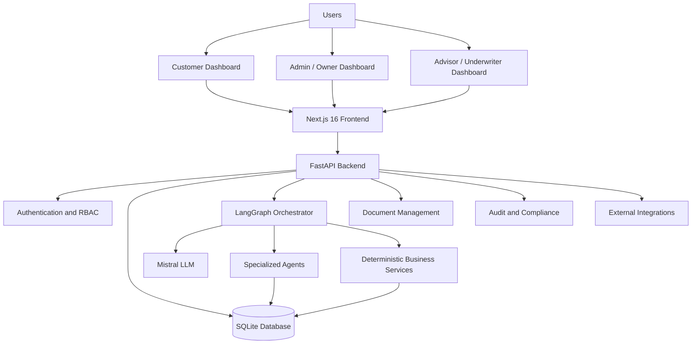
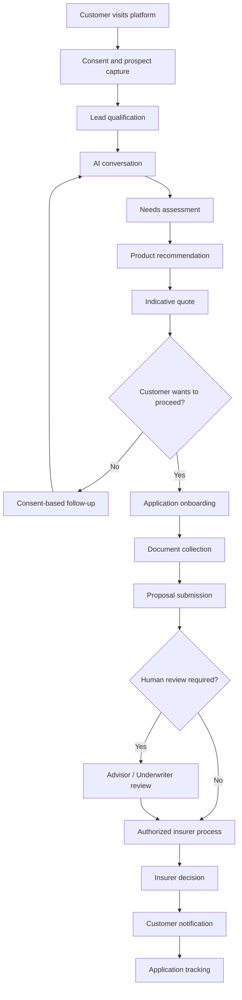

— Conversational Insurance Acquisition & Onboarding Platform
## Master Development Plan, Phase-Wise Prompts & AGENTS.md

# PART 1 — PROJECT DEVELOPMENT INSTRUCTIONS

## 1. Project Vision

Build a professional, production-oriented, AI-powered insurance acquisition and onboarding platform.

The platform should help insurance businesses acquire prospects, understand customer needs, recommend suitable insurance products, generate indicative quotes, collect proposal information, manage documents, coordinate underwriting reviews, and track conversions.

The platform must support three distinct user experiences within one unified application:

1. Customer Dashboard — customers explore insurance, communicate with the AI assistant, receive recommendations, obtain indicative quotes, complete applications, upload documents, and track application progress.
2. Admin / Owner Dashboard — business owners and administrators manage leads, applications, employees, AI agents, products, analytics, integrations, and compliance.
3. Advisor / Underwriter Dashboard — insurance advisors manage assigned customers, conversations, documents, application reviews, and underwriting escalations.

Do not restrict the platform to the original 11 agents. Design additional agents, workflows, services, and supporting modules wherever they provide genuine business value.

The goal is to create a complete insurance technology product, not merely an AI chatbot or dashboard demonstration.

## 2. Mandatory Technology Stack

### Frontend
- Next.js 16.
- TypeScript.
- App Router.
- Tailwind CSS.
- shadcn/ui — use the actual, directly imported shadcn components.
- Lucide React icons.
- React Hook Form.
- Zod validation.
- TanStack Table for complex data tables where appropriate.
- Recharts for analytics.
- Next.js Server Components by default.
- Client Components only where interaction requires them.

### Backend
- Python.
- FastAPI.
- LangGraph for agent orchestration and stateful workflows.
- Mistral LLM exclusively for LLM-powered operations.
- SQLite as the initial relational database.
- SQLAlchemy for database access.
- Pydantic for data validation.
- Alembic for schema migrations.
- Async execution wherever appropriate.

### AI and Agent Architecture
- Mistral must be the only LLM provider.
- LangGraph must manage multi-agent workflows.
- Agents must have clearly defined responsibilities.
- Agents must communicate through structured state and validated outputs.
- Business-critical calculations must use deterministic backend services.
- The LLM must not invent premiums, eligibility decisions, policy terms, or underwriting outcomes.
- Agent execution must be observable and auditable.

### Important Configuration Rules

Use environment variables for all secrets and external configuration.

Examples:

- MISTRAL_API_KEY
- MISTRAL_MODEL
- DATABASE_URL
- JWT_SECRET
- FRONTEND_URL
- BACKEND_URL

Do not commit secrets.

Do not silently replace missing configuration with default credentials, another provider, a mock service, or a fallback implementation.

If a required configuration is missing, stop the relevant operation and return a clear, actionable error.

SQLite is the required initial database. Do not introduce another database without explicit approval.

## 3. Strict Development Rules

These requirements apply to the entire project.

### No fallback
- No OpenAI fallback.
- No alternative LLM provider.
- No automatic model switching.
- No mock LLM responses.
- No silent substitution of services.
- No fallback to fake data when an API fails.
- No fake success responses.
- No pretending that an external integration succeeded.
- No hidden fallback implementation when a required feature is unavailable.

If Mistral is unavailable, report the failure. Do not pretend that the AI operation completed.

### No hardcoding
Do not hardcode:
- Insurance premium calculations.
- Product pricing.
- Eligibility rules.
- Coverage limits.
- Underwriting thresholds.
- Customer information.
- Dashboard metrics.
- Agent outputs.
- Employee records.
- Application statuses.
- API credentials.
- Business configuration.

Business configuration should be stored in the database or loaded through explicitly configured services.

Use seeded records only for clearly identified development fixtures when explicitly requested. Never present fixtures as real customer or business data.

Static interface labels, route definitions, validation schemas, and visual design tokens are acceptable.

### No unnecessary complexity
- Do not create an LLM agent for every simple operation.
- Use normal Python services for deterministic operations.
- Use LangGraph for actual orchestration and multi-step reasoning.
- Keep modules maintainable.
- Avoid giant files.
- Avoid duplicated logic.
- Avoid unnecessary abstractions.
- Do not build features that have no meaningful purpose.

### UI consistency
- Professional enterprise SaaS appearance.
- White-only visual theme.
- No dark mode.
- No dark dashboard components.
- No black background sections.
- Use white backgrounds, subtle light-grey surfaces, and restrained blue accents.
- Consistent spacing, typography, border radius, shadows, buttons, tables, cards, and forms.
- Responsive desktop, tablet, and mobile layouts.
- Use actual shadcn/ui components directly.
- Do not recreate shadcn components unnecessarily.
- Do not use arbitrary UI libraries when shadcn/ui already provides the component.

# PART 2 — APPLICATION ARCHITECTURE

## 4. High-Level Architecture

Build one application with three role-based dashboards.



## 5. Suggested Project Structure

```text
insurance-platform/
│
├── AGENTS.md
├── README.md
├── .env.example
├── .gitignore
├── docker-compose.yml
│
├── frontend/
│   ├── app/
│   │   ├── (auth)/
│   │   ├── customer/
│   │   ├── admin/
│   │   ├── advisor/
│   │   ├── api/
│   │   ├── layout.tsx
│   │   └── globals.css
│   │
│   ├── components/
│   │   ├── ui/
│   │   ├── shared/
│   │   ├── customer/
│   │   ├── admin/
│   │   └── advisor/
│   │
│   ├── hooks/
│   ├── lib/
│   ├── services/
│   ├── types/
│   └── public/
│
├── backend/
│   ├── app/
│   │   ├── main.py
│   │   ├── core/
│   │   ├── api/
│   │   ├── models/
│   │   ├── schemas/
│   │   ├── repositories/
│   │   ├── services/
│   │   ├── agents/
│   │   ├── graph/
│   │   ├── tools/
│   │   ├── integrations/
│   │   ├── security/
│   │   └── audit/
│   │
│   ├── migrations/
│   ├── tests/
│   └── requirements.txt
│
└── docs/
    ├── architecture.md
    ├── database-schema.md
    ├── api-documentation.md
    ├── agent-workflows.md
    └── compliance.md
```

Adapt the structure when necessary, but maintain clear separation of responsibilities.

# PART 3 — PHASE-WISE DEVELOPMENT PROMPTS

Each phase should be completed, tested, and reviewed before moving to the next phase.

Do not generate the entire application in one step.

---

## PHASE 0 — Repository Inspection and Technical Planning

### Objective
Understand the existing repository and establish a development plan before writing substantial code.

### Prompt

You are the lead software architect for PS-21, an AI-powered insurance acquisition and onboarding platform.

First, inspect the entire existing repository.

Read AGENTS.md and follow every instruction in it.

Identify:
- Existing frontend and backend structure.
- Existing dependencies.
- Existing application features.
- Existing database configuration.
- Missing modules.
- Architectural problems.
- Configuration and security problems.

Do not overwrite working code without understanding its purpose.

Create:
1. Architecture documentation.
2. Technical implementation roadmap.
3. Database entity plan.
4. API module plan.
5. Agent workflow plan.
6. UI design system plan.

Confirm that Next.js 16, FastAPI, LangGraph, Mistral, and SQLite are compatible with the intended architecture.

Do not implement fake features.

Do not introduce another LLM provider.

At the end, provide a clear report of the repository and the implementation plan.

### Completion criteria
- Architecture documented.
- Folder structure agreed.
- Database entities identified.
- Dependencies identified.
- Environment requirements documented.

---

## PHASE 1 — Project Foundation and UI Design System

### Objective
Create the application foundation and establish a consistent, premium-quality design system.

### Prompt

Build the frontend foundation using Next.js 16, TypeScript, Tailwind CSS, and shadcn/ui.

Create a polished enterprise SaaS interface.

The entire application must use a white visual theme.

### Visual direction

Use:
- Main background: white.
- Secondary background: very light grey.
- Primary accent: professional blue.
- Text: dark navy or charcoal.
- Borders: subtle light grey.
- Success: restrained green.
- Warning: restrained amber.
- Error: restrained red.

Do not use dark mode or dark components.

Avoid excessive gradients, glassmorphism, oversized cards, unnecessary animations, and decorative elements.

The UI must look like a professionally designed financial technology product.

### Required components

Use shadcn/ui directly for:
- Button.
- Card.
- Input.
- Label.
- Select.
- Dialog.
- Sheet.
- Dropdown Menu.
- Sidebar.
- Tabs.
- Table.
- Badge.
- Avatar.
- Tooltip.
- Popover.
- Calendar.
- Date Picker where available through the installed shadcn component setup.
- Form.
- Checkbox.
- Radio Group.
- Switch.
- Progress.
- Skeleton.
- Alert.
- Alert Dialog.
- Breadcrumb.
- Pagination.
- Command.
- Separator.
- Scroll Area.

Install missing shadcn components through the official shadcn CLI.

Do not replace actual shadcn components with homemade approximations.

### Build
- Shared application layout.
- Role-based navigation shells.
- Reusable page headers.
- Consistent typography.
- Design tokens.
- Form patterns.
- Table patterns.
- Loading and error states.
- Responsive sidebar.
- Notification system.

Do not create fake dashboard metrics at this stage.

### Completion criteria
- Frontend starts successfully.
- Design system is consistent.
- Components are reusable.
- No dark UI elements.
- All three dashboard shells exist.

---

## PHASE 2 — Backend Foundation, SQLite and Authentication

### Objective
Build the actual backend foundation and database.

### Prompt

Build a production-oriented FastAPI backend with SQLite and SQLAlchemy.

Use Alembic for migrations.

Create a well-structured database with appropriate relationships, constraints, indexes, and timestamps.

### Initial entities

Create suitable models for:

- Users.
- Roles.
- Permissions.
- Customers.
- Advisors.
- Prospects.
- Lead Sources.
- Behavioral Signals.
- Lead Scores.
- Conversations.
- Conversation Messages.
- Insurance Products.
- Product Configurations.
- Customer Qualifications.
- Recommendations.
- Quotes.
- Applications.
- Application Documents.
- Underwriting Cases.
- Underwriting Reviews.
- Follow-ups.
- Agent Executions.
- Agent Configurations.
- Audit Logs.
- Consent Records.
- Notifications.
- System Settings.

Extend this schema where necessary.

Do not store everything in a single JSON column. Use relational tables for structured information and JSON only where flexible structured data is justified.

### Authentication

Implement:
- Secure login.
- Logout.
- Password hashing.
- Access tokens.
- Refresh-token handling.
- Role-based access control.
- Permission-based authorization.
- Protected API routes.
- Session revocation.

Roles should include:
- Customer.
- Advisor.
- Underwriter.
- Admin.
- Owner.

Ensure that a customer cannot access another customer's records.

Ensure that advisors only access authorized cases.

Restrict sensitive medical and financial information according to permissions.

### Backend standards

Use:
- Pydantic schemas.
- SQLAlchemy repositories.
- Service layer.
- API routers.
- Centralized exception handling.
- Structured logging.
- Database transactions.
- Input validation.

### Completion criteria
- SQLite database works.
- Migrations work.
- Authentication works.
- RBAC works.
- API error handling is consistent.
- Automated tests cover critical authorization rules.

---

## PHASE 3 — Mistral and LangGraph Foundation

### Objective
Create the actual AI infrastructure before implementing individual agents.

### Prompt

Implement the AI infrastructure using LangGraph and Mistral.

Mistral is the only permitted LLM provider.

Use the configured Mistral model from environment variables.

Do not implement an LLM fallback.

If the Mistral API key or model configuration is missing, fail clearly.

If Mistral returns an error, propagate a structured error to the appropriate application layer.

Do not fabricate a successful response.

### Build

1. Mistral client initialization.
2. Environment configuration validation.
3. Structured LLM output handling.
4. Pydantic output validation.
5. Token and latency tracking.
6. Error handling.
7. LangGraph state definitions.
8. Agent execution framework.
9. Tool registration.
10. Graph persistence and checkpointing.
11. Execution tracing.
12. Agent audit records.

### LangGraph requirements

Use typed state definitions.

Support:
- Conditional routing.
- Human-in-the-loop interruptions.
- Resume operations.
- Retry only for explicitly classified transient failures, with bounded retry policies.
- Timeouts.
- Execution limits.
- Persistent workflow state.

Do not retry business decisions blindly.

Do not allow an LLM to bypass authorization or compliance controls.

### Completion criteria
- Real Mistral request succeeds with valid credentials.
- Missing credentials produce a clear error.
- Invalid structured outputs are rejected.
- LangGraph state persists correctly.
- Agent executions are traceable.

---

## PHASE 4 — Prospect and Lead Management

### Objective
Build the actual lead acquisition and management system.

### Prompt

Implement prospect ingestion and lead management.

Create APIs and frontend screens for:
- Prospect creation.
- Prospect source tracking.
- Consent recording.
- Behavioral signal ingestion.
- Lead scoring.
- Customer segmentation.
- Lead assignment.
- Lead activity timeline.
- Prospect search.
- Filters and pagination.
- Lead status management.

Create a deterministic scoring service where configured scoring criteria are maintained in the database.

AI may assist with unstructured conversation analysis, but must not invent customer signals.

Build the Admin lead management interface using shadcn/ui.

Build the Advisor assigned-leads interface.

### Important
Anonymous behavioral signals must not automatically be treated as permission to identify or contact a person.

Only use approved, consented acquisition and communication processes.

### Completion criteria
- Leads can be created and managed.
- Signals are recorded.
- Scores have explainable contributing factors.
- Leads can be assigned.
- All important actions are audited.

---

## PHASE 5 — Customer Dashboard and Conversational AI

### Objective
Build the complete customer experience.

### Prompt

Build the Customer Dashboard.

It must feel like a modern, trustworthy insurance application.

### Main screens

1. Customer Home.
2. Explore Insurance.
3. AI Insurance Advisor.
4. Needs Assessment.
5. Coverage Calculator.
6. Insurance Recommendations.
7. Indicative Quote.
8. Application Onboarding.
9. Document Upload.
10. Application Tracking.
11. Profile and Preferences.
12. Consent and Privacy Settings.

### Conversational assistant

Create a real conversational insurance assistant powered by Mistral and LangGraph.

It must:
- Understand customer intent.
- Ask one useful question at a time.
- Maintain conversation context.
- Collect relevant information.
- Explain insurance terminology.
- Identify missing information.
- Summarize customer requirements.
- Support configured languages.
- Recommend suitable product categories.
- Explain recommendation reasoning.
- Guide customers through application steps.

The assistant must not make unsupported claims.

It must clearly explain that quotes are indicative where applicable and subject to insurer terms and underwriting.

Do not invent products, prices, exclusions, or policy benefits.

Use database-backed product information.

### UI requirements

Use a conversational interface with:
- Message history.
- Typing/loading indicators.
- Suggested replies.
- Form-based responses.
- File uploads.
- Conversation resume.
- Language selection.
- Clear progress indicators.

Use shadcn components directly.

### Completion criteria
- Customer can register and log in.
- Customer can start a conversation.
- Conversation state persists.
- Qualification information is stored.
- Customer can resume an unfinished journey.

---

## PHASE 6 — Insurance Recommendation and Quotation Engine

### Objective
Build reliable insurance recommendation and indicative quote workflows.

### Prompt

Implement the insurance recommendation and quotation modules.

Create structured insurance product records.

Each product should support configurable:
- Product category.
- Product name.
- Coverage details.
- Eligibility criteria.
- Benefits.
- Exclusions.
- Waiting periods where relevant.
- Coverage limits.
- Pricing configuration.
- Required declarations.
- Required documents.
- Insurer information.
- Product availability.

### Recommendation engine

Use customer needs and validated qualification information.

Provide:
- Recommended product.
- Recommended coverage.
- Recommendation reasons.
- Important assumptions.
- Missing information.
- Alternative options.
- Limitations and exclusions.

Use Mistral for explanation and conversational presentation.

Use deterministic services and approved product rules for eligibility and calculations.

### Quotation engine

Premium calculations must use approved pricing configurations or a real insurer pricing API.

Never ask the LLM to calculate or guess premiums.

Store:
- Quote inputs.
- Pricing configuration version.
- Calculated premium.
- Taxes and charges where applicable.
- Quote timestamp.
- Quote validity.
- Pricing source.
- Calculation audit details.

If a required pricing source is unavailable, return an error or explicitly mark the quote unavailable. Never show a fabricated price.

### Completion criteria
- Recommendations are traceable.
- Pricing is deterministic.
- Quotes are stored.
- Calculation inputs are auditable.
- No fabricated pricing or coverage information.

---

## PHASE 7 — Application Onboarding and Document Management

### Objective
Enable customers to complete actual insurance application workflows.

### Prompt

Implement a step-by-step proposal and onboarding system.

Support:
- Personal information.
- Contact information.
- Address.
- Employment information.
- Income declarations where required.
- Dependents.
- Existing coverage.
- Health declarations where applicable.
- Nominee information.
- Required declarations.
- Consent.
- Document upload.
- Application review.
- Proposal submission.

Build a dynamic onboarding form based on product requirements.

Use Zod and backend Pydantic validation.

### Document management

Support:
- Secure file upload.
- File type validation.
- File size limits.
- Secure storage.
- Document metadata.
- Document verification status.
- Document replacement.
- Authorized access.
- Audit history.

If OCR or document extraction is implemented, extracted data must be validated before it becomes trusted application data.

Do not mark documents verified merely because extraction succeeded.

### Completion criteria
- Application progresses through defined steps.
- Drafts persist.
- Documents can be uploaded securely.
- Validation works.
- Proposal submission is auditable.

---

## PHASE 8 — Advisor and Underwriter Dashboard

### Objective
Create the employee-facing case management and review workspace.

### Prompt

Build the Advisor / Underwriter Dashboard.

It must help employees manage customer cases efficiently.

### Main screens

1. My Workspace.
2. Assigned Leads.
3. Customer Conversations.
4. Customer Case Details.
5. Application Management.
6. Document Verification.
7. Underwriting Cases.
8. Follow-up Management.
9. Activity Timeline.
10. Notifications.

### Case workspace

Display:
- Customer profile.
- Qualification summary.
- Customer requirements.
- Conversation history.
- AI recommendation.
- Quote information.
- Application progress.
- Documents.
- Missing information.
- Risk flags.
- Previous reviews.
- Escalation history.

### Underwriting workflow

Implement:
- Review assignment.
- Case prioritization.
- Missing information requests.
- Medical/document review.
- Risk flag visibility.
- Human review notes.
- Request for additional information.
- Recommendation for further review.
- Decision recording within the user's authorized role.

Formal underwriting and policy issuance must remain with the authorized insurer process or approved underwriting system.

AI must not independently approve or reject applications.

### Completion criteria
- Advisors see authorized assigned cases.
- Underwriters see authorized review cases.
- Human decisions are recorded.
- Customer status updates are synchronized.
- Sensitive data access is audited.

---

## PHASE 9 — Admin and Owner Dashboard

### Objective
Create the complete business administration and monitoring interface.

### Prompt

Build the Admin / Owner Dashboard.

### Main screens

1. Business Overview.
2. Lead Management.
3. Customer Management.
4. Application Management.
5. Product Management.
6. Employee Management.
7. Agent Control Centre.
8. Business Analytics.
9. Conversion Funnel.
10. Compliance and Audit.
11. Integration Management.
12. System Settings.

### Overview

Display real database-backed metrics:
- Total prospects.
- Qualified leads.
- Active conversations.
- Quotes generated.
- Applications submitted.
- Applications awaiting review.
- Conversion rates.
- Follow-up tasks.

Do not generate placeholder statistics.

When there is no data, show a meaningful empty state.

### Agent Control Centre

Show:
- Agent name.
- Agent purpose.
- Current status.
- Last execution.
- Execution duration.
- Success and failure counts.
- Recent errors.
- Current workflow.
- Execution logs.

Provide authorized controls to enable, disable, or pause agents.

Agent controls must affect actual backend execution, not just the UI.

### Analytics

Build real analytics using database queries.

Include:
- Acquisition channel performance.
- Product category performance.
- Lead conversion funnel.
- Application completion rates.
- Drop-off analysis.
- Advisor performance.
- Agent execution metrics.
- Quote-to-application conversion.

### Compliance

Provide searchable audit records for:
- Consent.
- Customer communications.
- AI recommendations.
- Quote calculations.
- Application updates.
- Document access.
- Human review decisions.
- Agent execution.

### Completion criteria
- Admin permissions work.
- Business metrics use real records.
- Agent controls work.
- Audit history is searchable.
- Analytics are based on actual data.

---

## PHASE 10 — Advanced AI Agents and Workflow Orchestration

### Objective
Extend the platform with specialized agents and real multi-agent workflows.

### Prompt

Design the final agent architecture based on the implemented business processes.

Do not create agents simply to increase the agent count.

Each agent must have:
- Clear responsibility.
- Input schema.
- Output schema.
- Tools.
- Permission boundaries.
- Execution rules.
- Error handling.
- Audit records.
- Defined handoff conditions.

### Recommended agent ecosystem

1. Prospect Intelligence Agent — interprets permitted acquisition signals.
2. Lead Qualification Agent — assesses lead intent and completeness.
3. Conversational Engagement Agent — manages customer conversations.
4. Needs Assessment Agent — collects insurance requirements.
5. Risk Information Analysis Agent — organizes declared risk information without making formal underwriting decisions.
6. Recommendation Agent — explains suitable product options using approved product data.
7. Quote Coordination Agent — obtains pricing from approved deterministic services.
8. Onboarding Agent — guides proposal completion.
9. Document Review Assistance Agent — extracts and organizes information for authorized verification.
10. Drop-off Detection Agent — detects incomplete customer journeys.
11. Follow-up Coordination Agent — manages consent-based follow-up tasks.
12. Underwriting Escalation Agent — prepares structured human review cases.
13. Compliance Monitoring Agent — identifies missing disclosures or process violations.
14. Customer Support Agent — answers product and application questions using approved information.
15. Conversion Analytics Agent — analyzes funnel performance.
16. Workflow Orchestrator — coordinates all LangGraph workflows.

You may introduce more agents if the architecture benefits from them.

### Important orchestration rules

Use LangGraph stateful graphs.

Define:
- Entry points.
- Routing decisions.
- Shared state.
- Checkpoints.
- Human approval nodes.
- Error branches.
- Completion states.

Do not allow agents to execute arbitrary database operations.

Expose specific validated tools with permission checks.

Do not let an AI agent independently change user roles, pricing configurations, underwriting decisions, or system security settings.

### Completion criteria
- Workflows run end to end.
- Human handoffs work.
- Execution logs are stored.
- Errors are observable.
- State can resume after interruption.

---

## PHASE 11 — Notifications and Integrations

### Objective
Connect the application to external business systems.

### Prompt

Implement an integration architecture with explicit configuration and honest integration status.

Potential integrations:
- WhatsApp Business Platform.
- Email provider.
- SMS provider.
- Insurer quote APIs.
- Insurer underwriting APIs.
- Secure document storage.
- Analytics and monitoring services.

Build a common integration configuration and health monitoring interface.

Every integration must use its official API and documented authentication.

Do not pretend that a message was sent when the provider rejected it.

Do not create fake insurer API responses.

If an integration is not configured, show that it is unavailable and explain the required configuration.

### Completion criteria
- Integration status is accurate.
- API failures are handled.
- Credentials are secure.
- Webhooks are authenticated.
- External events are logged.

---

## PHASE 12 — Security, Compliance, Testing and Production Readiness

### Objective
Make the platform reliable, secure, and maintainable.

### Prompt

Perform a full production-readiness review.

### Security

Review:
- Authentication.
- Authorization.
- Customer data isolation.
- Sensitive document access.
- API input validation.
- File upload security.
- SQL injection risks.
- XSS risks.
- CSRF protections where applicable.
- Rate limiting.
- Secret management.
- Audit logs.
- Data retention.
- Consent management.

### Insurance compliance

Design the workflows to support applicable Indian insurance regulations, insurer-specific sales requirements, and applicable privacy and data-protection obligations.

Include:
- Customer consent.
- Communication preferences.
- Required disclosures.
- Recommendation records.
- Quote provenance.
- Proposal audit trail.
- Human underwriting handoffs.
- Data access history.

Do not represent the platform as legally compliant merely because these features exist. Actual compliance must be reviewed against applicable requirements by qualified personnel.

### Testing

Implement:
- Backend unit tests.
- API integration tests.
- Database tests.
- Authorization tests.
- LangGraph workflow tests.
- Mistral integration tests.
- Frontend component tests.
- End-to-end tests.
- Critical customer journey tests.

External-service tests must not pretend to have reached production systems.

Use controlled test doubles only within explicitly isolated automated tests. Never use them as silent runtime fallbacks.

### Production readiness

Provide:
- Environment configuration.
- Database backup strategy.
- Migration instructions.
- Logging.
- Error monitoring.
- Deployment documentation.
- Health checks.
- Startup validation.
- Operational troubleshooting.

### Completion criteria
- Critical workflows tested.
- Authorization verified.
- No fake runtime data.
- No silent fallback behavior.
- Deployment instructions complete.
- Known limitations documented.

---

# PART 4 — REQUIRED END-TO-END BUSINESS WORKFLOW

The final application must support this complete journey:



The Admin Dashboard must be able to monitor business progress throughout this workflow.

The Advisor Dashboard must receive authorized human review tasks.

The Customer Dashboard must display the correct application status.

All three dashboards must reflect the same underlying application state.

# PART 5 — FINAL ACCEPTANCE CRITERIA

The project is not complete just because the dashboards look good.

The final platform must demonstrate:

1. A customer can register and log in.
2. A customer can start an AI conversation.
3. Mistral generates actual responses.
4. LangGraph coordinates the workflow.
5. Customer qualification information is stored in SQLite.
6. Product recommendations use actual configured product records.
7. Quotes use approved deterministic pricing logic.
8. Customers can complete applications.
9. Documents can be uploaded securely.
10. Advisors can access authorized cases.
11. Underwriters can review assigned cases.
12. Admins can manage the platform.
13. Owners can monitor business performance.
14. Agent executions are visible and auditable.
15. Customer progress remains synchronized across dashboards.
16. Human approval is required where the business process requires it.
17. Errors are displayed honestly.
18. No runtime mock data or fabricated success responses exist.
19. The interface is consistently professional and white-themed.
20. The application works as an integrated system.

# PART 6 — EXECUTION INSTRUCTIONS FOR THE CODING AGENT

Follow these rules while implementing the phases:

- Work on one phase at a time.
- Inspect existing code before editing.
- Read AGENTS.md before starting.
- Do not skip phases.
- Do not silently remove existing functionality.
- Do not claim a feature is complete until it has been tested.
- Do not leave important buttons non-functional.
- Do not use placeholder API implementations in runtime code.
- Do not generate fabricated customer data.
- Do not hardcode business rules.
- Do not implement an alternate LLM provider.
- Do not introduce a dark theme.
- Use direct shadcn/ui components.
- Keep frontend and backend responsibilities separate.
- Keep database access in repositories/services.
- Validate all external and LLM-generated data.
- Update documentation when architecture changes.

At the end of every phase, report:

1. What was implemented.
2. Which files were created or modified.
3. Which database changes were made.
4. Which APIs were added.
5. Which tests were executed.
6. Test results.
7. Known issues.
8. What is required for the next phase.

Do not start the next phase until the current phase passes its acceptance criteria.

