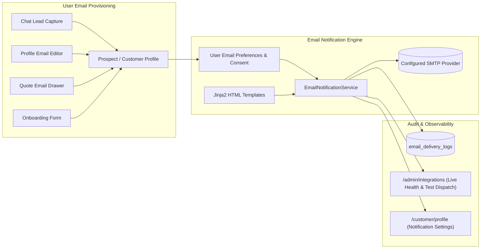
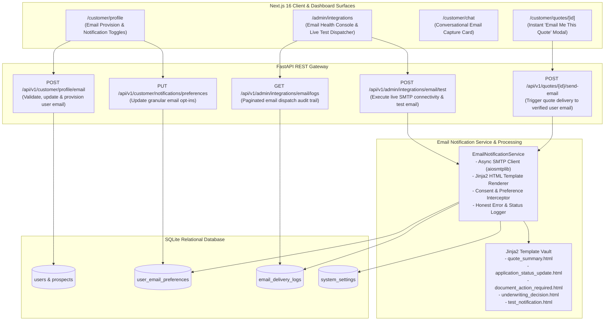
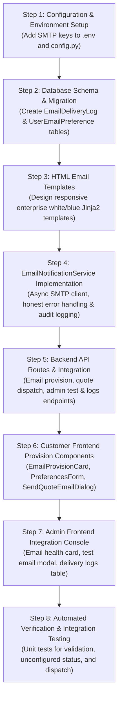

# PS-21 — Phase 11 Technical Specification & Implementation Plan
## Email Notification Engine & User Email Provisioning Architecture
### Scoped Exclusively to Email Notifications & Customer Email Provisioning

**Project:** PS-21 Conversational Insurance Acquisition & Onboarding Platform  
**Target Directories:** `microproject/backend` & `microproject/frontend`  
**Parent Guidelines:** `microproject/AGENTS.md` & `microproject/docs/Master_prompt.md` (Phase 11: Lines 1019–1054)  
**Tailoring Directive:** Focused exclusively on **Email Notifications** (WhatsApp, SMS, and mock external insurer APIs omitted). Comprehensive **User Email Provisioning** engineered for capturing, verifying, and managing user email addresses across customer journeys.  
**Document Status:** Ready for Execution (Planning Document)  

---

## 1. Executive Summary & Objectives

The primary objective of **Phase 11** is to establish the production-grade **Email Notification Architecture** and a reliable **User Email Provisioning Pipeline** for the PS-21 platform. In accordance with the project prompt and user requirements, Phase 11 focuses strictly on email communication, deliberately excluding SMS, WhatsApp, and simulated insurer underwriting APIs.

In regulated insurance acquisition, customer communication must be authoritative, timely, transparent, and legally provable under the Digital Personal Data Protection (DPDP) Act 2023 and IRDAI regulations. Crucially, **notifications can only succeed if there is an explicit, verified provision for capturing and maintaining the customer's email address**, and if outgoing messages reflect **honest delivery status with zero fabricated success responses** (`AGENTS.md` Rule 6 & 16: *"Pretend notifications were sent — NEVER"*).



### Primary Objectives of Phase 11:

1. **User Email Capture & Provisioning Pipeline:**
   - Provide clear, multi-touchpoint provisions for taking and updating the user's email address:
     - **Conversational Lead Capture:** The AI chat assistant / lead qualification agent prompts for and records the prospect's email address when they request quote calculations, policy comparisons, or consultation follow-ups.
     - **Customer Profile Provision (`/customer/profile`):** A dedicated, validated email management card allowing customers to view, update, and confirm their primary notification email.
     - **Instant Quote Email Drawer / Modal:** An interactive "Email Me This Quote" provision on the customer quote view (`/customer/quotes/[id]`) allowing prospects or logged-in customers to specify or confirm the destination email address.
     - **Granular Notification Preferences:** Customer-facing toggles for transactional quote alerts, application milestone updates, document requests, and marketing/follow-up communications.

2. **Deterministic Email Notification Engine (`EmailNotificationService`):**
   - Async SMTP communication powered by Python `aiosmtplib` and standard library `email.mime`.
   - Explicit environment variable configuration (`SMTP_HOST`, `SMTP_PORT`, `SMTP_USER`, `SMTP_PASSWORD`, `SMTP_FROM_EMAIL`, `SMTP_FROM_NAME`, `SMTP_USE_TLS`).
   - Transactional, responsive, white-and-blue branded HTML email templates:
     - `quote_summary`: Premium breakdown, coverage limits, policy highlights, instant proposal link.
     - `application_status_update`: Lifecycle mutations (Submitted, Under Review, Information Requested, Approved, Declined).
     - `document_action_required`: Immediate alert when an advisor or underwriter rejects a KYC document with specific instructions.
     - `underwriting_decision`: Formal approval notice, policy issuance confirmation, or underwriting loading explanation.
     - `integration_health_test`: Diagnostic probe message for administrators.

3. **Honest Delivery Status & Zero-Mock Guarantee:**
   - Strict adherence to `AGENTS.md` Rule 6: If `SMTP_HOST` or credentials are missing or placeholder, the engine marks the delivery as `NOT_CONFIGURED` or `FAILED` with explicit diagnostic messages. It will never claim an email was dispatched when it was not.
   - Comprehensive delivery audit table (`email_delivery_logs`) storing timestamp, recipient email, subject line, template key, status (`PENDING`, `SENT`, `FAILED`, `SUPPRESSED_NO_CONSENT`, `NOT_CONFIGURED`), error traces, and retry attempts.

4. **Integration Health & Administrative Test Console (`/admin/integrations`):**
   - Live health probe testing actual TCP/SMTP socket connectivity and authentication.
   - Interactive "Send Test Email" tool enabling admins to send a test message to an entered recipient email and view real-time SMTP handshakes or error stacks.
   - Live, searchable, filterable Email Delivery Audit Log table.

---

## 2. Core Mandates & Non-Negotiable Phase 11 Rules

All Phase 11 database models, services, API routes, templates, and React components must strictly observe the following mandates:

| Mandate | Specification & Regulatory Constraint | Strict Enforcement Mechanism |
| :--- | :--- | :--- |
| **No Pretended Notifications** | The application must never report that an email was sent if SMTP was unconfigured or the server rejected the dispatch. | If `SMTP_HOST` is empty or SMTP socket raises an exception, the status is immutably recorded as `NOT_CONFIGURED` or `FAILED`. The API returns an explicit error or honest status payload. |
| **Explicit User Email Provision** | Taking the user's email must not be an afterthought or implicit assumption; explicit provisions must exist across chat, profile, and quote workflows. | Pydantic schema validation (`EmailStr`), uniqueness checking, explicit DB storage in `users.email` and `prospects.email`, and dedicated UI input fields. |
| **Consent & Opt-Out Enforcement** | In compliance with DPDP Act 2023, transactional emails must honor customer consent and all communications must include an unsubscribe/opt-out provision. | `FollowUpCoordinationAgent` and `EmailNotificationService` inspect `UserEmailPreference.marketing_consent` before queuing outbound reminders. Suppressed dispatches are logged as `SUPPRESSED_NO_CONSENT`. |
| **Pure White Fintech UI Theme** | Visual interfaces for email settings, test tools, and notification consoles must adhere to the enterprise white theme. | Pure white background (`bg-white`), slate borders (`border-slate-200`), dark navy text (`text-slate-900`), blue accents (`bg-blue-600`), official shadcn/ui components (`Card`, `Input`, `Button`, `Switch`, `Badge`, `Dialog`, `Table`). No dark mode. |
| **Secure Credential Handling** | SMTP passwords and API secrets must never be committed to source code or exposed in frontend API payloads. | Loaded strictly via Pydantic `Settings` from `.env`. Masked in UI health inspection (`smtp.example.com:587`, password masked as `••••••••`). |
| **Deterministic Template Rendering** | Email copy and numeric tables must be generated deterministically; the LLM must not invent premiums or coverage numbers. | Jinja2 templates render values directly from verified database records (`Quote`, `Application`, `Document`). |

---

## 3. Technology Stack & Architectural Positioning



---

## 4. Database Schema Enhancements & Migration Plan

Phase 11 introduces two dedicated tables to manage email delivery governance and user notification preferences:

### 4.1 Schema Definitions

#### 1. `email_delivery_logs` Table
Maintains an immutable, legally defensible record of every email dispatch attempt.

```python
class EmailDeliveryLog(Base, TimestampMixin):
    __tablename__ = "email_delivery_logs"

    id: Mapped[int] = mapped_column(Integer, primary_key=True, autoincrement=True)
    user_id: Mapped[Optional[str]] = mapped_column(String(36), ForeignKey("users.id", ondelete="SET NULL"), nullable=True, index=True)
    recipient_email: Mapped[str] = mapped_column(String(255), nullable=False, index=True)
    subject: Mapped[str] = mapped_column(String(255), nullable=False)
    template_name: Mapped[str] = mapped_column(String(100), nullable=False, index=True)
    status: Mapped[str] = mapped_column(String(50), nullable=False, index=True)  # PENDING, SENT, FAILED, NOT_CONFIGURED, SUPPRESSED_NO_CONSENT
    error_message: Mapped[Optional[str]] = mapped_column(Text, nullable=True)
    payload_json: Mapped[Optional[Dict[str, Any]]] = mapped_column(JSON, nullable=True)
    sent_at: Mapped[Optional[datetime]] = mapped_column(DateTime(timezone=True), nullable=True)
    retry_count: Mapped[int] = mapped_column(Integer, default=0, nullable=False)
```

#### 2. `user_email_preferences` Table
Provides granular control over what emails the user receives.

```python
class UserEmailPreference(Base, TimestampMixin):
    __tablename__ = "user_email_preferences"

    id: Mapped[int] = mapped_column(Integer, primary_key=True, autoincrement=True)
    user_id: Mapped[str] = mapped_column(String(36), ForeignKey("users.id", ondelete="CASCADE"), unique=True, nullable=False, index=True)
    notification_email: Mapped[Optional[str]] = mapped_column(String(255), nullable=True)
    quote_alerts: Mapped[bool] = mapped_column(Boolean, default=True, nullable=False)
    application_updates: Mapped[bool] = mapped_column(Boolean, default=True, nullable=False)
    document_requests: Mapped[bool] = mapped_column(Boolean, default=True, nullable=False)
    marketing_consent: Mapped[bool] = mapped_column(Boolean, default=False, nullable=False)
    consent_timestamp: Mapped[Optional[datetime]] = mapped_column(DateTime(timezone=True), nullable=True)
```

### 4.2 Migration Script
An automated migration script `backend/apply_phase11_migration.py` will safely create `email_delivery_logs` and `user_email_preferences` tables in `ps21_insurance.db` without altering existing customer data.

---

## 5. Directory Structure & Component Inventory

```text
microproject/
├── backend/
│   ├── .env.example                                      # Enhanced with SMTP configuration keys
│   ├── apply_phase11_migration.py                        # SQLite migration script for Phase 11 tables
│   ├── app/
│   │   ├── core/
│   │   │   └── config.py                                 # Added SMTP settings (host, port, user, etc.)
│   │   ├── models/
│   │   │   └── email.py                                  # EmailDeliveryLog & UserEmailPreference models
│   │   ├── schemas/
│   │   │   └── email.py                                  # Pydantic schemas for requests, responses & logs
│   │   ├── services/
│   │   │   ├── email_service.py                          # Async SMTP dispatch, Jinja2 rendering & logging
│   │   │   └── email_templates/                          # Transactional HTML email templates
│   │   │       ├── base_email.html                       # Enterprise white/blue email master layout
│   │   │       ├── quote_summary.html                    # Indicative quote breakdown template
│   │   │       ├── application_status.html               # Status change alert template
│   │   │       ├── document_action.html                  # Document rejection / re-upload request template
│   │   │       ├── underwriting_decision.html            # Final underwriting approval/decision template
│   │   │       └── test_email.html                       # Admin diagnostic probe template
│   │   └── api/
│   │       └── v1/
│   │           ├── email.py                              # Customer email provision & preference endpoints
│   │           ├── admin_integrations.py                 # Live SMTP health probe, test email, logs table
│   │           └── quotes.py                             # Added quote email trigger endpoint
│
└── frontend/
    └── src/
        ├── components/
        │   ├── customer/
        │   │   ├── EmailProvisionCard.tsx                # Customer email editor & validation card
        │   │   ├── NotificationPreferencesForm.tsx       # Toggles for granular email notification types
        │   │   └── SendQuoteEmailDialog.tsx              # Modal for confirming/providing email to receive quote
        │   └── admin/
        │       ├── EmailIntegrationPanel.tsx             # Live SMTP health status, socket test & credentials
        │       ├── SendTestEmailDialog.tsx               # Admin interactive test email sender modal
        │       └── EmailDeliveryLogTable.tsx             # Paginated, searchable email audit trail
        └── app/
            ├── customer/
            │   ├── profile/page.tsx                      # Integrated EmailProvisionCard & Preferences
            │   └── quotes/[id]/page.tsx                  # Integrated SendQuoteEmailDialog
            └── admin/
                └── integrations/page.tsx                 # Enhanced with live email health, test tool & logs
```

---

## 6. Detailed Backend Specifications

### 6.1 Configuration (`app/core/config.py`)
Add explicit, documented SMTP settings:

```python
# Email & SMTP Configuration
SMTP_HOST: Optional[str] = None
SMTP_PORT: int = 587
SMTP_USER: Optional[str] = None
SMTP_PASSWORD: Optional[str] = None
SMTP_FROM_EMAIL: str = "no-reply@ps21-insurance.com"
SMTP_FROM_NAME: str = "PS-21 Insurance Services"
SMTP_USE_TLS: bool = True
SMTP_TIMEOUT_SECONDS: int = 10
```

### 6.2 Deterministic `EmailNotificationService` (`app/services/email_service.py`)

Key methods:
1. `send_email(to_email: str, subject: str, template_name: str, context: dict, user_id: Optional[str] = None, category: str = "transactional") -> EmailDeliveryResult`:
   - Checks recipient email format.
   - If user exists, checks `UserEmailPreference` (ensuring marketing emails have explicit consent).
   - Verifies whether `SMTP_HOST` is configured. If unconfigured:
     - Immutably writes an `EmailDeliveryLog` record with `status="NOT_CONFIGURED"`.
     - Returns `EmailDeliveryResult(success=False, status="NOT_CONFIGURED", message="SMTP_HOST is not configured.")`.
   - Renders HTML and plain-text alternatives using Jinja2 templates.
   - Attempts async TLS connection via `aiosmtplib` (or synchronous standard `smtplib` in async executor).
   - Upon success:
     - Sets `status="SENT"`, `sent_at=utc_now()`.
     - Writes record to `EmailDeliveryLog`.
     - Returns `EmailDeliveryResult(success=True, status="SENT")`.
   - Upon exception:
     - Sets `status="FAILED"`, `error_message=str(e)`.
     - Writes record to `EmailDeliveryLog`.
     - Returns `EmailDeliveryResult(success=False, status="FAILED", message=str(e))`.

2. `check_smtp_health() -> IntegrationHealthItem`:
   - Probes live socket connectivity to `SMTP_HOST:SMTP_PORT`.
   - Returns honest status (`active`, `warning`, `error`, `not_configured`).

3. `send_test_email(to_email: str) -> EmailDeliveryResult`:
   - Admin-triggered live test with diagnostic metadata.

### 6.3 Customer Email Provisioning Endpoints (`app/api/v1/email.py`)

- `POST /api/v1/customer/profile/email`:
  - Input: `{ "email": "customer@example.com" }`
  - Validates email format, checks for collisions with other users, updates `users.email` and `user_email_preferences.notification_email`, and returns updated profile.
- `GET /api/v1/customer/notifications/preferences`:
  - Returns current notification preferences for logged-in customer.
- `PUT /api/v1/customer/notifications/preferences`:
  - Updates toggles (`quote_alerts`, `application_updates`, `document_requests`, `marketing_consent`).

### 6.4 Quote Delivery Endpoint (`app/api/v1/quotes.py`)

- `POST /api/v1/quotes/{quote_id}/send-email`:
  - Allows the customer (or prospect with valid access token / email input) to request quote delivery.
  - Generates HTML quote summary using deterministic pricing matrix facts.
  - Sends email via `EmailNotificationService`.
  - Returns honest delivery result (`success`, `status`, `message`).

### 6.5 Admin Integration & Delivery Audit Endpoints (`app/api/v1/admin_integrations.py`)

- `POST /api/v1/admin/integrations/email/test`:
  - Input: `{ "recipient_email": "admin@example.com" }`
  - Sends diagnostic test email and returns live handshake result.
- `GET /api/v1/admin/integrations/email/logs`:
  - Query params: `page`, `page_size`, `status`, `search`.
  - Returns paginated list of `EmailDeliveryLog` records.

---

## 7. Frontend User Experience Specifications (Strict Enterprise White Theme)

### 7.1 Customer Email Provisioning Interfaces

1. **Customer Profile — Email Management Card (`EmailProvisionCard.tsx`):**
   - Clean white card (`bg-white border border-slate-200 rounded-lg p-6`).
   - Displays current verified email address with a green badge (`Verified`).
   - "Change Notification Email" button opening an inline edit state with validation.
   - Immediate feedback upon updating without page reload.

2. **Customer Notification Preferences (`NotificationPreferencesForm.tsx`):**
   - Granular shadcn/ui `Switch` components:
     - *Quote Summaries & Pricing Alerts* (Default: On)
     - *Application & Underwriting Milestones* (Default: On)
     - *Document Verification Requests* (Default: On)
     - *Advisory & Follow-up Communications* (Default: Off, requires explicit consent click)
   - Clear explanatory text explaining each category.

3. **Instant Quote Email Modal (`SendQuoteEmailDialog.tsx`):**
   - Triggered from `/customer/quotes/[id]` via an "Email Me This Quote" button.
   - Pre-fills user email if authenticated, or provides an input field for prospects.
   - Displays real-time dispatch status: shows a loading spinner during SMTP handshake, followed by an honest success alert or actionable error banner (e.g. *"SMTP service is currently unconfigured in development mode"*).

### 7.2 Admin Email Integration Console (`EmailIntegrationPanel.tsx` & `/admin/integrations`)

1. **Email Engine Health Card:**
   - Displays live SMTP host, port, TLS status, and authenticated sender name.
   - Clear badge: `Active` (Green), `Not Configured` (Amber), or `Connection Error` (Red).
   - "Test Connection & Dispatch Email" button opening the test modal.

2. **Send Test Email Dialog (`SendTestEmailDialog.tsx`):**
   - Form taking a target recipient email address.
   - Displays exact server response, elapsed connection milliseconds, and delivery status.

3. **Live Email Delivery Log Table (`EmailDeliveryLogTable.tsx`):**
   - Columns: `Timestamp`, `Recipient`, `Subject`, `Template`, `Status` (Badge), `Error Details`, `Retry`.
   - Color-coded status badges:
     - `SENT` (Emerald badge)
     - `FAILED` (Rose badge)
     - `NOT_CONFIGURED` (Amber badge)
     - `SUPPRESSED_NO_CONSENT` (Slate badge)
   - Expandable modal/row to view full JSON payload and SMTP diagnostic error trace.

---

## 8. Step-by-Step Implementation Roadmap



- **Step 1:** Add `SMTP_*` parameters to `backend/.env.example` and `backend/app/core/config.py`.
- **Step 2:** Define `EmailDeliveryLog` and `UserEmailPreference` models in `backend/app/models/email.py` and run `apply_phase11_migration.py`.
- **Step 3:** Implement production-grade Jinja2 HTML email templates in `backend/app/services/email_templates/`.
- **Step 4:** Implement `EmailNotificationService` in `backend/app/services/email_service.py` with zero-mock guarantees.
- **Step 5:** Create `/api/v1/customer/profile/email`, `/api/v1/quotes/{id}/send-email`, and `/api/v1/admin/integrations/email/*` endpoints.
- **Step 6:** Build customer frontend components (`EmailProvisionCard`, `SendQuoteEmailDialog`, `NotificationPreferencesForm`) and attach them to `/customer/profile` and `/customer/quotes/[id]`.
- **Step 7:** Enhance `/admin/integrations` with `EmailIntegrationPanel`, `SendTestEmailDialog`, and `EmailDeliveryLogTable`.
- **Step 8:** Run backend and frontend automated tests verifying honest error reporting, email validation, and log recording.

---

## 9. Automated Test Strategy & Scenarios

1. **Email Address Provision & Validation Tests:**
   - Valid email (`customer@example.com`) successfully saves to user profile and email preferences.
   - Invalid email (`not-an-email`) is rejected with HTTP 422 Unprocessable Entity.
   - Duplicate email update is rejected with HTTP 409 Conflict.
2. **Honest Delivery Status (Zero-Mock) Tests:**
   - When `SMTP_HOST` is null or invalid, `send_email` returns `status="NOT_CONFIGURED"` and writes a log record with status `NOT_CONFIGURED`.
   - When SMTP server raises connection error, `send_email` returns `status="FAILED"`, records error message, and does not claim success.
3. **Consent Enforcement Tests:**
   - Marketing/follow-up email dispatch without active `marketing_consent` is blocked with `SUPPRESSED_NO_CONSENT`.
4. **Admin Test Probe Tests:**
   - `POST /api/v1/admin/integrations/email/test` accurately returns live SMTP connection state.
5. **Frontend UI Tests:**
   - Ensure customer profile displays verified email provision card and preference switches.
   - Ensure quote page displays "Email Me This Quote" button and dialog.

---

## 10. Acceptance & Completion Criteria

- [ ] `email_delivery_logs` and `user_email_preferences` tables exist in `ps21_insurance.db` with foreign key integrity.
- [ ] Explicit user email provisioning is active: customers can view, update, and manage their email and notification opt-ins in `/customer/profile`.
- [ ] Customers and prospects can trigger quote summaries to their email from `/customer/quotes/[id]` with real-time feedback.
- [ ] `EmailNotificationService` uses real SMTP transport (`aiosmtplib`/`smtplib`) with zero fake success responses.
- [ ] If SMTP is unconfigured, the UI clearly displays `Not Configured` with instructions, and dispatch attempts record `NOT_CONFIGURED` without lying.
- [ ] `/admin/integrations` provides live SMTP health status, interactive test email dispatch, and filterable delivery logs.
- [ ] All UI components strictly adhere to the white enterprise design system (pure white backgrounds, slate borders, blue accents, shadcn/ui components).

