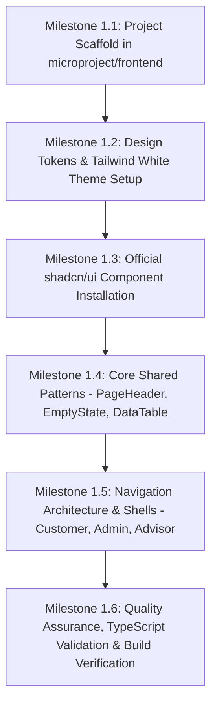

# PS-21 — Phase 1 Technical Specification & Implementation Plan
## Frontend Foundation & Enterprise UI Design System

**Project:** PS-21 Conversational Insurance Acquisition & Onboarding Platform  
**Target Directory:** `microproject/frontend`  
**Parent Guidelines:** `microproject/AGENTS.md` & `microproject/Master_prompt.md`  
**Status:** Ready for Execution  

---

## 1. Executive Summary & Objectives

The goal of **Phase 1** is to build the frontend foundation using Next.js 16 (App Router), TypeScript, Tailwind CSS, and official `shadcn/ui` components, establishing a pristine enterprise-grade financial technology design system.

### Key Mandates & Non-Negotiables (from AGENTS.md)
1. **White-Only Enterprise SaaS Theme:**
   - Backgrounds: Pure white (`#ffffff`) and very light grey secondary surfaces (`#f8fafc` / `#f1f5f9`).
   - Typography: Dark navy / charcoal (`#0f172a` / `#1e293b`).
   - Accents: Professional deep blue (`#1e40af` / `#2563eb`).
   - Strictly **NO dark mode**, no dark cards, no black background panels, no arbitrary neon gradients or glassmorphism.
2. **Direct shadcn/ui Components:**
   - Must use actual shadcn/ui components installed directly via CLI into `@/components/ui/`.
   - No homemade approximations or duplicate wrappers.
3. **Three Role-Based Dashboard Navigation Shells:**
   - **Customer Dashboard Shell** (`/customer`)
   - **Admin / Owner Dashboard Shell** (`/admin`)
   - **Advisor / Underwriter Dashboard Shell** (`/advisor`)
   - Shared **Auth Shell** (`/(auth)`)
4. **No Hardcoded Dynamic Business Data or Fake Metrics:**
   - Dashboards must render clean empty states with clear calls-to-action rather than fabricated numbers or placeholder charts.
5. **Responsiveness & Accessibility:**
   - Fully responsive sidebar (collapsible on desktop, drawer on mobile).
   - ARIA-compliant primitives powered by Radix UI.

---

## 2. Directory Structure (`microproject/frontend`)

```text
microproject/frontend/
├── package.json
├── tsconfig.json
├── tailwind.config.ts
├── postcss.config.mjs
├── components.json                  # shadcn/ui configuration
├── .env.example                     # NEXT_PUBLIC_API_URL, etc.
├── public/
│   └── brand/
│       ├── logo.svg
│       └── icon.svg
├── src/ (or root app directory)
│   ├── app/
│   │   ├── layout.tsx               # Root layout (Inter font, Toaster, theme lock)
│   │   ├── globals.css              # White-only design tokens & CSS variables
│   │   ├── page.tsx                 # Landing / Redirect to role selection or login
│   │   ├── not-found.tsx            # Custom 404 page
│   │   ├── error.tsx                # Global error boundary
│   │   ├── loading.tsx              # Global loading skeleton
│   │   │
│   │   ├── (auth)/                  # Shared Auth Shell
│   │   │   ├── layout.tsx
│   │   │   ├── login/page.tsx
│   │   │   └── register/page.tsx
│   │   │
│   │   ├── customer/                # Customer Dashboard Shell
│   │   │   ├── layout.tsx           # Customer navigation header/sidebar
│   │   │   ├── page.tsx             # Overview (Empty states + quick starts)
│   │   │   ├── explore/page.tsx     # Product catalog exploration
│   │   │   ├── chat/page.tsx        # Conversational AI assistant placeholder shell
│   │   │   ├── quotes/page.tsx      # Saved / Active quotes
│   │   │   ├── applications/page.tsx# Insurance application tracker
│   │   │   ├── documents/page.tsx   # Document vault & upload
│   │   │   └── profile/page.tsx     # Customer settings
│   │   │
│   │   ├── admin/                   # Admin & Owner Dashboard Shell
│   │   │   ├── layout.tsx           # Admin enterprise sidebar & top bar
│   │   │   ├── page.tsx             # Executive overview & empty analytics
│   │   │   ├── leads/page.tsx       # Lead acquisition table shell
│   │   │   ├── applications/page.tsx# Applications oversight
│   │   │   ├── agents/page.tsx      # AI agent monitoring & configuration
│   │   │   ├── products/page.tsx    # Insurance products & pricing rules
│   │   │   ├── audit/page.tsx       # Compliance & audit trail
│   │   │   └── settings/page.tsx    # Organization & system settings
│   │   │
│   │   └── advisor/                 # Advisor & Underwriter Dashboard Shell
│   │       ├── layout.tsx           # Advisor workbench layout
│   │       ├── page.tsx             # Active case queue & empty state
│   │       ├── queue/page.tsx       # Assigned customer review cases
│   │       ├── reviews/page.tsx     # Underwriting review decisions
│   │       └── documents/page.tsx   # Document verification queue
│   │
│   ├── components/
│   │   ├── ui/                      # Official shadcn/ui components
│   │   │   ├── button.tsx
│   │   │   ├── card.tsx
│   │   │   ├── input.tsx
│   │   │   ├── label.tsx
│   │   │   ├── select.tsx
│   │   │   ├── dialog.tsx
│   │   │   ├── sheet.tsx
│   │   │   ├── dropdown-menu.tsx
│   │   │   ├── sidebar.tsx
│   │   │   ├── tabs.tsx
│   │   │   ├── table.tsx
│   │   │   ├── badge.tsx
│   │   │   ├── avatar.tsx
│   │   │   ├── tooltip.tsx
│   │   │   ├── popover.tsx
│   │   │   ├── calendar.tsx
│   │   │   ├── form.tsx
│   │   │   ├── checkbox.tsx
│   │   │   ├── radio-group.tsx
│   │   │   ├── switch.tsx
│   │   │   ├── progress.tsx
│   │   │   ├── skeleton.tsx
│   │   │   ├── alert.tsx
│   │   │   ├── alert-dialog.tsx
│   │   │   ├── breadcrumb.tsx
│   │   │   ├── pagination.tsx
│   │   │   ├── command.tsx
│   │   │   ├── separator.tsx
│   │   │   └── scroll-area.tsx
│   │   │
│   │   ├── shared/                  # Universal enterprise UI patterns
│   │   │   ├── page-header.tsx      # Standardized title + breadcrumbs + action slots
│   │   │   ├── empty-state.tsx      # High-fidelity empty state card
│   │   │   ├── data-table.tsx       # TanStack Table reusable wrapper
│   │   │   ├── stat-card.tsx        # Enterprise KPI card (supports empty/null)
│   │   │   ├── status-badge.tsx     # Financial domain status pills
│   │   │   ├── loading-card.tsx     # Skeleton cards for async fetching
│   │   │   └── theme-guard.tsx      # Enforces light theme across document
│   │   │
│   │   ├── navigation/              # Shell navigation components
│   │   │   ├── app-sidebar.tsx      # Shared responsive sidebar with role config
│   │   │   ├── top-nav.tsx          # User avatar, role switch (demo), notifications
│   │   │   ├── mobile-nav.tsx       # Sheet-based mobile navigation
│   │   │   └── role-nav-config.ts   # Navigation routes mapping per role
│   │   │
│   │   ├── customer/                # Customer-specific shared UI widgets
│   │   ├── admin/                   # Admin-specific shared UI widgets
│   │   └── advisor/                 # Advisor-specific shared UI widgets
│   │
│   ├── lib/
│   │   ├── utils.ts                 # `cn` helper (clsx + tailwind-merge)
│   │   ├── constants.ts             # Static labels, application constants
│   │   └── validations/             # Common Zod validation schemas
│   │       └── auth.ts
│   │
│   ├── hooks/
│   │   ├── use-breadcrumbs.ts       # Path-based auto-breadcrumbs
│   │   └── use-mobile.ts            # Viewport detection
│   │
│   └── types/
│       ├── nav.ts                   # Nav item & section interfaces
│       └── common.ts                # Table, pagination, status badge types
```

---

## 3. Visual Identity & Design Tokens

### 3.1 Color Palette (CSS Variables in `globals.css`)
```css
:root {
  /* Surface colors */
  --background: 0 0% 100%;             /* #FFFFFF Pure White */
  --foreground: 222 47% 11%;           /* #0F172A Deep Navy / Charcoal */
  --card: 0 0% 100%;                   /* #FFFFFF Card Face */
  --card-foreground: 222 47% 11%;
  --popover: 0 0% 100%;
  --popover-foreground: 222 47% 11%;

  /* Muted / Secondary backgrounds */
  --muted: 210 40% 96.1%;              /* #F1F5F9 Soft Blue-Grey */
  --muted-foreground: 215 16% 47%;     /* #64748B Subtitle Slate */

  /* Borders & Inputs */
  --border: 214.3 31.8% 91.4%;         /* #E2E8F0 Clean Border */
  --input: 214.3 31.8% 91.4%;
  --ring: 221.2 83.2% 53.3%;           /* Focus Ring */

  /* Brand Accent: Professional Trust Blue */
  --primary: 221.2 83.2% 43.3%;        /* #1E40AF Corporate Blue */
  --primary-foreground: 210 40% 98%;   /* Pure Crisp White text */

  /* Secondary Accents */
  --secondary: 210 40% 96.1%;          /* Slate 100 */
  --secondary-foreground: 222 47% 11%;

  /* Status Tokens (Subtle & Restrained) */
  --success: 142 71% 45%;              /* #16A34A Emerald */
  --success-foreground: 355 100% 97%;
  --warning: 38 92% 50%;               /* #D97706 Amber */
  --warning-foreground: 48 96% 89%;
  --destructive: 0 84.2% 60.2%;        /* #DC2626 Crimson */
  --destructive-foreground: 210 40% 98%;

  /* Metric & Chart Palette (Light Only) */
  --chart-1: 221 83% 53%;              /* Deep Blue */
  --chart-2: 199 89% 48%;              /* Sky Cyan */
  --chart-3: 142 71% 45%;              /* Restrained Emerald */
  --chart-4: 38 92% 50%;               /* Amber */
  --chart-5: 262 83% 58%;              /* Indigo */

  --radius: 0.5rem;                    /* 8px clean modern radius */
}

/* Enforce NO dark mode override */
@media (prefers-color-scheme: dark) {
  :root {
    color-scheme: light !important;
  }
}
```

### 3.2 Typography & Sizing Standards
- **Font Stack:** Inter / Inter Variable (via `next/font/google`).
- **Heading 1:** `text-2xl font-bold tracking-tight text-slate-900` (Page titles).
- **Heading 2:** `text-lg font-semibold tracking-tight text-slate-800` (Section titles).
- **Subtitle / Meta:** `text-sm text-slate-500` (Contextual subtitles).
- **Body:** `text-sm text-slate-700 leading-relaxed`.
- **Microcopy:** `text-xs font-medium text-slate-400`.

---

## 4. Required Components & Installation Plan

### 4.1 CLI Setup & Packages
1. Initial packages to install:
   - `clsx`, `tailwind-merge`
   - `lucide-react`
   - `@tanstack/react-table`
   - `react-hook-form`, `@hookform/resolvers`, `zod`
   - `sonner` (or `next-themes` locked strictly to `light`)
   - `@radix-ui/*` primitives (via shadcn)

2. Exact `shadcn/ui` components to add via CLI:
   `button`, `card`, `input`, `label`, `select`, `dialog`, `sheet`, `dropdown-menu`, `sidebar`, `tabs`, `table`, `badge`, `avatar`, `tooltip`, `popover`, `calendar`, `form`, `checkbox`, `radio-group`, `switch`, `progress`, `skeleton`, `alert`, `alert-dialog`, `breadcrumb`, `pagination`, `command`, `separator`, `scroll-area`.

---

## 5. Navigation Shells Specification

### 5.1 Shared Root Shell (`app/layout.tsx`)
- Embeds Inter font with subpixel antialiasing.
- Includes Toaster notifications container (Sonner) styled with clean white background and subtle borders.
- Light theme enforcement script ensuring no browser dark-mode invert happens.

### 5.2 Customer Dashboard Shell (`app/customer/layout.tsx`)
- **Target Audience:** Policyholders & insurance prospects.
- **Top Bar:** Platform logo, active status indicator, notification bell, user profile menu.
- **Navigation Items:**
  1. *Overview* (`/customer`) — Active status, quick links, progress summary.
  2. *Insurance Explorer* (`/customer/explore`) — Catalog of health, term life, vehicle policies.
  3. *AI Insurance Assistant* (`/customer/chat`) — Conversational consultation shell.
  4. *Quotes* (`/customer/quotes`) — Indicative quotes list and comparison.
  5. *Applications* (`/customer/applications`) — Multi-step onboarding application state tracker.
  6. *Document Vault* (`/customer/documents`) — KYC & medical document upload & status.
  7. *Profile & Settings* (`/customer/profile`) — Personal details & consent preferences.

### 5.3 Admin / Owner Dashboard Shell (`app/admin/layout.tsx`)
- **Target Audience:** Business owners, system administrators, compliance officers.
- **Sidebar Structure:**
  - *Executive:* Dashboard Overview (`/admin`), Analytics (`/admin/analytics`).
  - *Acquisition:* Leads Pipeline (`/admin/leads`), Conversions (`/admin/conversions`).
  - *Operations:* Applications Oversight (`/admin/applications`), Documents Verification (`/admin/documents`).
  - *Platform Management:* Insurance Products (`/admin/products`), AI Agents (`/admin/agents`).
  - *Governance:* Audit & Compliance Logs (`/admin/audit`), System Settings (`/admin/settings`).

### 5.4 Advisor / Underwriter Dashboard Shell (`app/advisor/layout.tsx`)
- **Target Audience:** Human insurance advisors & licensed underwriters.
- **Top Bar:** Escalation alerts, active workload badge, assigned cases summary.
- **Navigation Items:**
  1. *Workbench* (`/advisor`) — Assigned cases overview & task priorities.
  2. *Escalations Queue* (`/advisor/queue`) — Human-in-the-loop review cases escalated by AI.
  3. *Underwriting Reviews* (`/advisor/reviews`) — Formal risk evaluation and decision entry.
  4. *Customer Consultations* (`/advisor/conversations`) — Supervised customer dialogue histories.
  5. *Document Verification* (`/advisor/documents`) — Verification checklist & approval workflows.

---

## 6. Shared Enterprise UI Patterns

### 6.1 `PageHeader` Component
```tsx
interface PageHeaderProps {
  title: string;
  description?: string;
  breadcrumbs?: { label: string; href?: string }[];
  actions?: React.ReactNode;
}
```
Standardizes title, contextual subtitle, hierarchical breadcrumbs, and primary action buttons across every view.

### 6.2 `EmptyState` Component
```tsx
interface EmptyStateProps {
  icon: LucideIcon;
  title: string;
  description: string;
  actionLabel?: string;
  onAction?: () => void;
  secondaryActionLabel?: string;
  onSecondaryAction?: () => void;
}
```
Used on all views prior to Phase 2 backend data connection to ensure **zero fake metrics or hardcoded placeholder items**.

### 6.3 Standard Table Pattern (`DataTable`)
- Powered by `@tanstack/react-table`.
- Integrated pagination controls (`Pagination` component).
- Column sorting indicators.
- Loading skeleton rows during data hydration.
- Built-in empty state when records array is empty.

### 6.4 Status Badge System (`StatusBadge`)
Standardized semantic badges for insurance lifecycle statuses:
- `DRAFT` / `IN_PROGRESS`: Blue / Slate badge.
- `QUOTED` / `UNDER_REVIEW`: Amber badge.
- `APPROVED` / `ISSUED`: Green badge.
- `REJECTED` / `FLAGGED`: Red badge.
- `ESCALATED`: Purple badge.

---

## 7. Step-by-Step Implementation Roadmap



### Milestone 1.1 — Scaffold Next.js 16 Project
- Initialize Next.js 16 project in `microproject/frontend` with TypeScript, Tailwind CSS, App Router, ESLint, and `@/` path alias.
- Configure clean `.gitignore` and `.env.example`.

### Milestone 1.2 — Configure Theme Tokens & Enforce White Theme
- Update `tailwind.config.ts` with custom color tokens and border radii.
- Update `globals.css` with the strict light-only CSS variables.
- Remove dark-mode media queries and ensure `html` tag has `class="light"` permanently.

### Milestone 1.3 — Install & Verify shadcn/ui Component Library
- Initialize `shadcn` via `components.json` with `new-york` or `default` style, slate/zinc base, CSS variables enabled.
- Run automated CLI additions for all 28 required shadcn components.
- Verify zero syntax or type issues in `@/components/ui/`.

### Milestone 1.4 — Implement Shared Pattern Components
- Create `src/components/shared/page-header.tsx`.
- Create `src/components/shared/empty-state.tsx`.
- Create `src/components/shared/data-table.tsx`.
- Create `src/components/shared/status-badge.tsx`.
- Create `src/components/shared/stat-card.tsx` with honest empty state support.

### Milestone 1.5 — Construct the 3 Dashboard Shells
- **Customer Shell:** Responsive layout, top header with navigation links and user profile, and placeholder pages (`/customer`, `/explore`, `/quotes`, `/applications`, `/documents`).
- **Admin Shell:** Enterprise collapsible sidebar, header with search command dialog (`Command`), notifications sheet, and placeholder pages with empty states.
- **Advisor Shell:** Split-queue workbench layout with case filters, escalation alerts banner, and task review page shells.
- **Auth Shell:** Clean split layout for `/login` and `/register` with validated form shells (React Hook Form + Zod).

### Milestone 1.6 — Verification & Quality Gate
- Run `npm run lint` and `npm run build` to confirm zero compilation errors.
- Visual inspection to verify that no dark mode components, dark cards, or hardcoded mock metrics exist.
- Verify that all navigation links work and route transitions are smooth.

---

## 8. Acceptance Criteria & Definition of Done

Phase 1 will be considered complete when:
- [ ] Next.js frontend builds without errors (`npm run build`).
- [ ] White-only enterprise design theme is completely consistent across all routes.
- [ ] Zero dark components, dark cards, or random gradients exist.
- [ ] All required shadcn components are present in `@/components/ui/`.
- [ ] Customer (`/customer`), Admin (`/admin`), and Advisor (`/advisor`) navigation shells are accessible and responsive.
- [ ] Responsive navigation sidebar and mobile drawer operate properly.
- [ ] Shared UI patterns (`PageHeader`, `EmptyState`, `DataTable`, `StatusBadge`) are functional and documented.
- [ ] No fake metrics or hardcoded runtime data are displayed; empty states are shown when data is absent.
- [ ] Ready for Phase 2 backend SQLite, SQLAlchemy, and FastAPI integration.

