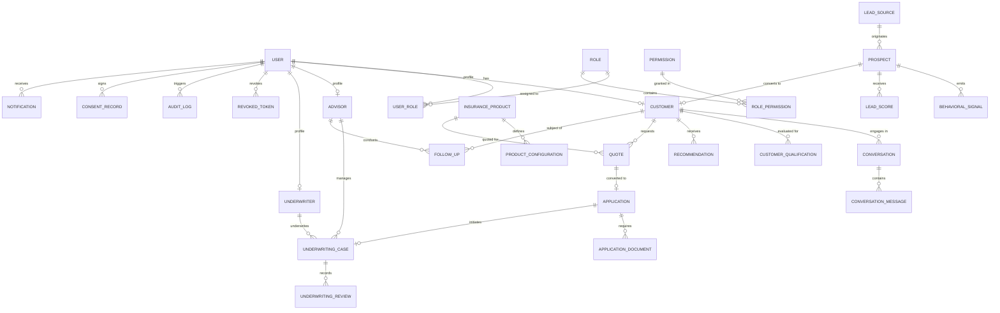
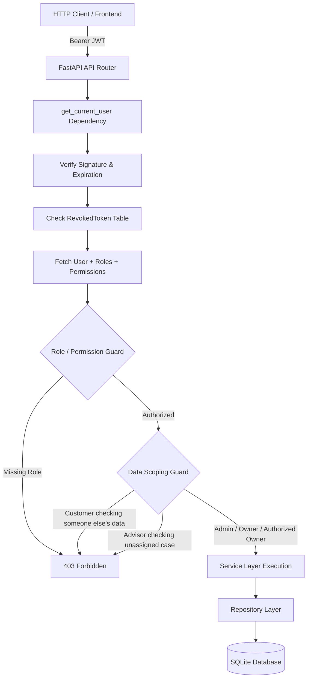

# PS-21 — Phase 2 Technical Specification & Implementation Plan
## Backend Foundation, SQLite Relational Architecture & Enterprise Authentication

**Project:** PS-21 Conversational Insurance Acquisition & Onboarding Platform  
**Target Directory:** `microproject/backend`  
**Parent Guidelines:** `microproject/AGENTS.md` & `microproject/docs/Master_prompt.md`  
**Status:** Ready for Execution (Planning Document)  

---

## 1. Executive Summary & Objectives

The goal of **Phase 2** is to engineer the production-grade backend foundation for the PS-21 insurance platform using **FastAPI**, **SQLAlchemy 2.0 (Async)**, **SQLite (with WAL mode & Foreign Key enforcement)**, and **Alembic**.

Phase 2 establishes:
1. **The Complete Relational Domain Model (26+ Entities):** Fully mapped relational tables covering Identity & Access Management (IAM), Customer & Advisor Profiles, Prospects & Behavioral Signals, Conversations & Messages, Insurance Products & Configurations, Customer Qualifications, Recommendations & Quotes, Applications & Documents, Underwriting Reviews, AI Agent Observability (preparing Phase 3), Audit Trails, Consent Records, and System Settings.
2. **Robust Multi-Role Authentication & Token Lifecycle:** JWT-based access tokens with refresh token rotation, secure password hashing (Argon2 / bcrypt), and persistent session revocation / token blacklisting.
3. **Enterprise Role-Based (RBAC) & Permission-Based Authorization:** Strict enforcement of 5 core roles (`Customer`, `Advisor`, `Underwriter`, `Admin`, `Owner`) with granular permission checks.
4. **Data Isolation & Scoping Guardrails:**
   - Strict customer data isolation (customers can never view another customer's quotes, applications, or profile).
   - Advisor case scoping (advisors only access cases assigned to them or their department queue).
   - Sensitive medical and financial data masking for unauthorized callers.
5. **Layered Clean Architecture:** Complete separation into Routers, Dependencies, Services, Repositories, and SQLAlchemy Models with centralized Pydantic v2 validation and unified exception handling.
6. **Alembic Migrations & Automated Pytest Test Suite:** Reproducible migration history and automated testing verifying authorization boundaries and data isolation.

---

## 2. Technology Stack & Backend Standards

| Component | Selected Technology | Technical Standard / Justification |
| :--- | :--- | :--- |
| **Framework** | FastAPI 0.115+ | High-performance async ASGI framework with native OpenAPI schema generation and dependency injection. |
| **Language & Runtime** | Python 3.11+ | Strict static typing using `typing` and Pydantic v2 annotations. |
| **ORM & Database Toolkit** | SQLAlchemy 2.0 (Async) | Modern 2.0 declarative style using `Mapped[T]` and `mapped_column()`. Async engine via `aiosqlite`. |
| **Database** | SQLite 3 | Embedded zero-latency relational engine. Must run with `PRAGMA journal_mode=WAL;` and `PRAGMA foreign_keys=ON;`. |
| **Schema Migrations** | Alembic 1.13+ | Version-controlled, deterministic schema migrations with async `env.py` integration. |
| **Data Validation** | Pydantic v2 | Model validation for all API inputs, outputs, error envelopes, and configuration schemas. |
| **Password Hashing** | `pwdlib[bcrypt]` / `passlib` | Constant-time adaptive salt-hashed passwords. |
| **Token Authentication** | PyJWT / python-jose | Signed JWTs (HMAC-SHA256) with short-lived access tokens (15m) and persistent refresh tokens (7d). |
| **Testing** | Pytest + pytest-asyncio + httpx | Async test client testing endpoints, RBAC rules, customer isolation, and database constraints. |
| **Code Quality** | Ruff & mypy | Linting, code formatting, and static type checking. |

---

## 3. Directory Structure (`microproject/backend`)

```text
microproject/backend/
├── app/
│   ├── __init__.py
│   ├── main.py                          # FastAPI app entrypoint, lifespan, CORS, middleware, routers
│   │
│   ├── core/                            # Core application infrastructure
│   │   ├── __init__.py
│   │   ├── config.py                    # Pydantic Settings (.env loading, secrets, token lifetimes)
│   │   ├── database.py                  # SQLAlchemy async engine, sessionmaker, SQLite PRAGMA hooks
│   │   ├── security.py                  # Password hashing & JWT generation/decoding
│   │   ├── exceptions.py                # Domain exceptions & custom HTTP error handlers
│   │   ├── logging.py                   # Structured logging configuration
│   │   └── middleware.py               # Request ID tracking, CORS, audit interceptor
│   │
│   ├── models/                          # SQLAlchemy 2.0 Declarative Models
│   │   ├── __init__.py                  # Imports all models for Alembic metadata collection
│   │   ├── base.py                      # Base declarative class, TimestampMixin, IDMixin
│   │   ├── auth.py                      # User, Role, Permission, UserRole, RolePermission, RevokedToken
│   │   ├── profile.py                   # Customer, Advisor, Underwriter profiles
│   │   ├── prospect.py                  # Prospect, LeadSource, BehavioralSignal, LeadScore
│   │   ├── conversation.py              # Conversation, ConversationMessage
│   │   ├── product.py                   # InsuranceProduct, ProductConfiguration
│   │   ├── recommendation.py            # CustomerQualification, Recommendation, Quote
│   │   ├── application.py               # Application, ApplicationDocument
│   │   ├── underwriting.py              # UnderwritingCase, UnderwritingReview
│   │   ├── agent.py                     # AgentConfiguration, AgentExecution (prepared for Phase 3)
│   │   ├── audit.py                     # AuditLog, ConsentRecord
│   │   └── system.py                    # Notification, SystemSetting, FollowUp
│   │
│   ├── schemas/                         # Pydantic Schemas (Request / Response DTOs)
│   │   ├── __init__.py
│   │   ├── common.py                    # ResponseEnvelope[T], PaginatedResponse[T], ErrorResponse
│   │   ├── auth.py                      # LoginRequest, TokenResponse, RefreshTokenRequest, UserRegisterRequest
│   │   ├── user.py                      # UserRead, UserUpdate, RoleRead, PermissionRead
│   │   ├── customer.py                  # CustomerRead, CustomerUpdate
│   │   ├── prospect.py                  # ProspectCreate, ProspectRead, BehavioralSignalCreate
│   │   ├── product.py                   # ProductRead, ProductConfigurationRead
│   │   ├── quote.py                     # QuoteRead, QuoteCreate
│   │   ├── application.py               # ApplicationRead, ApplicationCreate, DocumentRead
│   │   ├── underwriting.py              # UnderwritingCaseRead, ReviewCreate, ReviewRead
│   │   ├── audit.py                     # AuditLogRead
│   │   └── system.py                    # NotificationRead, SystemSettingRead
│   │
│   ├── repositories/                    # Data Access Layer (Repository Pattern)
│   │   ├── __init__.py
│   │   ├── base.py                      # BaseRepository[ModelType] with generic CRUD methods
│   │   ├── user_repository.py           # User & authentication lookups
│   │   ├── rbac_repository.py           # Role and permission queries
│   │   ├── customer_repository.py       # Customer scoping and retrieval
│   │   ├── prospect_repository.py       # Prospect tracking & signal persistence
│   │   ├── product_repository.py        # Product catalog & pricing matrix queries
│   │   ├── quote_repository.py          # Quote calculation & persistence
│   │   ├── application_repository.py    # Application & document metadata
│   │   ├── underwriting_repository.py   # Underwriting case queue & reviews
│   │   └── audit_repository.py          # Audit log ingestion & compliance queries
│   │
│   ├── services/                        # Business Logic Layer
│   │   ├── __init__.py
│   │   ├── auth_service.py              # Authentication, token generation, refresh, logout
│   │   ├── user_service.py              # User management, role assignment
│   │   ├── rbac_service.py              # Permission checks, data isolation rules
│   │   ├── audit_service.py             # Event recording (logins, access, updates)
│   │   ├── prospect_service.py          # Lead capture & scoring signals
│   │   ├── product_service.py           # Product catalog querying
│   │   └── application_service.py       # Application drafting & submission
│   │
│   ├── api/                             # API Presentation Layer (FastAPI Routers)
│   │   ├── __init__.py
│   │   ├── deps.py                      # Dependency injection (get_db, get_current_user, require_role, etc.)
│   │   └── v1/
│   │       ├── __init__.py
│   │       ├── api.py                   # Aggregator router (/api/v1)
│   │       ├── auth.py                  # POST /auth/login, /refresh, /logout, GET /auth/me
│   │       ├── users.py                 # GET/PUT /users (Admin & Profile)
│   │       ├── roles.py                 # GET /roles, GET /permissions (Admin)
│   │       ├── prospects.py             # POST /prospects, POST /prospects/signal
│   │       ├── products.py              # GET /products, GET /products/{id}
│   │       ├── quotes.py                # POST /quotes, GET /quotes/{id}
│   │       ├── applications.py          # GET/POST /applications
│   │       ├── underwriting.py          # GET /underwriting/cases, POST /underwriting/reviews
│   │       ├── audit.py                 # GET /audit (Admin / Compliance)
│   │       └── health.py                # GET /health, GET /health/db
│   │
│   └── db/                              # Seeding & Initial Data Fixtures
│       ├── __init__.py
│       ├── init_db.py                   # Creates initial tables, seeds default roles, permissions & admin
│       └── seed_products.py             # Seeds standard insurance products & configuration rules
│
├── alembic/                             # Alembic Migration Scripts
│   ├── env.py                           # Async Alembic runner wired to app.models.base.Base
│   ├── script.py.mako                   # Migration template
│   └── versions/                        # Migration revision files
│       └── 0001_initial_schema.py       # Baseline migration with all 26+ tables
│
├── tests/                               # Comprehensive Automated Test Suite
│   ├── __init__.py
│   ├── conftest.py                      # Test database fixture, async client, mock auth headers
│   ├── test_auth.py                     # Login, token refresh, logout/blacklist, invalid credentials
│   ├── test_rbac.py                     # Role-based barrier tests (Customer vs Admin vs Advisor)
│   ├── test_data_isolation.py           # Cross-customer access denial, advisor case assignment scoping
│   ├── test_models.py                   # Database relationship integrity & constraint tests
│   └── test_health.py                   # Health and readiness endpoints
│
├── .env.example                         # Environment configuration template
├── alembic.ini                          # Alembic database URL & migration settings
├── pyproject.toml                       # Python package metadata, ruff & pytest configuration
├── requirements.txt                     # Pinned backend dependencies
└── README.md                            # Setup, migration, and testing instructions
```

---

## 4. Complete Database Schema Architecture (The 26+ Relational Entities)

Every entity is designed with:
- Standard primary key: integer auto-increment or UUID string.
- Foreign keys with `ON DELETE RESTRICT` or `CASCADE` where appropriate.
- `created_at` and `updated_at` timestamps (UTC).
- Targeted indexes for frequent queries (e.g. `user_id`, `email`, `status`, `assigned_advisor_id`).
- Relational integrity: No giant unstructured JSON blobs for core domain data; JSON columns are reserved strictly for arbitrary dynamic rules, metadata, or LLM payload logs.



### 4.1 Detailed Entity Specifications

#### Domain 1: Identity, Access Management & Authentication
1. **`User`**:
   - `id`: UUID / String (PK)
   - `email`: String(255), Unique, Indexed, Non-null
   - `hashed_password`: String(255), Non-null
   - `first_name`: String(100), Non-null
   - `last_name`: String(100), Non-null
   - `phone`: String(30), Nullable
   - `is_active`: Boolean, Default `True`
   - `is_verified`: Boolean, Default `False`
   - `created_at`, `updated_at`: DateTime(timezone=True)
2. **`Role`**:
   - `id`: Integer (PK)
   - `name`: String(50), Unique (`Customer`, `Advisor`, `Underwriter`, `Admin`, `Owner`)
   - `description`: String(255)
3. **`Permission`**:
   - `id`: Integer (PK)
   - `code`: String(100), Unique (`cases:read`, `cases:review`, `medical_data:view`, `pricing:manage`, `audit:read`, etc.)
   - `description`: String(255)
   - `module`: String(50)
4. **`UserRole`**:
   - `id`: Integer (PK)
   - `user_id`: FK -> `users.id` (ON DELETE CASCADE)
   - `role_id`: FK -> `roles.id` (ON DELETE CASCADE)
   - Unique Constraint (`user_id`, `role_id`)
5. **`RolePermission`**:
   - `id`: Integer (PK)
   - `role_id`: FK -> `roles.id` (ON DELETE CASCADE)
   - `permission_id`: FK -> `permissions.id` (ON DELETE CASCADE)
   - Unique Constraint (`role_id`, `permission_id`)
6. **`RevokedToken`**:
   - `id`: Integer (PK)
   - `jti`: String(64), Unique, Indexed (JWT ID)
   - `user_id`: FK -> `users.id`
   - `token_type`: String(20) (`access`, `refresh`)
   - `expires_at`: DateTime(timezone=True)
   - `revoked_at`: DateTime(timezone=True)
   - `reason`: String(100)

#### Domain 2: Domain Profiles
7. **`Customer`**:
   - `id`: UUID / String (PK)
   - `user_id`: FK -> `users.id` (Unique, 1-to-1)
   - `date_of_birth`: Date, Nullable
   - `marital_status`: String(30), Nullable
   - `occupation`: String(100), Nullable
   - `annual_income`: Numeric(14, 2), Nullable
   - `health_status`: String(50), Nullable
   - `risk_tier`: String(20), Default `'standard'`
   - `assigned_advisor_id`: FK -> `advisors.id` (Nullable)
8. **`Advisor`**:
   - `id`: UUID / String (PK)
   - `user_id`: FK -> `users.id` (Unique, 1-to-1)
   - `license_number`: String(100), Unique, Non-null
   - `specializations`: String(255) (e.g. Life, Health, Commercial)
   - `max_active_cases`: Integer, Default 50
   - `is_available`: Boolean, Default `True`
9. **`Underwriter`**:
   - `id`: UUID / String (PK)
   - `user_id`: FK -> `users.id` (Unique, 1-to-1)
   - `authority_level`: String(50) (e.g. `Level 1 - Up to $500k`, `Senior - Unlimited`)
   - `max_coverage_limit`: Numeric(14, 2), Default 500000.00
   - `license_number`: String(100), Unique, Non-null

#### Domain 3: Prospect & Lead Acquisition
10. **`LeadSource`**:
    - `id`: Integer (PK)
    - `name`: String(100), Unique (e.g., Organic Search, Facebook Ad, Referral)
    - `channel_type`: String(50) (`web`, `mobile`, `partner`)
    - `utm_campaign`: String(100), Nullable
    - `is_active`: Boolean, Default `True`
11. **`Prospect`**:
    - `id`: UUID / String (PK)
    - `email`: String(255), Indexed, Nullable
    - `phone`: String(30), Nullable
    - `name`: String(100), Nullable
    - `source_id`: FK -> `lead_sources.id` (Nullable)
    - `status`: String(50), Default `'new'` (`new`, `engaged`, `qualified`, `converted`, `dropped`)
    - `converted_customer_id`: FK -> `customers.id` (Nullable)
12. **`BehavioralSignal`**:
    - `id`: Integer (PK)
    - `prospect_id`: FK -> `prospects.id` (Indexed)
    - `session_id`: String(100), Indexed
    - `signal_type`: String(100) (`page_view`, `quote_attempt`, `calculator_interaction`, `rage_click`)
    - `payload_json`: JSON, Nullable
    - `created_at`: DateTime(timezone=True)
13. **`LeadScore`**:
    - `id`: Integer (PK)
    - `prospect_id`: FK -> `prospects.id` (Indexed)
    - `score`: Numeric(5, 2) (0.0 to 100.0)
    - `score_factors_json`: JSON (Structured weights and reasoning)
    - `calculated_at`: DateTime(timezone=True)

#### Domain 4: Conversations & Omnichannel Messaging
14. **`Conversation`**:
    - `id`: UUID / String (PK)
    - `customer_id`: FK -> `customers.id` (Nullable)
    - `prospect_id`: FK -> `prospects.id` (Nullable)
    - `channel`: String(30), Default `'web_chat'` (`web_chat`, `whatsapp`, `portal`)
    - `status`: String(30), Default `'active'` (`active`, `closed`, `escalated_to_human`)
    - `initiated_at`, `ended_at`: DateTime(timezone=True)
15. **`ConversationMessage`**:
    - `id`: Integer (PK)
    - `conversation_id`: FK -> `conversations.id` (Indexed)
    - `sender_type`: String(20) (`user`, `agent`, `advisor`, `system`)
    - `sender_id`: String(100), Nullable
    - `content`: Text, Non-null
    - `metadata_json`: JSON, Nullable
    - `created_at`: DateTime(timezone=True)

#### Domain 5: Products, Pricing & Product Configurations
16. **`InsuranceProduct`**:
    - `id`: UUID / String (PK)
    - `code`: String(50), Unique, Indexed (e.g. `TERM_SECURE_PLUS`, `HEALTH_SHIELD_PRO`)
    - `name`: String(150), Non-null
    - `category`: String(50), Non-null (`term_life`, `health`, `critical_illness`, `disability`)
    - `description`: Text, Non-null
    - `is_active`: Boolean, Default `True`
    - `base_rules_json`: JSON (Eligibility rules: min/max age, smoking penalties, income multiples)
17. **`ProductConfiguration`**:
    - `id`: Integer (PK)
    - `product_id`: FK -> `insurance_products.id` (Indexed)
    - `tier_name`: String(50) (`Essential`, `Comprehensive`, `Elite`)
    - `min_sum_assured`: Numeric(14, 2), Non-null
    - `max_sum_assured`: Numeric(14, 2), Non-null
    - `term_options_json`: JSON (Valid policy terms in years: [10, 15, 20, 25, 30])
    - `riders_json`: JSON (Available add-on riders: accidental death, critical illness waiver)

#### Domain 6: Qualifications, Recommendations & Quotes
18. **`CustomerQualification`**:
    - `id`: UUID / String (PK)
    - `customer_id`: FK -> `customers.id` (Nullable)
    - `prospect_id`: FK -> `prospects.id` (Nullable)
    - `eligibility_status`: String(30) (`eligible`, `ineligible`, `needs_review`)
    - `financial_capacity`: Numeric(14, 2), Nullable
    - `health_tier`: String(30), Default `'standard'`
    - `factors_json`: JSON (Income verification, BMI, smoking status)
19. **`Recommendation`**:
    - `id`: UUID / String (PK)
    - `customer_id`: FK -> `customers.id`
    - `conversation_id`: FK -> `conversations.id` (Nullable)
    - `recommended_product_id`: FK -> `insurance_products.id`
    - `match_score`: Numeric(5, 2) (0 to 100)
    - `rationale`: Text, Non-null
    - `status`: String(30), Default `'active'` (`active`, `accepted`, `declined`)
20. **`Quote`**:
    - `id`: UUID / String (PK)
    - `quote_number`: String(50), Unique, Indexed (e.g., `QTE-2026-0001`)
    - `customer_id`: FK -> `customers.id` (Indexed)
    - `product_id`: FK -> `insurance_products.id` (Indexed)
    - `sum_assured`: Numeric(14, 2), Non-null
    - `policy_term_years`: Integer, Non-null
    - `payment_frequency`: String(20), Non-null (`monthly`, `quarterly`, `annually`)
    - `base_premium`: Numeric(10, 2), Non-null
    - `rider_premium`: Numeric(10, 2), Default 0.00
    - `tax_amount`: Numeric(10, 2), Non-null
    - `total_premium`: Numeric(10, 2), Non-null
    - `calculation_breakdown_json`: JSON (Actuarial breakdown formulas)
    - `expires_at`: DateTime(timezone=True), Non-null
    - `status`: String(30), Default `'active'` (`active`, `expired`, `converted_to_application`)

#### Domain 7: Applications & Document Management
21. **`Application`**:
    - `id`: UUID / String (PK)
    - `application_number`: String(50), Unique, Indexed (e.g., `APP-2026-0042`)
    - `customer_id`: FK -> `customers.id` (Indexed)
    - `quote_id`: FK -> `quotes.id` (Unique, 1-to-1)
    - `product_id`: FK -> `insurance_products.id`
    - `status`: String(50), Default `'draft'` (`draft`, `submitted`, `in_review`, `underwriting_approved`, `rejected`, `policy_issued`)
    - `proposal_data_json`: JSON (Full collected proposal details, beneficiaries, medical declarations)
    - `submitted_at`: DateTime(timezone=True), Nullable
22. **`ApplicationDocument`**:
    - `id`: UUID / String (PK)
    - `application_id`: FK -> `applications.id` (Indexed)
    - `customer_id`: FK -> `customers.id` (Indexed)
    - `document_type`: String(50), Non-null (`id_proof`, `income_proof`, `medical_report`, `bank_statement`)
    - `file_name`: String(255), Non-null
    - `file_path`: String(500), Non-null
    - `file_size_bytes`: Integer, Non-null
    - `mime_type`: String(100), Non-null
    - `file_hash`: String(64), Non-null (SHA-256 integrity hash)
    - `verification_status`: String(30), Default `'pending'` (`pending`, `verified`, `rejected`)
    - `verified_by_id`: FK -> `users.id` (Nullable)
    - `rejection_reason`: String(255), Nullable

#### Domain 8: Underwriting Cases & Reviews
23. **`UnderwritingCase`**:
    - `id`: UUID / String (PK)
    - `case_number`: String(50), Unique, Indexed (e.g., `UW-2026-0089`)
    - `application_id`: FK -> `applications.id` (Unique, 1-to-1)
    - `customer_id`: FK -> `customers.id` (Indexed)
    - `assigned_advisor_id`: FK -> `advisors.id` (Nullable, Indexed)
    - `assigned_underwriter_id`: FK -> `underwriters.id` (Nullable, Indexed)
    - `risk_rating`: String(30), Default `'standard'` (`preferred`, `standard`, `substandard`, `decline`)
    - `status`: String(50), Default `'assigned'` (`assigned`, `medical_review`, `financial_review`, `escalated`, `approved`, `declined`)
    - `medical_risk_summary`: Text, Nullable
    - `financial_risk_summary`: Text, Nullable
24. **`UnderwritingReview`**:
    - `id`: Integer (PK)
    - `case_id`: FK -> `underwriting_cases.id` (Indexed)
    - `reviewer_id`: FK -> `users.id` (Indexed)
    - `review_type`: String(50) (`initial_assessment`, `medical_evaluation`, `supervisor_escalation`)
    - `decision`: String(50) (`approved_standard`, `approved_with_loading`, `declined`, `more_info_needed`)
    - `loading_percentage`: Numeric(5, 2), Default 0.00
    - `notes`: Text, Non-null
    - `conditions`: Text, Nullable
    - `reviewed_at`: DateTime(timezone=True)

#### Domain 9: AI Agent Observability (Infrastructure for Phase 3)
25. **`AgentConfiguration`**:
    - `id`: Integer (PK)
    - `agent_name`: String(100), Unique, Indexed (e.g., `AdvisorAgent`, `UnderwriterAgent`, `IntakeAgent`)
    - `description`: Text
    - `model_name`: String(100), Default `'mistral-large-latest'`
    - `system_prompt_template`: Text, Non-null
    - `temperature`: Numeric(3, 2), Default 0.2
    - `is_active`: Boolean, Default `True`
    - `registered_tools_json`: JSON (Array of tool declarations)
26. **`AgentExecution`**:
    - `id`: UUID / String (PK)
    - `agent_name`: String(100), Indexed
    - `session_id`: String(100), Indexed
    - `conversation_id`: FK -> `conversations.id` (Nullable)
    - `input_state_json`: JSON, Non-null
    - `output_state_json`: JSON, Nullable
    - `status`: String(30) (`started`, `success`, `failed`, `interrupted`)
    - `latency_ms`: Integer, Nullable
    - `token_usage_json`: JSON (prompt_tokens, completion_tokens, total_tokens)
    - `error_message`: Text, Nullable
    - `executed_at`: DateTime(timezone=True)

#### Domain 10: Audit, Consent, Notifications & System Settings
27. **`AuditLog`**:
    - `id`: Integer (PK)
    - `user_id`: FK -> `users.id` (Nullable, Indexed)
    - `action`: String(100), Non-null (e.g. `USER_LOGIN`, `DOCUMENT_DOWNLOAD`, `CASE_DECISION`)
    - `resource_type`: String(100), Non-null (`Application`, `UnderwritingCase`, `Document`, `User`)
    - `resource_id`: String(100), Non-null
    - `ip_address`: String(45), Nullable
    - `user_agent`: String(255), Nullable
    - `changes_json`: JSON, Nullable (Before/after state diff)
    - `timestamp`: DateTime(timezone=True), Indexed
28. **`ConsentRecord`**:
    - `id`: Integer (PK)
    - `user_id`: FK -> `users.id` (Nullable)
    - `prospect_id`: FK -> `prospects.id` (Nullable)
    - `consent_type`: String(100), Non-null (`terms_of_service`, `data_privacy`, `medical_records_access`)
    - `consent_version`: String(20), Non-null
    - `ip_address`: String(45), Nullable
    - `granted_at`: DateTime(timezone=True), Non-null
    - `revoked_at`: DateTime(timezone=True), Nullable
29. **`FollowUp`**:
    - `id`: Integer (PK)
    - `customer_id`: FK -> `customers.id` (Nullable)
    - `prospect_id`: FK -> `prospects.id` (Nullable)
    - `assigned_advisor_id`: FK -> `advisors.id` (Indexed)
    - `due_date`: DateTime(timezone=True), Non-null
    - `channel`: String(30) (`phone`, `email`, `chat`)
    - `status`: String(30), Default `'pending'` (`pending`, `completed`, `cancelled`)
    - `notes`: Text, Nullable
30. **`Notification`**:
    - `id`: Integer (PK)
    - `user_id`: FK -> `users.id` (Indexed)
    - `title`: String(200), Non-null
    - `message`: Text, Non-null
    - `notification_type`: String(50) (`case_update`, `document_required`, `quote_ready`, `security_alert`)
    - `is_read`: Boolean, Default `False`
    - `link_url`: String(255), Nullable
    - `created_at`: DateTime(timezone=True)
31. **`SystemSetting`**:
    - `id`: Integer (PK)
    - `key`: String(100), Unique, Indexed
    - `value_json`: JSON, Non-null
    - `description`: String(255), Nullable
    - `is_encrypted`: Boolean, Default `False`
    - `updated_at`: DateTime(timezone=True)

---

## 5. Authentication, RBAC & Data Isolation Architecture



### 5.1 Token Specifications
- **Access Token:**
  - Lifetime: 15 minutes.
  - Claims: `sub` (User UUID), `email`, `roles` (List of role strings), `jti` (unique UUID), `exp`, `iat`.
- **Refresh Token:**
  - Lifetime: 7 days.
  - Claims: `sub` (User UUID), `token_type`: `'refresh'`, `jti`, `exp`.
  - Stored in HTTP-only secure cookie or Authorization request body.
  - On use: Old refresh token is revoked in `RevokedToken` and a new pair is issued (refresh token rotation).

### 5.2 Role & Permission Matrix
| Role | Primary Scope | Default Assigned Permissions |
| :--- | :--- | :--- |
| **`Customer`** | Self only | `profile:read`, `profile:update`, `quotes:create`, `quotes:read_own`, `applications:create`, `applications:read_own`, `documents:upload`, `documents:read_own`, `conversations:read_own` |
| **`Advisor`** | Assigned leads & customers | All Customer permissions + `cases:read_assigned`, `cases:update_assigned`, `leads:read_assigned`, `quotes:create_for_customer`, `documents:verify`, `followups:manage` |
| **`Underwriter`**| Assigned / department underwriting cases | `cases:read_all`, `cases:review`, `cases:decide`, `medical_data:view`, `financial_data:view`, `risk:evaluate` |
| **`Admin`** | System operations & compliance | All above permissions + `users:manage`, `roles:assign`, `products:manage`, `audit:read`, `agents:configure`, `settings:manage` |
| **`Owner`** | Full platform superuser | Unrestricted root permissions across all resources |

### 5.3 Data Isolation Guardrails
1. **Customer Isolation (`get_scoped_customer_id`):**
   ```python
   async def get_scoped_customer_id(
       requested_customer_id: str,
       current_user: User = Depends(get_current_user)
   ) -> str:
       if "Admin" in current_user.role_names or "Owner" in current_user.role_names:
           return requested_customer_id
       if "Customer" in current_user.role_names:
           if current_user.customer is None or current_user.customer.id != requested_customer_id:
               raise HTTPException(status_code=403, detail="Access denied: Cannot access another customer's records")
           return requested_customer_id
       # Advisors are scoped to assigned cases
       ...
   ```
2. **Medical & Sensitive Data Masking:**
   - Any endpoint returning medical risk evaluation fields (`medical_risk_summary`, `medical_report`) checks caller for `medical_data:view` permission.
   - If missing, sensitive fields are redacted (`"[RESTRICTED - AUTHORIZED UNDERWRITER ONLY]"`).

---

## 6. Implementation Plan: Step-by-Step Execution Phases

```mermaid
graph LR
    S1[Step 1: Scaffolding & Config] --> S2[Step 2: SQLAlchemy Models]
    S2 --> S3[Step 3: Alembic Migrations]
    S3 --> S4[Step 4: Auth Engine]
    S4 --> S5[Step 5: RBAC & Guardrails]
    S5 --> S6[Step 6: Repositories & Services]
    S6 --> S7[Step 7: REST API Routers]
    S7 --> S8[Step 8: Automated Pytest Suite]
    S8 --> S9[Step 9: Seed Fixtures & Verification]
```



### Step 1: Project Scaffolding, Environment & Database Infrastructure
- Create `microproject/backend` directory structure.
- Define `requirements.txt` with pinned dependencies (`fastapi`, `uvicorn`, `sqlalchemy[asyncio]`, `aiosqlite`, `alembic`, `pydantic-settings`, `pwdlib[bcrypt]`, `pyjwt`, `pytest`, `httpx`).
- Write `app/core/config.py`: Pydantic `BaseSettings` reading `.env` (`DATABASE_URL`, `JWT_SECRET`, `JWT_ALGORITHM`, `ACCESS_TOKEN_EXPIRE_MINUTES`, `MISTRAL_API_KEY`).
- Write `app/core/database.py`:
  - `create_async_engine("sqlite+aiosqlite:///./ps21_insurance.db")`.
  - Hook listener for SQLite PRAGMAs:
    ```python
    @event.listens_for(engine.sync_engine, "connect")
    def set_sqlite_pragma(dbapi_connection, connection_record):
        cursor = dbapi_connection.cursor()
        cursor.execute("PRAGMA journal_mode=WAL")
        cursor.execute("PRAGMA foreign_keys=ON")
        cursor.close()
    ```
  - `async_sessionmaker` and `get_db` generator dependency.

### Step 2: Complete Relational Schema (SQLAlchemy 2.0 Models)
- Write `app/models/base.py`:
  - Base class inheriting from `DeclarativeBase`.
  - `TimestampMixin` with timezone-aware `created_at` and `updated_at`.
- Implement modular domain models:
  - `app/models/auth.py` (`User`, `Role`, `Permission`, `UserRole`, `RolePermission`, `RevokedToken`).
  - `app/models/profile.py` (`Customer`, `Advisor`, `Underwriter`).
  - `app/models/prospect.py` (`LeadSource`, `Prospect`, `BehavioralSignal`, `LeadScore`).
  - `app/models/conversation.py` (`Conversation`, `ConversationMessage`).
  - `app/models/product.py` (`InsuranceProduct`, `ProductConfiguration`).
  - `app/models/recommendation.py` (`CustomerQualification`, `Recommendation`, `Quote`).
  - `app/models/application.py` (`Application`, `ApplicationDocument`).
  - `app/models/underwriting.py` (`UnderwritingCase`, `UnderwritingReview`).
  - `app/models/agent.py` (`AgentConfiguration`, `AgentExecution`).
  - `app/models/audit.py` (`AuditLog`, `ConsentRecord`).
  - `app/models/system.py` (`Notification`, `SystemSetting`, `FollowUp`).
- Ensure all models are exported in `app/models/__init__.py` for complete Alembic metadata discovery.

### Step 3: Alembic Configuration & Initial Migration
- Initialize Alembic environment in `backend/alembic`.
- Configure `alembic/env.py` to run async migrations and import `app.models.base.Base.metadata`.
- Generate baseline migration `0001_initial_schema.py` creating all 31 tables with constraints, indexes, and foreign keys.
- Test running `alembic upgrade head` and verify SQLite file creation and table structures.

### Step 4: Authentication Engine & Cryptography
- Write `app/core/security.py`:
  - Password hashing with bcrypt/pwdlib (`hash_password`, `verify_password`).
  - JWT creation (`create_access_token`, `create_refresh_token`).
  - JWT decoding and payload validation (`decode_token`).
- Implement Pydantic auth schemas in `app/schemas/auth.py`:
  - `LoginRequest`, `TokenResponse`, `RefreshTokenRequest`, `UserRegisterRequest`, `UserRead`.

### Step 5: Role-Based Authorization & Tenant Scoping Dependencies
- Write `app/api/deps.py`:
  - `get_current_user`: extracts Bearer token, decodes JWT, verifies JTI is not in `RevokedToken`, loads active user.
  - `require_roles(roles: list[str])`: checks if current user possesses any of the required roles.
  - `require_permissions(permissions: list[str])`: checks if current user possesses the required granular permission.
  - `get_scoped_customer_id`: prevents customer cross-tenant data access.
  - `get_scoped_case_id`: verifies advisor assignment to the requested underwriting case.

### Step 6: Repositories & Business Service Layer
- Write `app/repositories/base.py`:
  - Generic `BaseRepository[ModelType]` with `get`, `get_by_id`, `list`, `create`, `update`, `delete`.
- Implement domain repositories:
  - `UserRepository` (lookup by email, role attachment).
  - `AuthRepository` (revoked token persistence).
  - `CustomerRepository`, `ProspectRepository`, `ProductRepository`, `QuoteRepository`, `ApplicationRepository`, `UnderwritingRepository`, `AuditRepository`.
- Write `app/services/`:
  - `auth_service.py`: login, token rotation, logout/revocation.
  - `user_service.py`: registration, profile retrieval, role assignment.
  - `rbac_service.py`: permission evaluation.
  - `audit_service.py`: structured audit log creation.
  - `product_service.py`: catalog listing.

### Step 7: API Presentation Layer & Centralized Error Handling
- Write `app/core/exceptions.py`:
  - Custom exceptions: `EntityNotFoundException`, `AuthenticationFailedException`, `PermissionDeniedException`, `BusinessRuleViolationException`.
  - Exception handler returning standard JSON error envelope:
    ```json
    {
      "success": false,
      "error": {
        "code": "PERMISSION_DENIED",
        "message": "Access denied: Cannot access another customer's records",
        "details": null
      },
      "timestamp": "2026-11-05T22:45:00Z"
    }
    ```
- Implement routers in `app/api/v1/`:
  - `/api/v1/auth`: login, refresh, logout, me, register.
  - `/api/v1/users`: user management (Admin/Owner).
  - `/api/v1/roles`: roles & permissions lookup.
  - `/api/v1/products`: insurance product catalog.
  - `/api/v1/quotes`: quote lookup & draft creation.
  - `/api/v1/applications`: customer applications.
  - `/api/v1/underwriting`: advisor/underwriter case queue.
  - `/api/v1/audit`: audit log querying.
  - `/api/v1/health`: API and database ping.
- Write `app/main.py`: assemble FastAPI app, CORS middleware, API v1 router prefix, exception handlers, and lifespan event.

### Step 8: Comprehensive Pytest Test Suite
- Write `tests/conftest.py`:
  - In-memory/temp-file SQLite database fixture.
  - Async `httpx.AsyncClient` wired to the FastAPI app.
  - User fixtures for all 5 roles (`customer_user`, `advisor_user`, `underwriter_user`, `admin_user`, `owner_user`) with valid auth tokens.
- Write test modules:
  - `tests/test_auth.py`: login success, incorrect password, token refresh, token logout/revocation, expired token rejection.
  - `tests/test_rbac.py`: Customer forbidden from accessing Admin/Advisor routes; Advisor forbidden from admin routes; Underwriter authorized for review routes.
  - `tests/test_data_isolation.py`: Customer A cannot access Customer B's quotes or applications (returns 403 Forbidden); Advisor cannot access another advisor's unassigned private case.
  - `tests/test_models.py`: Foreign key constraint checks, unique constraint violations.
  - `tests/test_health.py`: `/api/v1/health` and DB connectivity check.

### Step 9: Database Seeding & Verification Run
- Write `app/db/init_db.py`:
  - Seeds core roles (`Customer`, `Advisor`, `Underwriter`, `Admin`, `Owner`).
  - Seeds core permissions (`cases:read`, `cases:review`, `medical_data:view`, `pricing:manage`, etc.).
  - Seeds initial default administrator account.
- Write `app/db/seed_products.py`:
  - Seeds baseline insurance products (`TERM_SECURE_PLUS`, `HEALTH_SHIELD_PRO`) with valid configuration ranges and pricing rules.
- Execute full test suite: `pytest` must pass 100% of tests.

---

## 7. Acceptance & Completion Criteria

Phase 2 is considered complete only when all of the following conditions are met:
1. **Database & Migrations:**
   - SQLite database initializes with WAL mode and foreign key enforcement enabled.
   - Alembic runs all migrations cleanly from scratch (`alembic upgrade head`) without errors.
   - All 26+ tables and relationship constraints exist as specified.
2. **Authentication Engine:**
   - User registration and login return valid JWT access and refresh tokens.
   - Token refresh successfully rotates refresh tokens and invalidates the previous one.
   - Logout successfully places the token in `RevokedToken`; subsequent requests with revoked tokens are rejected with `401 Unauthorized`.
3. **Authorization & RBAC:**
   - All 5 roles (`Customer`, `Advisor`, `Underwriter`, `Admin`, `Owner`) are enforced via FastAPI dependencies.
   - Role barriers prevent unauthorized endpoint execution (e.g. Customers cannot access `/api/v1/underwriting` or `/api/v1/admin`).
4. **Data Isolation & Tenant Security:**
   - Customer A is strictly barred from accessing Customer B's records (403 Forbidden).
   - Advisors can only access authorized/assigned cases.
   - Sensitive medical and financial data is restricted to authorized roles.
5. **Code Quality & Architecture:**
   - Clean layered architecture: No business logic in routers, no raw SQL in services, all DB access through repositories.
   - Standardized Pydantic v2 schemas and uniform JSON error envelopes.
   - Structured logging active for security and domain events.
6. **Testing:**
   - Automated Pytest suite executes and passes 100% of test cases.
   - Test coverage includes authentication, RBAC, customer isolation, and error handling.
