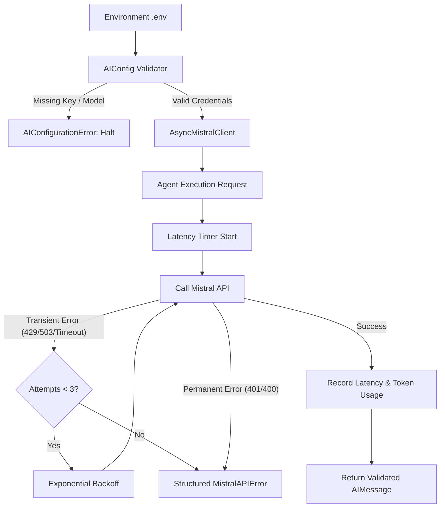
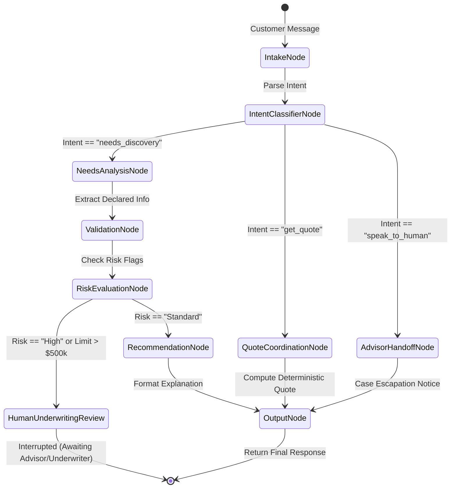
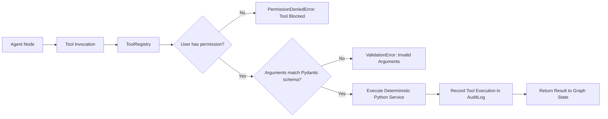
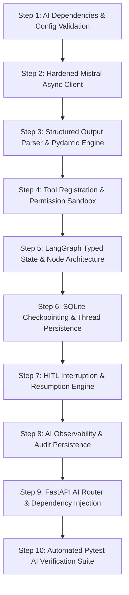

# PS-21 — Phase 3 Technical Specification & Implementation Plan
## Mistral AI Foundation, LangGraph Multi-Agent Orchestration & Observability Substrate

**Project:** PS-21 Conversational Insurance Acquisition & Onboarding Platform  
**Target Directory:** `microproject/backend`  
**Parent Guidelines:** `microproject/AGENTS.md` & `microproject/docs/Master_prompt.md`  
**Status:** Ready for Execution (Planning Document)  

---

## 1. Executive Summary & Objectives

The primary objective of **Phase 3** is to engineer the production-grade AI infrastructure and multi-agent orchestration substrate for the PS-21 insurance platform prior to implementing specific business agents in Phases 4 through 10.

Built directly on top of the Phase 2 backend foundation (FastAPI, SQLAlchemy 2.0 Async, SQLite, and the IAM/Observability database schema), Phase 3 establishes:
1. **Strict Mistral LLM Exclusivity:** A hardened, asynchronous Mistral client wrapper that rejects fallbacks, verifies environment configurations, tracks token consumption and millisecond latency, and translates API errors into structured domain exceptions.
2. **LangGraph Stateful Orchestration:** A typed state graph framework supporting multi-step reasoning, conditional routing, recursion limits, bounded transient retries, and persistence.
3. **SQLite Checkpointing & Thread Persistence:** Persistent thread checkpoints allowing multi-turn conversations and long-running insurance workflows to survive process restarts and pause across sessions.
4. **Human-in-the-Loop (HITL) Approval Gaps:** Native interruption and resumption primitives (`interrupt()`) enabling insurance advisors and underwriters to review high-risk flags, manual quote requirements, and medical escalations before workflows proceed.
5. **Sandboxed Tool Registration with RBAC:** A declarative tool registry enforcing role-based permissions and schema validation so agents cannot execute arbitrary database mutations or bypass authorization rules.
6. **Deterministic Service Separation:** Architectural boundaries guaranteeing that dynamic business calculations (premiums, eligibility, underwriting decisions) remain in deterministic backend services, with the LLM restricted to natural language understanding, reasoning, extraction, and explanation.
7. **End-to-End AI Observability & Auditing:** Automated recording of every agent execution, token metric, latency figure, and tool call into the database (`agent_executions` and `audit_logs`).

---

## 2. Core Mandates & Non-Negotiable AI Rules

As mandated by `AGENTS.md` and `Master_prompt.md`, the following architectural constraints are strictly enforced:

| Mandate | Specification & Constraint | Strict Enforcement Mechanism |
| :--- | :--- | :--- |
| **Mistral LLM Only** | Mistral is the sole permitted LLM provider. Absolutely **NO** OpenAI, Anthropic, Gemini, local Ollama, or alternative providers. | Attempting to import or initialize non-Mistral providers raises a hard runtime error. No automatic fallback providers are configured. |
| **No Fallback Policy** | Never return fake/mock LLM responses or fall back to static text when Mistral fails. | If the Mistral API fails or credentials are missing, the operation immediately halts and returns a structured error to the caller. |
| **No Dynamic Hardcoding** | No hardcoded premiums, product prices, eligibility rules, or underwriting thresholds. | All product rules and pricing matrices are retrieved from SQLite via registered tools and evaluated deterministically. |
| **Schema Validation** | Every structured output generated by Mistral must match a Pydantic v2 schema. | Responses that fail schema validation trigger a single structured repair attempt or raise a `SchemaValidationError`. |
| **Human-in-the-Loop** | AI agents must never independently approve or decline insurance policies or bind coverage. | LangGraph nodes trigger workflow interruptions (`interrupt`) whenever underwriting thresholds or compliance gates are reached. |
| **Bounded Retries** | Retries are permitted **only** for classified transient failures (HTTP 429 rate limit, 503 service unavailable, network timeout). | Retries use exponential backoff with max 3 attempts. Business logic failures and 4xx client errors abort immediately without retrying. |
| **Tool Permissions** | Agents operate under strict permission boundaries. No direct database query execution. | Every tool call validates the caller's session permissions against required tool capabilities before execution. |

---

## 3. Technology Stack & AI Infrastructure

| Component | Selected Technology | Version | Purpose & Architecture |
| :--- | :--- | :--- | :--- |
| **LLM Provider** | Mistral AI | API v1 | Official Mistral client (`mistralai`) utilized for all generative and extraction tasks. |
| **Default Model** | `mistral-large-latest` | Current | Primary model for complex multi-step reasoning, needs analysis, and underwriting escalation summaries. |
| **Fast Model** | `mistral-small-latest` | Current | High-throughput model for intent classification, sentiment analysis, and quick entity extraction. |
| **Orchestration** | LangGraph | 0.2.30+ | Stateful multi-agent graph architecture with conditional routing and checkpoint persistence. |
| **Graph Primitives** | LangChain Core | 0.3.15+ | Core message abstractions (`HumanMessage`, `AIMessage`, `SystemMessage`, `ToolMessage`). |
| **Persistence** | SQLite Checkpointer | Async / WAL | Graph state persistence across turns using `SqliteSaver` or custom async SQLAlchemy checkpoint engine. |
| **Validation** | Pydantic v2 | 2.7+ | Strict parsing, validation, and serialization of all agent inputs, outputs, and tool arguments. |
| **Instrumentation** | Python `time.perf_counter` | Standard | High-resolution millisecond latency tracking per LLM invocation and graph step. |

---

## 4. Backend AI Directory Structure (`microproject/backend/app/ai`)

```text
microproject/backend/
├── app/
│   ├── ai/                              # Core AI & Multi-Agent Infrastructure
│   │   ├── __init__.py
│   │   ├── config.py                    # Mistral configuration validation & model constants
│   │   │
│   │   ├── client/                      # Hardened Mistral Client Wrapper
│   │   │   ├── __init__.py
│   │   │   ├── mistral_client.py        # Async client with retry, token count, and latency capture
│   │   │   ├── exceptions.py            # AI-specific domain exceptions (AIConfigError, MistralAPIError, etc.)
│   │   │   └── structured_output.py     # Pydantic structured output parser & JSON repair handler
│   │   │
│   │   ├── graph/                       # LangGraph Orchestration Substrate
│   │   │   ├── __init__.py
│   │   │   ├── state.py                 # Core typed state definitions (BaseAgentState, ConversationalState)
│   │   │   ├── checkpointer.py          # SQLite checkpoint saver setup and thread recovery
│   │   │   ├── orchestrator.py          # StateGraph builder, compile logic, and runner interface
│   │   │   ├── routing.py               # Conditional edge evaluators (intent router, escalation check)
│   │   │   └── interrupts.py            # Human-in-the-loop pause and resume handlers
│   │   │
│   │   ├── agents/                      # Agent Base Architecture & Registry
│   │   │   ├── __init__.py
│   │   │   ├── base.py                  # BaseAgent abstract class (enforces Section 13 of AGENTS.md)
│   │   │   ├── registry.py              # Agent discovery, status verification, and lifecycle manager
│   │   │   └── definitions/             # Foundational agent implementations for Phase 3 verification
│   │   │       ├── __init__.py
│   │   │       ├── orchestrator_agent.py# Workflow coordinator agent
│   │   │       └── diagnostic_agent.py  # Health and verification agent for automated testing
│   │   │
│   │   ├── tools/                       # Declarative Tool Execution Substrate
│   │   │   ├── __init__.py
│   │   │   ├── base.py                  # BaseTool class with permission checks and JSON schema generator
│   │   │   ├── registry.py              # Central tool registration and invocation dispatcher
│   │   │   └── system_tools.py          # Foundational tools (database ping, product lookup, case lookup)
│   │   │
│   │   ├── prompts/                     # Prompt Management & Templates
│   │   │   ├── __init__.py
│   │   │   ├── base.py                  # Prompt template builder with variable substitution
│   │   │   ├── system_guardrails.py     # Universal system prompts (insurance compliance, anti-hallucination)
│   │   │   └── agent_prompts.py         # Agent-specific prompt templates
│   │   │
│   │   └── observability/               # AI Observability, Tracing & Audit Persistence
│   │       ├── __init__.py
│   │       ├── tracer.py                # Graph execution listener and step timer
│   │       └── audit_recorder.py        # Writes execution records to DB (agent_executions, audit_logs)
│   │
│   ├── api/v1/
│   │   └── ai.py                        # FastAPI router for AI diagnostic, agent run, and thread inspection
│   │
│   └── tests/ai/                        # Dedicated AI Test Suite
│       ├── __init__.py
│       ├── conftest.py                  # AI test fixtures, mock Mistral responses, sample states
│       ├── test_mistral_client.py       # Client validation, error handling, token tracking
│       ├── test_structured_output.py   # Pydantic schema enforcement and malformed JSON rejection
│       ├── test_langgraph_flow.py       # StateGraph compilation, node execution, conditional edges
│       ├── test_checkpointer.py         # Persistence across sessions in SQLite
│       ├── test_human_in_the_loop.py    # Interrupt and resume workflow mechanics
│       ├── test_tool_permissions.py     # Tool registry access control and role enforcement
│       └── test_ai_observability.py     # Verification of database logging in agent_executions
```

---

## 5. Architectural Components & Design Specifications

### 5.1 Mistral Client & Configuration Validator

The client layer encapsulates all communication with the Mistral API.



#### Key Implementation Requirements:
1. **Strict Startup Validation:** `AIConfig` loads:
   - `MISTRAL_API_KEY`: Must be non-empty and formatted properly.
   - `MISTRAL_DEFAULT_MODEL`: Defaults to `mistral-large-latest`.
   - `MISTRAL_FAST_MODEL`: Defaults to `mistral-small-latest`.
   - `MISTRAL_TEMPERATURE`: Default `0.2` (deterministic reasoning).
   - `MISTRAL_MAX_TOKENS`: Default `2048`.
   - `MISTRAL_REQUEST_TIMEOUT_SECONDS`: Default `30.0`.
2. **Explicit Failure Mode:** If `MISTRAL_API_KEY` is missing or invalid, any AI request raises `AIConfigurationError("MISTRAL_API_KEY is not configured. AI operations cannot proceed.")`.
3. **Usage Instrumentation:** Every response extracts:
   - `prompt_tokens`
   - `completion_tokens`
   - `total_tokens`
   - `latency_ms` (calculated via `perf_counter`)

---

### 5.2 Structured Output Parser & Pydantic Validation Engine

All outputs consumed by backend workflows must adhere to explicit Pydantic v2 schemas.

```python
class StructuredLLMResponse(BaseModel, Generic[T]):
    raw_content: str
    parsed_data: T
    model_name: str
    prompt_tokens: int
    completion_tokens: int
    total_tokens: int
    latency_ms: int
    validation_passed: bool
    validation_errors: Optional[list[str]] = None
```

#### Workflow:
1. Agent specifies a target Pydantic response schema (e.g., `NeedsAssessmentOutput`, `EscalationDecisionOutput`).
2. The prompt injects the target JSON schema and system instructions requiring valid JSON output.
3. The response is parsed with Pydantic's `model_validate_json()`.
4. If validation fails:
   - A single repair attempt is made by passing the validation error back to Mistral with the previous output.
   - If the second attempt fails, a `SchemaValidationError` is raised. Fake or default data is **never** substituted.

---

### 5.3 LangGraph State Machine & Typed State Definitions

The multi-agent system uses LangGraph's `StateGraph` driven by typed dictionaries and Pydantic models.



#### Core State Definition:
```python
from typing import Annotated, Any, Dict, List, Optional
from typing_extensions import TypedDict
from langchain_core.messages import BaseMessage
from langgraph.graph.message import add_messages

class BaseAgentState(TypedDict):
    """Universal state shared across all insurance workflow graphs."""
    # Conversation & Thread Context
    thread_id: str
    session_id: str
    customer_id: Optional[str]
    user_role: str
    
    # Message History with LangGraph reducer
    messages: Annotated[List[BaseMessage], add_messages]
    
    # Routing & Flow Control
    current_agent: str
    next_step: Optional[str]
    is_completed: bool
    requires_human_review: bool
    human_review_reason: Optional[str]
    interrupted_at_node: Optional[str]
    
    # Domain Business Context (Read/Write via validated tools)
    customer_profile: Dict[str, Any]
    qualification_data: Dict[str, Any]
    active_quote_id: Optional[str]
    active_application_id: Optional[str]
    risk_flags: List[str]
    
    # Execution Metadata & Observability
    total_tokens_consumed: int
    execution_steps_count: int
    errors: List[str]
```

---

### 5.4 SQLite Graph Persistence & Checkpointing Engine

To enable seamless multi-turn conversations and long-running human review workflows:
1. **Thread Persistence:** Every graph invocation requires a `thread_id` (typically matching the `conversation_id` or `application_id`).
2. **Checkpointer Storage:** Use SQLite checkpointing (`SqliteSaver` or custom async session checkpointer connected to `ps21_insurance.db` / `checkpoints.db`).
3. **State Resumption:** When a customer returns to an ongoing conversation or an underwriter approves an escalated case, LangGraph restores the exact state from SQLite using the `thread_id`.

---

### 5.5 Human-in-the-Loop (HITL) Interruption & Resumption

In accordance with insurance compliance rules:
- AI agents cannot finalize underwriting decisions or bind coverage independently.
- When an agent encounters high-risk medical declarations or coverage exceeding standard thresholds, the node invokes `interrupt()`:
  ```python
  from langgraph.types import interrupt

  def risk_evaluation_node(state: BaseAgentState) -> BaseAgentState:
      declared_conditions = state["qualification_data"].get("pre_existing_conditions", [])
      coverage_amount = state["qualification_data"].get("desired_coverage", 0)
      
      if declared_conditions or coverage_amount > 500_000:
          # Trigger Human-in-the-Loop Interruption
          human_decision = interrupt({
              "reason": "UNDERWRITING_ESCALATION_REQUIRED",
              "case_id": state.get("active_application_id"),
              "risk_flags": state["risk_flags"],
              "message": "High coverage or pre-existing medical conditions require human underwriter sign-off."
          })
          # Workflow pauses here until advisor/underwriter submits a decision via API
          state["requires_human_review"] = False
          state["underwriting_decision"] = human_decision["decision"]
          return state
      
      return state
  ```
- **Resumption Endpoint:** Advisors/underwriters submit decisions via `POST /api/v1/ai/threads/{thread_id}/resume`, which passes the human input back to LangGraph's `resume` primitive.

---

### 5.6 Sandboxed Tool Registration with RBAC

Agents interact with the backend exclusively through registered, typed tools.



#### Tool Definition Standard:
```python
class BaseTool(ABC):
    name: str
    description: str
    required_permissions: list[str]
    args_schema: type[BaseModel]

    async def execute(self, user_context: UserContext, **kwargs) -> Any:
        # 1. Enforce RBAC
        if not user_context.has_all_permissions(self.required_permissions):
            raise PermissionDeniedException(f"User lacks required permissions: {self.required_permissions}")
        # 2. Execute deterministic business service
        return await self._run(user_context, **kwargs)
```

#### Foundational System Tools for Phase 3:
1. `GetProductCatalogTool`: Queries active insurance products and eligibility parameters.
2. `CalculateDeterministicQuoteTool`: Invokes the deterministic pricing service (never LLM arithmetic).
3. `GetCustomerContextTool`: Retrieves customer profile details scoped strictly to the requesting user.
4. `RecordAuditNoteTool`: Writes an audit entry for compliance tracking.

---

### 5.7 AI Observability & Audit Logging

Every agent execution automatically creates an entry in the SQLite database using the `AgentExecution` model created in Phase 2:
- `id`: Unique execution UUID.
- `agent_name`: Name of the executing agent (e.g., `WorkflowOrchestrator`, `NeedsAssessmentAgent`).
- `session_id`: Client session identifier.
- `conversation_id`: Associated conversation ID (if applicable).
- `input_state_json`: Snapshot of the input state.
- `output_state_json`: Snapshot of the output state.
- `status`: `'started'`, `'success'`, `'failed'`, or `'interrupted'`.
- `latency_ms`: Execution duration in milliseconds.
- `token_usage_json`: JSON containing prompt, completion, and total tokens.
- `error_message`: Full error trace if execution failed.
- `executed_at`: UTC timestamp.

---

## 6. API Design & Endpoint Contracts

All endpoints are mounted under `/api/v1/ai` and adhere to the project's standard response envelope:

```json
{
  "success": true,
  "data": { ... },
  "error": null,
  "timestamp": "2026-11-05T23:00:00Z"
}
```

### Endpoints Specification

| Method | Endpoint | Access Role | Description |
| :--- | :--- | :--- | :--- |
| `GET` | `/api/v1/ai/health` | Authenticated | Validates Mistral connectivity and configuration without running heavy inference. |
| `POST` | `/api/v1/ai/agents/{agent_name}/execute` | Admin, Owner | Diagnostic agent execution test harness. Runs a single agent turn with sample state. |
| `GET` | `/api/v1/ai/threads/{thread_id}/state` | Authenticated | Retrieves current LangGraph state, history, and checkpoint status for a thread. |
| `POST` | `/api/v1/ai/threads/{thread_id}/resume` | Advisor, Underwriter, Admin | Resumes a paused/interrupted workflow following human review approval. |
| `GET` | `/api/v1/ai/executions` | Admin, Owner | Returns paginated list of agent execution logs, token statistics, and latency metrics. |
| `GET` | `/api/v1/ai/agents/config` | Admin, Owner | Retrieves agent configurations, active models, temperatures, and enabled statuses. |
| `PUT` | `/api/v1/ai/agents/{agent_name}/config` | Admin, Owner | Updates agent configuration (enable/disable, switch model, adjust prompt). |

---

## 7. Implementation Plan: Step-by-Step Execution Phases



### Step 1: Dependencies & Configuration Infrastructure
- Add AI dependencies to `microproject/backend/requirements.txt`:
  ```text
  mistralai>=1.2.0
  langgraph>=0.2.30
  langchain-core>=0.3.15
  langchain-mistralai>=0.2.0
  langgraph-checkpoint-sqlite>=2.0.0
  ```
- Create `microproject/backend/app/ai/config.py`:
  - Pydantic Settings class validating Mistral API settings from `.env`.
  - Export model names: `MISTRAL_LARGE = "mistral-large-latest"`, `MISTRAL_SMALL = "mistral-small-latest"`.
  - Fail explicitly on missing `MISTRAL_API_KEY`.

### Step 2: Hardened Mistral Async Client Wrapper
- Create `microproject/backend/app/ai/client/mistral_client.py`:
  - Asynchronous client wrapper initialized with `AIConfig`.
  - `generate()` method supporting prompt tokens, temperature, and system messages.
  - Latency measurement using `time.perf_counter()`.
  - Bounded exponential backoff retry logic (maximum 3 retries, only for HTTP 429/503/timeout).
  - Explicit error propagation: converts raw client exceptions into domain exceptions (`MistralRateLimitError`, `MistralAuthenticationError`, `MistralAPIError`).

### Step 3: Structured Output Parser & Pydantic Validation Engine
- Create `microproject/backend/app/ai/client/structured_output.py`:
  - `generate_structured(prompt, schema_class)` method.
  - Native JSON-mode / tool-calling structured extraction.
  - Strict Pydantic model validation.
  - Schema repair loop on validation failure (max 1 correction prompt).
  - Rejection of fabricated or incomplete structures.

### Step 4: Tool Registration & Permission Sandbox
- Create `microproject/backend/app/ai/tools/base.py` and `registry.py`:
  - Abstract base tool class with schema generation.
  - User context verification: checks that calling user/role holds required permissions before tool execution.
  - Create foundational tools in `app/ai/tools/system_tools.py`:
    - `GetProductCatalogTool`: queries SQLite product table.
    - `CalculateDeterministicQuoteTool`: calculates quote via deterministic math.
    - `GetCustomerContextTool`: loads customer profile with tenant isolation.

### Step 5: LangGraph Typed State & Node Architecture
- Create `microproject/backend/app/ai/graph/state.py`:
  - `BaseAgentState` typed dictionary with `messages`, `thread_id`, `risk_flags`, `requires_human_review`.
- Create `microproject/backend/app/ai/graph/orchestrator.py`:
  - `StateGraph` builder configuring nodes and routing logic.
  - Recursion limit guardrail (default: 25 steps).
  - Execution timeout wrapper (default: 60s per graph run).

### Step 6: SQLite Checkpointing & Thread Persistence
- Create `microproject/backend/app/ai/graph/checkpointer.py`:
  - Initializes SQLite checkpointer (`SqliteSaver`).
  - Implements thread recovery: loads prior conversation and graph state given a `thread_id`.
  - Verifies state transitions survive process restarts.

### Step 7: Human-in-the-Loop Interruption & Resumption Engine
- Create `microproject/backend/app/ai/graph/interrupts.py`:
  - Handles `interrupt()` signals triggered during graph execution.
  - Stores interrupted state and notification in database.
  - `resume_thread(thread_id, human_input)` function to resume execution once approved.

### Step 8: AI Observability & Audit Persistence
- Create `microproject/backend/app/ai/observability/audit_recorder.py`:
  - Writes records to `AgentExecution` table upon graph completion or failure.
  - Stores `latency_ms`, token usage, input state, and output state.
  - Writes security-sensitive AI decisions to `AuditLog`.

### Step 9: FastAPI AI Router & Dependency Injection
- Create `microproject/backend/app/api/v1/ai.py`:
  - Implements all 7 endpoints defined in Section 6.
  - Enforces RBAC dependencies (`require_roles(["Admin", "Owner"])` for sensitive endpoints).
  - Mounts router under `/api/v1/ai` in `app/main.py`.

### Step 10: Automated Pytest AI Verification Suite
- Create tests in `microproject/backend/tests/ai/`:
  - Test client initialization, token tracking, and missing key rejection.
  - Test structured output validation and schema error rejection.
  - Test LangGraph workflow transitions and checkpointing.
  - Test Human-in-the-Loop interruption and resumption.
  - Test tool execution sandboxing and permission enforcement.
  - Test SQLite persistence of `AgentExecution` records.

---

## 8. Automated Test Strategy & Scenarios

| Test Case File | Test Scenario | Expected Outcome |
| :--- | :--- | :--- |
| `test_mistral_client.py` | Missing `MISTRAL_API_KEY` in environment. | Initialization raises `AIConfigurationError`; fails immediately with clear error. |
| `test_mistral_client.py` | Valid request with mocked Mistral API response. | Returns response object with `content`, `prompt_tokens > 0`, `latency_ms > 0`. |
| `test_mistral_client.py` | API returns HTTP 429 Rate Limit. | Client retries up to 3 times with exponential backoff before raising `MistralRateLimitError`. |
| `test_mistral_client.py` | API returns HTTP 401 Unauthorized. | Fails immediately without retrying; raises `MistralAuthenticationError`. |
| `test_structured_output.py` | LLM returns JSON adhering to Pydantic schema. | Validates cleanly into typed Pydantic instance; `validation_passed == True`. |
| `test_structured_output.py` | LLM returns non-conforming or malformed JSON. | Triggers repair prompt; if second attempt fails, raises `SchemaValidationError`. |
| `test_langgraph_flow.py` | Multi-step conversation graph execution. | State traverses nodes correctly; messages accumulate via `add_messages` reducer. |
| `test_checkpointer.py` | Multi-turn conversation across separate calls. | Graph recovers previous state from SQLite checkpointer using `thread_id`. |
| `test_human_in_the_loop.py` | Graph encounters high-risk condition. | Node executes `interrupt()`; workflow state changes to `interrupted`. |
| `test_human_in_the_loop.py` | Underwriter submits approval via resume API. | Graph resumes from interruption point and completes successfully with human input. |
| `test_tool_permissions.py` | Customer role attempts to invoke Admin-only tool. | Tool execution is blocked; raises `PermissionDeniedException`. |
| `test_ai_observability.py` | Graph runs to completion. | Database contains a new record in `agent_executions` with accurate token and latency metrics. |

---

## 9. Acceptance & Completion Criteria

Phase 3 is considered complete only when all of the following conditions are met:
1. **Mistral Integration:**
   - Real Mistral API requests execute successfully when valid credentials are provided.
   - Missing or blank `MISTRAL_API_KEY` raises a clear, actionable `AIConfigurationError`.
   - Token consumption (`prompt_tokens`, `completion_tokens`, `total_tokens`) and latency (`latency_ms`) are recorded for every invocation.
   - Transient failures trigger bounded retries; permanent errors fail fast without silent fallbacks.
2. **Structured Outputs:**
   - All structured agent outputs are validated against Pydantic v2 schemas.
   - Invalid outputs are rejected; no fabricated or fallback data is returned.
3. **LangGraph Stateful Orchestration:**
   - Graph compiles with typed state definitions and executes multi-node flows.
   - Graph state persists in SQLite checkpoints across turns using `thread_id`.
4. **Human-in-the-Loop:**
   - Workflows pause cleanly at designated approval nodes via `interrupt()`.
   - Workflows resume correctly when authorized review decisions are submitted.
5. **Tool Permissions & Deterministic Boundary:**
   - Tools enforce caller role permissions before executing backend operations.
   - Financial calculations and underwriting decisions remain strictly deterministic.
6. **Observability & Auditability:**
   - Every agent execution creates an auditable record in SQLite (`agent_executions`).
   - Diagnostic endpoints (`/api/v1/ai/health`, `/api/v1/ai/executions`) return live, verifiable metrics.
7. **Automated Testing:**
   - Automated Pytest suite executes and passes 100% of test cases in `backend/tests/ai/`.
