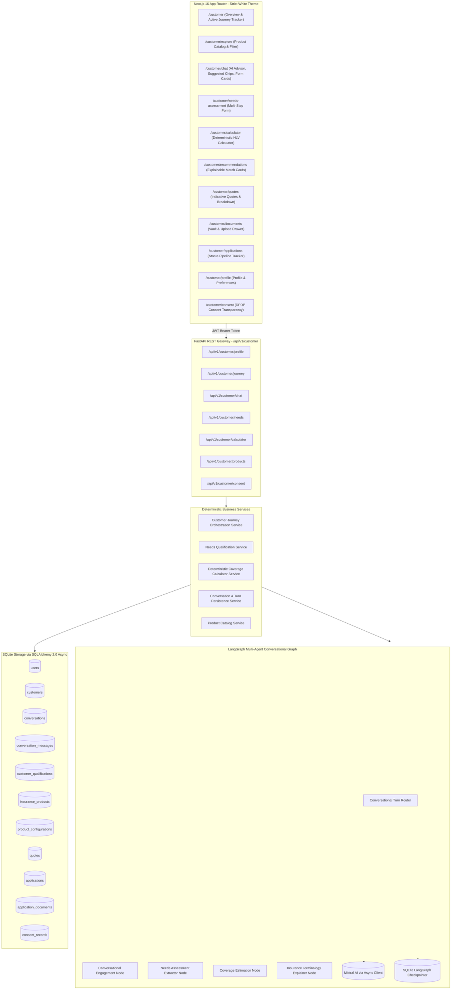
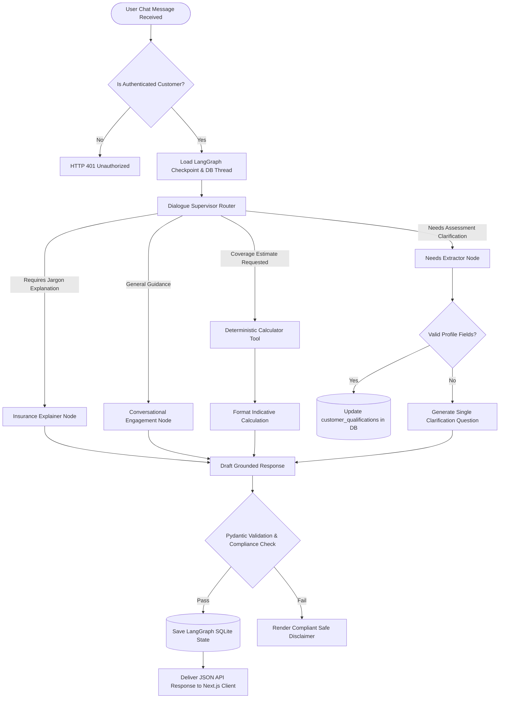

# PS-21 — Phase 5 Technical Specification & Implementation Plan
## Customer Dashboard Experience, Conversational AI Assistant & Stateful Needs Assessment Subsystem

**Project:** PS-21 Conversational Insurance Acquisition & Onboarding Platform  
**Target Directories:** `microproject/backend` & `microproject/frontend`  
**Parent Guidelines:** `microproject/AGENTS.md` & `microproject/docs/Master_prompt.md`  
**Status:** Ready for Execution (Planning Document)  

---

## 1. Executive Summary & Objectives

The primary objective of **Phase 5** is to engineer the complete **Customer Dashboard Experience and Conversational AI Subsystem** for the PS-21 insurance acquisition and onboarding platform. While Phase 2 established SQLite models and RBAC, Phase 3 delivered the Mistral/LangGraph foundational execution substrate, and Phase 4 provided prospect ingestion and lead queue tracking, **Phase 5 is where the customer's end-to-end digital insurance journey comes alive**.

In accordance with `Master_prompt.md` (Phase 5: Lines 591–663) and `AGENTS.md`, Phase 5 establishes:
1. **Full Customer Journey Lifecycle Across 12 Unified Screens:**
   - **Customer Home (`/customer`):** Real-time portfolio overview, active journey tracker, dynamic next-step cards, and recent interactions (strictly zero fabricated metrics).
   - **Explore Insurance (`/customer/explore`):** Interactive product catalog powered by database records (`insurance_products` and `product_configurations`) across Health, Term Life, and Motor categories.
   - **AI Insurance Advisor (`/customer/chat`):** Immersive, multi-turn conversational interface powered by Mistral and LangGraph with thread resumption, message history, streaming feedback, suggested quick replies, and inline form widgets.
   - **Needs Assessment (`/customer/needs-assessment`):** Comprehensive structured intake capturing dependents, current financial liability, health tier, tobacco usage, and existing coverage gaps.
   - **Coverage Calculator (`/customer/calculator`):** Actuarially grounded deterministic calculator estimating life and health sum assured requirements based on the Human Life Value (HLV) model and healthcare inflation curves.
   - **Insurance Recommendations (`/customer/recommendations`):** Explainable product matching display highlighting rationale, coverage fit, policy riders, and mandatory exclusions without fabricating terms.
   - **Indicative Quote Hub (`/customer/quotes`):** Itemized breakdown of base premiums, rider loadings, and applicable taxes with prominent compliance disclosures that rates are indicative and subject to underwriting.
   - **Application Onboarding (`/customer/onboarding`):** Guided step-by-step proposal questionnaire preview linked with customer qualifications.
   - **Document Vault (`/customer/documents`):** Secure customer document management interface for uploading and tracking identity, address, and medical records with SHA-256 verification status.
   - **Application Tracking (`/customer/applications` & `/customer/applications/[id]`):** Transparent status tracker monitoring proposals across Underwriting Review, Escalation, and Policy Issuance.
   - **Profile & Preferences (`/customer/profile`):** Personal demographics, occupation details, address, notification preferences, and multi-language preference (`en`, `hi`).
   - **Consent & Privacy Center (`/customer/consent`):** Transparent DPDP/IRDAI privacy dashboard allowing customers to review active consents, view timestamped audit logs, or revoke specific permissions.
2. **Autonomous Multi-Agent Conversational Architecture:**
   - Multi-agent LangGraph workflow featuring specialized nodes: `ConversationalEngagementAgent`, `NeedsAssessmentAgent`, `CoverageCalculatorAgent`, and `InsuranceExplainerAgent`.
   - **Turn-taking Discipline:** Enforces "one useful question at a time" to eliminate cognitive overload and customer drop-off.
   - **Context Preservation & Checkpointing:** Persistent conversation state stored in SQLite via `SqliteSaver`, allowing customers to leave on mobile and resume seamlessly on desktop.
   - **Anti-Hallucination Guardrails:** AI responses are strictly grounded in database-backed product rules. The assistant never invents premiums, eligibility rules, or policy benefits.
   - **Bilingual Support:** Configurable language prompt profiles supporting English (`en`) and Hindi (`hi`).
3. **Strict Enterprise White SaaS Aesthetics:**
   - Absolute enforcement of the clean white theme (`bg-white`, slate borders, navy typography, restrained blue accents).
   - Direct usage of actual `@/components/ui/*` shadcn primitives (zero homemade approximations, zero dark mode).
4. **Isolated Authorization & Privacy Security:**
   - Absolute customer data isolation: Customers can never query, read, or modify records belonging to other customers.
   - All backend endpoints enforce customer identity verification via JWT claims and active sessions.

---

## 2. Core Mandates & Non-Negotiable Phase 5 Rules

All Phase 5 code must strictly comply with the following architectural constraints established in `microproject/AGENTS.md`:

| Mandate | Specification & Constraint | Strict Enforcement Mechanism |
| :--- | :--- | :--- |
| **Only Mistral AI** | Mistral is the exclusive LLM provider. No OpenAI, Anthropic, Gemini, or fallback mocks. | AI service calls exclusively use `MistralClientWrapper`. If `MISTRAL_API_KEY` is missing or the API returns an error, the system raises a structured `AIConfigurationError` or `AIServiceException`. Never silently return canned fake responses. |
| **No Hardcoded Premiums or Data** | AI and UI must never invent premiums, eligibility decisions, or policy terms. | Premiums and coverage limits originate exclusively from deterministic backend services (`QuoteCalculationService`) and database product catalog tables (`insurance_products`). |
| **Deterministic Calculations** | Coverage calculations (e.g., HLV calculations, healthcare inflation adjustments) must use exact mathematical formulas in Python. | Math calculations are executed inside deterministic backend services, not through LLM guesswork. The LLM only formats and explains calculated figures. |
| **Customer Data Isolation** | A customer must never see or modify another customer's conversations, quotes, applications, or profile. | Every customer endpoint extracts `current_user.id` and validates that `customer.user_id == current_user.id`. Cross-customer access triggers HTTP 403 Forbidden. |
| **One Useful Question at a Time** | The conversational assistant must not bombard the customer with multi-part questions or lengthy checklists. | System prompt instructions and LangGraph dialogue state validation enforce that the agent collects information progressively, one clear query per conversational turn. |
| **Clear Indicative Disclosures** | Quotes and recommendations must never be presented as formal underwriting approvals or binding contracts. | Every UI card, chat message, and quote review presents an explicit disclaimer: *"Quotes are indicative estimates based on provided inputs and remain subject to formal underwriting review and insurer acceptance."* |
| **Strict Enterprise White Theme** | Pure white SaaS aesthetic with zero dark mode components or dark dashboard cards. | CSS rules enforce `bg-white`, `bg-slate-50`, `border-slate-200`, `text-slate-900`, and `text-blue-600`. Zero `dark:` Tailwind variants. |
| **Direct shadcn/ui Components** | Use actual directly imported shadcn/ui primitives. | Buttons, dialogs, sliders, tabs, sheets, alerts, badges, and progress bars use official components from `@/components/ui/*`. |
| **Persistent Journey Resumption** | Customers must be able to disconnect or close their browser and resume their exact onboarding flow. | LangGraph thread checkpointing combined with relational `conversations` and `customer_qualifications` records maintain full journey state in SQLite. |

---

## 3. Technology Stack & Architectural Positioning



---

## 4. Database Schema Enhancements & Migration Plan

The existing schema defined in Phase 2 contains foundational entities: `customers`, `conversations`, `conversation_messages`, `customer_qualifications`, `insurance_products`, and `consent_records`. Phase 5 introduces targeted schema enhancements to support rich customer onboarding state, structured needs assessment data, conversation resume markers, and customer preferences.

### 4.1 Schema Additions & Modifications

#### 1. `customers` Table Modifications:
- Add `preferred_language`: `String(10)`, Default `"en"`, Not Null (values: `"en"`, `"hi"`).
- Add `city`: `String(100)`, Nullable.
- Add `pincode`: `String(10)`, Nullable.
- Add `state`: `String(50)`, Nullable.
- Add `gender`: `String(20)`, Nullable (e.g., `"male"`, `"female"`, `"other"`).
- Add `tobacco_user`: `Boolean`, Default `False`, Not Null.
- Add `onboarding_stage`: `String(50)`, Default `"discovery"`, Not Null (values: `"discovery"`, `"needs_assessment"`, `"product_matching"`, `"quote_review"`, `"proposal_draft"`, `"submitted"`).
- Add `active_conversation_id`: `String(36)`, Nullable, Foreign Key referencing `conversations.id` (`ondelete="SET NULL"`).

#### 2. `customer_qualifications` Table Enhancements:
Extend the existing model to explicitly capture structured actuarial factors:
```python
# app/models/recommendation.py (CustomerQualification enhancements)
class CustomerQualification(Base, TimestampMixin):
    __tablename__ = "customer_qualifications"

    id: Mapped[str] = mapped_column(String(36), primary_key=True, default=generate_uuid)
    customer_id: Mapped[Optional[str]] = mapped_column(String(36), ForeignKey("customers.id", ondelete="CASCADE"), nullable=True, index=True)
    prospect_id: Mapped[Optional[str]] = mapped_column(String(36), ForeignKey("prospects.id", ondelete="CASCADE"), nullable=True, index=True)
    
    # Qualification Attributes
    eligibility_status: Mapped[str] = mapped_column(String(30), default="in_progress", nullable=False)  # eligible, ineligible, needs_review, in_progress
    target_category: Mapped[str] = mapped_column(String(50), nullable=False)  # term_life, health, motor
    financial_capacity: Mapped[Optional[float]] = mapped_column(Numeric(14, 2), nullable=True)
    health_tier: Mapped[str] = mapped_column(String(30), default="standard", nullable=False)  # preferred_plus, standard, rated, declined
    
    # Actuarial inputs for deterministic recommendation
    age: Mapped[Optional[int]] = mapped_column(Integer, nullable=True)
    dependents_count: Mapped[int] = mapped_column(Integer, default=0, nullable=False)
    has_pre_existing_conditions: Mapped[bool] = mapped_column(Boolean, default=False, nullable=False)
    existing_coverage_amount: Mapped[float] = mapped_column(Numeric(14, 2), default=0.00, nullable=False)
    recommended_sum_assured: Mapped[Optional[float]] = mapped_column(Numeric(14, 2), nullable=True)
    
    # Detailed factor audit trail
    factors_json: Mapped[Optional[Dict[str, Any]]] = mapped_column(JSON, nullable=True)
    completed_steps_json: Mapped[Optional[List[str]]] = mapped_column(JSON, default=list, nullable=True)
```

#### 3. `conversations` Table Enhancements:
- Add `last_turn_at`: `DateTime(timezone=True)`, Default `utc_now`, Not Null, indexed.
- Add `thread_title`: `String(150)`, Default `"Insurance Advisory Consultation"`, Not Null.
- Add `conversation_mode`: `String(30)`, Default `"general_advisory"`, Not Null (values: `"general_advisory"`, `"needs_intake"`, `"quote_calculation"`, `"claim_faq"`).
- Add `summary_text`: `Text`, Nullable.

#### 4. `conversation_messages` Table Enhancements:
- Add `message_type`: `String(30)`, Default `"text"`, Not Null (values: `"text"`, `"suggested_chips"`, `"form_widget"`, `"quote_preview"`, `"disclaimer"`).
- Add `widget_data_json`: `JSON`, Nullable (stores structured payload for inline interactive cards).

---

## 5. Directory Structure & Component Inventory

```text
microproject/
├── backend/
│   ├── app/
│   │   ├── api/v1/
│   │   │   ├── customer_profile.py        # Customer profile, preferences, address
│   │   │   ├── customer_journey.py        # Journey progression, active stage, resume state
│   │   │   ├── customer_chat.py           # Conversational AI turns, streaming, message history
│   │   │   ├── customer_needs.py          # Structured needs assessment intake & validation
│   │   │   ├── customer_calculator.py     # Deterministic HLV and healthcare coverage calculator
│   │   │   └── customer_consent.py        # Customer privacy preferences & active consent view
│   │   │
│   │   ├── schemas/
│   │   │   ├── customer.py                # Profile, preference, and address validation schemas
│   │   │   ├── journey.py                 # Journey status, stage transition, resume payload schemas
│   │   │   ├── conversation.py            # Message turns, widget payloads, chip suggestions
│   │   │   ├── needs_assessment.py        # Multi-factor needs assessment request/response schemas
│   │   │   └── calculator.py              # Coverage calculation inputs, HLV math breakdown schemas
│   │   │
│   │   ├── repositories/
│   │   │   ├── conversation_repository.py # Conversation CRUD, message history with pagination
│   │   │   ├── qualification_repository.py# Qualification retrieval, upsert, and factor recording
│   │   │   └── customer_repository.py     # Customer profile updates and preferences
│   │   │
│   │   ├── services/
│   │   │   ├── customer_journey_service.py# Stage transitions, journey resumption, checkpoint sync
│   │   │   ├── needs_assessment_service.py# Structured needs intake, gap calculation, qualification
│   │   │   ├── coverage_calculator_service.py # Deterministic Human Life Value (HLV) & medical math
│   │   │   └── customer_chat_service.py   # LangGraph execution coordination and turn persistence
│   │   │
│   │   └── ai/
│   │       ├── agents/definitions/
│   │       │   ├── conversational_advisor_agent.py # Dialogue manager and single-question orchestrator
│   │       │   ├── needs_assessment_agent.py      # Extracting structured profile from dialogue
│   │       │   └── insurance_explainer_agent.py    # Jargon breakdown and policy nuance explainer
│   │       └── prompts/
│   │           ├── advisor_system_en.py   # English system prompt with strict anti-hallucination rules
│   │           └── advisor_system_hi.py   # Hindi system prompt for bilingual advisory
│   │
│   └── tests/
│       └── customer/
│           ├── __init__.py
│           ├── conftest.py                # Fixtures for customer users, active threads, sample products
│           ├── test_customer_isolation.py # Verifies customer A cannot read customer B data
│           ├── test_needs_assessment.py   # Validation of structured needs and qualifications
│           ├── test_coverage_calculator.py# Actuarial math verification for HLV and healthcare formulas
│           ├── test_conversational_turn.py# Multi-turn LangGraph dialogue and turn persistence
│           ├── test_journey_resume.py     # State restoration across interrupted sessions
│           └── test_anti_hallucination.py # Verifies refusal to guess pricing or non-existent policies
│
└── frontend/
    └── src/
        ├── app/
        │   └── customer/
        │       ├── page.tsx               # Customer Home (Portfolio Overview & Active Journey)
        │       ├── explore/
        │       │   └── page.tsx           # Product Catalog & Plan Explorer
        │       ├── chat/
        │       │   └── page.tsx           # AI Insurance Advisor Conversational Hub
        │       ├── needs-assessment/
        │       │   └── page.tsx           # Step-by-Step Structured Needs Questionnaire
        │       ├── calculator/
        │       │   └── page.tsx           # Interactive Deterministic Coverage Calculator
        │       ├── recommendations/
        │       │   └── page.tsx           # Personalized Explainable Insurance Recommendations
        │       ├── quotes/
        │       │   ├── page.tsx           # Indicative Quotes Review Hub
        │       │   └── [id]/page.tsx      # Detailed Quote Breakdown & Calculation Audit
        │       ├── onboarding/
        │       │   └── page.tsx           # Proposal Application Preview & Pre-fill
        │       ├── documents/
        │       │   └── page.tsx           # Document Upload & Integrity Vault
        │       ├── applications/
        │       │   ├── page.tsx           # Application Status Tracking List
        │       │   └── [id]/page.tsx      # Underwriting Progression Timeline
        │       ├── profile/
        │       │   └── page.tsx           # Customer Profile, Address & Preferences
        │       └── consent/
        │           └── page.tsx           # DPDP Privacy & Consent Management Center
        │
        ├── components/
        │   └── customer/
        │       ├── chat/
        │       │   ├── chat-message-list.tsx   # Virtualized message history with avatars & timestamps
        │       │   ├── chat-input-bar.tsx      # Multi-line input with send, voice/attachment triggers
        │       │   ├── suggestion-chips.tsx    # Clickable prompt suggestion pills
        │       │   ├── chat-widget-card.tsx    # Inline interactive micro-forms (sliders, radio groups)
        │       │   ├── typing-indicator.tsx    # Subtle pulsing dots with active agent name
        │       │   └── resume-journey-banner.tsx# Banner notifying customer of unfinished journey
        │       ├── calculator/
        │       │   ├── hlv-calculator-form.tsx # Income, debt, expense sliders with instant math
        │       │   └── calculation-breakdown-card.tsx # Visual breakdown of required protection
        │       ├── needs/
        │       │   ├── needs-progress-stepper.tsx# Clean breadcrumb progress indicator
        │       │   └── qualification-summary-card.tsx# Summary of captured profile factors
        │       ├── journey/
        │       │   └── journey-status-tracker.tsx# Visual chevron milestone pipeline
        │       └── shared/
        │           ├── indicative-quote-pill.tsx # Mandatory compliance warning pill
        │           └── language-switcher.tsx    # English / Hindi locale toggle
        │
        └── services/
            ├── customer-api.ts            # Typed client for customer profile, journey, needs, and chat
            └── calculator-api.ts          # API client for deterministic coverage estimations
```

---

## 6. Detailed Backend Specifications

### 6.1 Pydantic Validation Schemas

#### 1. Journey & State Resumption Schemas (`schemas/journey.py`):
```python
from datetime import datetime
from typing import Any, Dict, List, Optional
from pydantic import BaseModel, Field

class JourneyStatusResponse(BaseModel):
    customer_id: str
    current_stage: str = Field(..., description="discovery, needs_assessment, product_matching, quote_review, proposal_draft, submitted")
    active_conversation_id: Optional[str]
    has_active_quote: bool
    active_quote_id: Optional[str]
    has_active_application: bool
    active_application_id: Optional[str]
    qualification_completed: bool
    missing_requirements: List[str]
    last_activity_at: datetime

class JourneyTransitionRequest(BaseModel):
    target_stage: str = Field(..., pattern=r"^(discovery|needs_assessment|product_matching|quote_review|proposal_draft|submitted)$")
    context_data: Optional[Dict[str, Any]] = None

class ResumeJourneyResponse(BaseModel):
    thread_id: str
    conversation_id: str
    stage: str
    last_message: Optional[str]
    suggested_action: str
    qualification_snapshot: Dict[str, Any]
```

#### 2. Conversational Message & Widget Schemas (`schemas/conversation.py`):
```python
class WidgetDataPayload(BaseModel):
    widget_type: str = Field(..., pattern=r"^(coverage_slider|category_picker|tobacco_toggle|family_counter|quote_card)$")
    title: str
    parameters: Dict[str, Any] = Field(default_factory=dict)
    submit_action_url: Optional[str] = None

class CustomerChatTurnRequest(BaseModel):
    conversation_id: Optional[str] = Field(None, description="Existing conversation ID or null to initiate a new thread")
    message: str = Field(..., min_length=1, max_length=2000, description="Customer message or selected chip response")
    language: str = Field("en", pattern=r"^(en|hi)$", description="Language preference for conversational response")
    client_context: Optional[Dict[str, Any]] = Field(default_factory=dict, description="Active client viewport context")

class ConversationMessageRead(BaseModel):
    id: int
    conversation_id: str
    sender_type: str = Field(..., pattern=r"^(user|agent|advisor|system)$")
    sender_name: str
    content: str
    message_type: str = Field("text", pattern=r"^(text|suggested_chips|form_widget|quote_preview|disclaimer)$")
    suggested_chips: Optional[List[str]] = None
    widget_data: Optional[WidgetDataPayload] = None
    created_at: datetime

class ConversationThreadRead(BaseModel):
    id: str
    customer_id: str
    title: str
    status: str
    mode: str
    messages: List[ConversationMessageRead]
    created_at: datetime
    last_turn_at: datetime
```

#### 3. Needs Assessment Schemas (`schemas/needs_assessment.py`):
```python
class NeedsAssessmentSubmit(BaseModel):
    category: str = Field(..., pattern=r"^(term_life|health|motor)$")
    age: int = Field(..., ge=18, le=80, description="Age of the primary insured")
    annual_income: float = Field(..., ge=0, description="Gross annual income in INR")
    dependents_count: int = Field(0, ge=0, le=10, description="Number of financially dependent members")
    marital_status: str = Field("single", pattern=r"^(single|married|divorced|widowed)$")
    occupation: str = Field(..., max_length=100)
    tobacco_user: bool = Field(False, description="Tobacco/nicotine consumption in past 36 months")
    has_pre_existing_conditions: bool = Field(False)
    pre_existing_conditions_details: Optional[str] = Field(None, max_length=500)
    existing_life_cover: float = Field(0.0, ge=0)
    existing_health_cover: float = Field(0.0, ge=0)
    desired_coverage_amount: Optional[float] = Field(None, ge=100000)

class NeedsAssessmentResponse(BaseModel):
    qualification_id: str
    customer_id: str
    category: str
    eligibility_status: str
    calculated_coverage_gap: float
    recommended_sum_assured: float
    health_risk_tier: str
    key_observations: List[str]
    qualifying_products_count: int
    created_at: datetime
```

#### 4. Deterministic Calculator Schemas (`schemas/calculator.py`):
```python
class HLVCalculationRequest(BaseModel):
    annual_income: float = Field(..., ge=100000, description="Annual earned income in INR")
    current_age: int = Field(..., ge=18, le=65)
    retirement_age: int = Field(60, ge=45, le=75)
    annual_household_expenses: float = Field(..., ge=50000)
    outstanding_liabilities: float = Field(0.0, ge=0, description="Home loans, personal loans, vehicle loans")
    current_liquid_investments: float = Field(0.0, ge=0, description="Mutual funds, FD, existing life cover")
    inflation_rate_percent: float = Field(6.0, ge=3.0, le=12.0)

class HLVCalculationResponse(BaseModel):
    methodology: str = "Human Life Value (Income Replacement & Expense Capitalization Model)"
    recommended_term_cover: float
    human_life_value_raw: float
    outstanding_liabilities_component: float
    existing_cover_offset: float
    net_protection_gap: float
    rule_of_thumb_multiplier: str
    calculation_breakdown: Dict[str, Any]
    formula_explanation: str
```

---

### 6.2 Deterministic Coverage Calculator Engine (`services/coverage_calculator_service.py`)

In strict accordance with `AGENTS.md` Mandates 5 ("No Hardcoding") and 11 ("Insurance Business Rules"), calculations must never be generated by LLM guesswork. The `CoverageCalculatorService` implements the actuarial Human Life Value (HLV) formula:

$$\text{HLV} = \left( \text{Net Annual Income to Family} \times \frac{1 - (1 + r)^{-n}}{r} \right) + \text{Debts} - \text{Liquid Assets}$$

Where:
- $n = \text{Retirement Age} - \text{Current Age}$ (working years left)
- $r = \frac{\text{Discount Rate} - \text{Inflation Rate}}{1 + \text{Inflation Rate}}$ (real rate of return)
- $\text{Net Annual Income to Family} = \text{Annual Income} - \text{Personal Maintenance Expenses (typically 20–30\%)}$

```python
# app/services/coverage_calculator_service.py
from typing import Any, Dict
from app.schemas.calculator import HLVCalculationRequest, HLVCalculationResponse

class CoverageCalculatorService:
    @staticmethod
    def calculate_human_life_value(payload: HLVCalculationRequest) -> HLVCalculationResponse:
        working_years = max(1, payload.retirement_age - payload.current_age)
        
        # Personal consumption deduction (standard 30% personal maintenance)
        family_dependency_income = payload.annual_income * 0.70
        
        # Real discount rate adjustment: assuming nominal return of 8% and inflation of 6%
        nominal_return = 0.08
        inflation = payload.inflation_rate_percent / 100.0
        real_rate = (nominal_return - inflation) / (1 + inflation)
        
        if abs(real_rate) < 0.001:
            capitalized_income = family_dependency_income * working_years
        else:
            # Present Value of Annuity formula
            capitalized_income = family_dependency_income * ((1 - ((1 + real_rate) ** -working_years)) / real_rate)
            
        gross_hlv = capitalized_income + payload.outstanding_liabilities
        net_gap = max(0.0, gross_hlv - payload.current_liquid_investments)
        
        # Round to nearest 5,00,000 INR (actuarial standard for sum assured)
        rounded_recommendation = round(net_gap / 500000.0) * 500000.0
        if rounded_recommendation < 2500000.0:
            rounded_recommendation = 2500000.0  # Industry baseline minimum for term life
            
        multiplier = round(rounded_recommendation / payload.annual_income, 1)

        return HLVCalculationResponse(
            recommended_term_cover=float(rounded_recommendation),
            human_life_value_raw=round(gross_hlv, 2),
            outstanding_liabilities_component=float(payload.outstanding_liabilities),
            existing_cover_offset=float(payload.current_liquid_investments),
            net_protection_gap=round(net_gap, 2),
            rule_of_thumb_multiplier=f"{multiplier}x Annual Income",
            calculation_breakdown={
                "working_years_remaining": working_years,
                "annual_family_income_secured": round(family_dependency_income, 2),
                "assumed_real_discount_rate_percent": round(real_rate * 100, 2),
                "capitalized_future_income": round(capitalized_income, 2),
                "liabilities_added": payload.outstanding_liabilities,
                "existing_coverage_subtracted": payload.current_liquid_investments,
            },
            formula_explanation=(
                f"Based on {working_years} remaining earning years until age {payload.retirement_age}, "
                f"accounting for {payload.inflation_rate_percent}% inflation and your existing financial assets."
            )
        )
```

---

### 6.3 LangGraph Conversational Subsystem (`app/ai/agents/definitions/conversational_advisor_agent.py`)

The conversational advisor is built on top of the Phase 3 LangGraph orchestrator and state engine (`app/ai/graph/orchestrator.py` and `state.py`). It coordinates conversation flow without hallucination, enforcing one question at a time and invoking deterministic tools when numbers or product comparisons are requested.



#### LangGraph State Extension for Phase 5:
```python
# app/ai/graph/customer_state.py
from typing import Annotated, Any, Dict, List, Optional
from typing_extensions import TypedDict
from langchain_core.messages import BaseMessage
from langgraph.graph.message import add_messages

class CustomerConversationState(TypedDict):
    thread_id: str
    customer_id: str
    language: str  # "en" or "hi"
    messages: Annotated[List[BaseMessage], add_messages]
    current_dialogue_step: str  # "greeting", "category_discovery", "needs_intake", "coverage_calc", "product_recommendation"
    qualification_draft: Dict[str, Any]
    missing_fields: List[str]
    suggested_chips: List[str]
    active_widget: Optional[Dict[str, Any]]
    is_turn_completed: bool
    tokens_consumed: int
```

#### System Prompt Rules for the AI Advisor (English Profile):
```text
You are the certified PS-21 Conversational Insurance Advisor.
Your mission is to understand customer protection requirements, demystify policy nuances, and guide them toward appropriate insurance categories.

STRICT OPERATIONAL RULES:
1. ASK EXACTLY ONE QUESTION AT A TIME. Never ask multiple questions in a single response.
2. NEVER FABRICATE OR GUESS PREMIUMS. All financial figures must come from registered tools.
3. CLEARLY STATE INDICATIVE STATUS: Every time potential coverage or costs are discussed, clarify that quotes are indicative and subject to formal underwriting.
4. NO UNSUPPORTED CLAIMS: Only cite products and benefits stored in the approved database catalog.
5. PROFESSIONAL ENTERPRISE TONE: Warm, transparent, trustworthy, concise, and financial-grade.
6. SUGGESTED REPLIES: Always provide 2 to 4 short, actionable quick-reply chips for mobile users.
7. LANGUAGE: Respond in the user's preferred language (English or Hindi) as specified in state.
```

---

### 6.4 API Route Endpoints (`app/api/v1/customer_*.py`)

| Method | Endpoint | Description | RBAC & Security |
| :--- | :--- | :--- | :--- |
| `GET` | `/api/v1/customer/profile` | Retrieves current authenticated customer profile, address, and preferences | `Customer` role only (`customer.user_id == current_user.id`) |
| `PUT` | `/api/v1/customer/profile` | Updates personal demographics, occupation, address, and tobacco status | `Customer` role only |
| `GET` | `/api/v1/customer/journey/status` | Current onboarding stage, missing steps, active quote/application status | Customer-scoped |
| `POST` | `/api/v1/customer/journey/resume` | Restores conversation thread and active state for an interrupted journey | Customer-scoped |
| `POST` | `/api/v1/customer/journey/transition` | Advances onboarding milestone from `discovery` to `needs_assessment`, etc. | Customer-scoped |
| `POST` | `/api/v1/customer/chat/turn` | Executes multi-agent conversational turn with LangGraph state checkpointing | Customer-scoped |
| `GET` | `/api/v1/customer/chat/history` | Fetches chronological message history with pagination for current thread | Customer-scoped |
| `POST` | `/api/v1/customer/needs/assess` | Submits structured needs assessment questionnaire and updates qualifications | Customer-scoped |
| `GET` | `/api/v1/customer/needs/summary` | Retrieves latest qualification record, risk tier, and coverage gap | Customer-scoped |
| `POST` | `/api/v1/customer/calculator/hlv` | Deterministic Human Life Value coverage calculation | Public or Customer |
| `GET` | `/api/v1/customer/consent` | Lists all active and historical DPDP consent grants for authenticated user | Customer-scoped |
| `POST` | `/api/v1/customer/consent/grant` | Explicitly grants a consent type (`marketing`, `data_processing`, `medical`) | Customer-scoped |
| `POST` | `/api/v1/customer/consent/revoke` | Revokes an active consent type with immediate timestamped audit log | Customer-scoped |

---

## 7. Frontend User Experience Specifications (Strict Enterprise White Theme)

In strict accordance with `AGENTS.md` Section 7 ("Frontend Design Rules"), the customer dashboard interface uses a **pure white SaaS theme**:
- Main backgrounds: Pure white (`bg-white`).
- Secondary surfaces: Very light slate (`bg-slate-50`).
- Borders: Subtle light slate (`border-slate-200`).
- Typography: Charcoal and dark slate (`text-slate-900`, `text-slate-600`).
- Accent colors: Professional blue (`bg-blue-600`, `hover:bg-blue-700`, `text-blue-600`).
- **Forbidden:** No dark mode (`dark:` classes), no black cards, no heavy neon gradients, no custom homemade buttons.

---

### 7.1 Screen 1: Customer Home (`/customer`)

```text
┌────────────────────────────────────────────────────────────────────────────────────────┐
│ Insurance Portfolio Overview                                      [ Need Help? Ask AI ]│
│ Welcome back, Priya Sharma. Here is your current insurance protection status.          │
├─────────────────┬─────────────────┬──────────────────┬─────────────────────────────────┤
│ ACTIVE QUOTES   │ PROPOSALS       │ DOCUMENTS        │ ACTIVE POLICIES                 │
│ 1 Indicative    │ 0 In Review     │ 2 Uploaded       │ 0 Issued Plans                  │
├─────────────────┴─────────────────┴──────────────────┴─────────────────────────────────┤
│ ACTIVE ONBOARDING JOURNEY                                                              │
│ [● Discovery] ──── [● Needs Assessment] ──── [○ Product Match] ──── [○ Proposal Draft] │
│ Current Milestone: Needs Assessment Completed. 2 Matching Life Plans Available.        │
│ [ Continue Journey: View Recommendations → ]      [ Chat with AI Advisor ]             │
├────────────────────────────────────────────────────┬───────────────────────────────────┤
│ RECENT ACTIVITY & ADVICE                           │ QUICK DISCOVERY ACTIONS           │
│ • Term Life HLV Calculator completed (₹1.50 Cr)   │ [ Explore Health Insurance ]      │
│ • Identity Proof uploaded to Document Vault        │ [ Calculate HLV Protection ]      │
│ • Conversational session resumed (Yesterday)       │ [ Review Privacy & Consents ]     │
└────────────────────────────────────────────────────┴───────────────────────────────────┘
```

- **Stat Cards:** Clean white cards with top border accents, displaying live counts from `quotes`, `applications`, and `documents` (no mock metrics).
- **Active Onboarding Banner:** Displays visual progress stepper tracking the customer's actual `onboarding_stage`.
- **Empty States:** When the customer has zero quotes or policies, renders the reusable `<EmptyState>` component with actionable discovery buttons.

---

### 7.2 Screen 2: Explore Insurance Catalog (`/customer/explore`)

```text
┌────────────────────────────────────────────────────────────────────────────────────────┐
│ Insurance Product Catalog                                        Category: [ All ▼ ]   │
│ Explore transparent, database-backed insurance products across Health, Life & Motor.    │
├────────────────────┬───────────────────────────────────┬───────────────────────────────┤
│ [ All Plans (12) ] │ [ Term Life (4) ]                 │ [ Health & Family (6) ]       │
├────────────────────┴───────────────────────────────────┴───────────────────────────────┤
│ SEARCH: [ Search by plan name, insurer, feature...                                   ] │
├─────────────────────────────────┬─────────────────────────────────┬────────────────────┤
│ PRUDENT SHIELD TERM LIFE        │ HEALTH GUARD COMPREHENSIVE      │ CRITICAL CARE PLUS │
│ Category: Term Life             │ Category: Health                │ Cat: Critical Care │
│ Insurer: SafeLife Assur. Ltd.   │ Insurer: Apex Health Insurance  │ Insurer: Apex      │
│ • Coverage: ₹50 Lakh - ₹2 Crore │ • Coverage: ₹5 Lakh - ₹50 Lakh  │ • Coverage: ₹25 L  │
│ • Age Limit: 18 - 65 Years      │ • 10,000+ Cashless Hospitals    │ • 36 Critical Ill. │
│ • Tax Benefit: Sec 80C Eligible │ • Zero Room Rent Capping        │ • Lump-sum Payout  │
│ [ Check Eligibility & Quote ]   │ [ Check Eligibility & Quote ]   │ [ Learn More ]     │
└─────────────────────────────────┴─────────────────────────────────┴────────────────────┘
```

- **Filter Bar:** Category pill selectors (`Term Life`, `Health`, `Motor`, `Critical Illness`).
- **Product Card:** Direct shadcn `<Card>` with badges for categories, bulleted key features from `base_rules_json`, and a clear button leading directly to the AI Advisor pre-configured with that product.

---

### 7.3 Screen 3: AI Insurance Advisor (`/customer/chat`)

The signature conversational experience of PS-21.

```text
┌────────────────────────────────────────────────────────────────────────────────────────┐
│ PS-21 Conversational Insurance Advisor                 Language: [ English ▼ ] [Reset] │
│ Interactive, grounded policy recommendations powered by Mistral AI & LangGraph.         │
├────────────────────────────────────────────────────────────────────────────────────────┤
│ ┌────────────────────────────────────────────────────────────────────────────────────┐ │
│ │ 🤖 Advisor: Hello Priya! Based on your profile, I can help calculate your coverage  │ │
│ │ need or explore our approved Term Life and Health plans. Which protection is top   │ │
│ │ of mind for you today?                                                             │ │
│ │                                                                10:32 AM            │ │
│ ├────────────────────────────────────────────────────────────────────────────────────┤ │
│ │                                  👤 You: I am looking for term insurance for myself │ │
│ │                                                                10:33 AM            │ │
│ ├────────────────────────────────────────────────────────────────────────────────────┤ │
│ │ 🤖 Advisor: Excellent choice. To recommend the optimal coverage amount, what is   │ │
│ │ your approximate gross annual income? (This allows us to apply the Human Life     │ │
│ │ Value calculation).                                                                │ │
│ │ ┌────────────────────────────────────────────────────────────────────────────────┐ │ │
│ │ │ [ ₹5L - ₹10L ]   [ ₹10L - ₹20L ]   [ ₹20L - ₹50L ]   [ ₹50L+ ]                 │ │ │
│ │ └────────────────────────────────────────────────────────────────────────────────┘ │ │
│ │                                                                10:33 AM            │ │
│ └────────────────────────────────────────────────────────────────────────────────────┘ │
├────────────────────────────────────────────────────────────────────────────────────────┤
│ SUGGESTED REPLIES:  [ Around ₹15 Lakhs ]   [ Why do you need my income? ]   [ Skip ]   │
├────────────────────────────────────────────────────────────────────────────────────────┤
│ ┌───────────────────────────────────────────────────────────────────────────┬────────┐ │
│ │ Type your message or question about insurance terms...                    │ [Send] │ │
│ └───────────────────────────────────────────────────────────────────────────┴────────┘ │
│ ⚠️ Disclaimer: Rates and recommendations generated in chat are indicative estimates.   │
└────────────────────────────────────────────────────────────────────────────────────────┘
```

#### Key Conversational Features:
1. **Suggested Quick-Reply Chips:** Rendered dynamically from LangGraph node outputs. Clicking a chip immediately submits the message.
2. **Inline Micro-Form Cards:** When numerical or categorical input is needed (income brackets, tobacco usage, coverage sliders), interactive controls appear right inside the message flow.
3. **Typing & Processing Indicator:** Displays pulsing three dots with text *"Advisor is evaluating product catalog..."* when awaiting Mistral response.
4. **Resumption Banner:** If an active conversation exists from a previous session, a prompt offers *"Resume your Term Life consultation from yesterday"* or *"Start new chat"*.
5. **Language Switcher:** Instant dropdown (`English` / `हिंदी`) which re-configures prompt persona and language generation parameters.

---

### 7.4 Screen 4: Needs Assessment Questionnaire (`/customer/needs-assessment`)

- Multi-step structured intake form built with `react-hook-form` and `zod`.
- **Step 1: Family & Dependents:** Marital status, number of children, dependent parents.
- **Step 2: Financial Profile:** Annual income, outstanding mortgages/loans, monthly household expenses.
- **Step 3: Health & Lifestyle:** Tobacco consumption toggle, pre-existing condition checklist, recent hospitalizations.
- **Step 4: Existing Portfolio:** Active life policies, employer health insurance limits.
- On completion, deterministically generates a `CustomerQualification` record with zero LLM hallucination.

---

### 7.5 Screen 5: Deterministic Coverage Calculator (`/customer/calculator`)

- Actuarial Human Life Value (HLV) calculator interface.
- Dynamic shadcn `<Slider>` controls for:
  - Current Age & Desired Retirement Age.
  - Annual Household Expenses.
  - Total Outstanding Liabilities (Home loan, education loan, personal loans).
  - Existing Liquid Savings & Mutual Funds.
- **Instant Live Output Card:**
  - Calculated Total Protection Needed (e.g., `₹1,75,00,000`).
  - Net Insurance Gap (Recommended sum assured minus existing cover).
  - Actuarial breakdown formula with transparent explanation.
  - Button: *"Find Plans Matching this Cover →"*.

---

### 7.6 Screen 6: Personalized Insurance Recommendations (`/customer/recommendations`)

- Renders recommended products matched deterministically from the database against the customer's qualification factors.
- Each recommendation card features:
  - **Match Score Badge:** e.g., `94% Match` based on eligibility rules.
  - **Why this Plan?** Bulleted list of deterministic match factors (e.g., *"Covers your calculated ₹1.5 Cr gap"*, *"Zero co-payment for age 32"*, *"Sec 80D tax savings"*).
  - **Key Exclusions & Limitations:** Honest transparency (e.g., *"24-month waiting period for pre-existing hypertension"*).
  - **Action Button:** *"Generate Indicative Quote"*.

---

### 7.7 Screen 7: Indicative Quote Hub & Breakdown (`/customer/quotes`)

- Comprehensive quote view displaying:
  - Base Premium, Selected Riders (Critical Illness rider, Accidental Total Disability rider), and GST (18%).
  - Frequency toggle: Monthly vs. Annually (with annual payment discount display).
  - Prominent Warning Banner: *"Indicative Quote — Subject to underwriting verification of medical declarations."*
  - Button: *"Proceed to Application Onboarding →"*.

---

### 7.8 Screen 8: Application Onboarding Flow (`/customer/onboarding`)

- Step-by-step proposal questionnaire previewing pre-filled answers from the chat and needs assessment.
- Clear step navigation:
  1. Personal & Contact Details.
  2. Nominee & Beneficiary Declarations.
  3. Medical & Lifestyle History.
  4. Legal Declarations & DPDP Consent.
- Saves progress automatically to `applications` table with `status="draft"`.

---

### 7.9 Screen 9: Document Upload Vault (`/customer/documents`)

- Direct file uploader using drag-and-drop.
- Document categories: Identity Proof (Aadhaar, Passport), Address Proof (Utility bill, Rental agreement), Income Proof (Salary slip, Form 16), Medical Reports.
- Client-side validation: MIME type check (PDF, PNG, JPEG), 10MB maximum size.
- Real-time display of SHA-256 integrity hash and `verification_status` (`pending`, `verified`, `rejected`).

---

### 7.10 Screen 10: Application Status Tracking (`/customer/applications` & `[id]`)

- Visual tracking pipeline monitoring submitted proposals:
  `Submitted` ➔ `Document Verification` ➔ `Underwriting Review` ➔ `Policy Issued`.
- Expandable timeline showing exact dates, reviewer notes (where permitted), and requests for additional information.

---

### 7.11 Screen 11: Profile & Preferences (`/customer/profile`)

- Form allowing customer to update:
  - Full Name, Email, Verified Phone Number.
  - Residential Address (City, Pincode, State).
  - Language preference (`en`, `hi`).
  - Contact communication channels (Email, SMS, WhatsApp).

---

### 7.12 Screen 12: Consent & Privacy Settings (`/customer/consent`)

- In strict compliance with Indian Digital Personal Data Protection (DPDP) Act and IRDAI rules:
  - Table of active consents: `Terms of Service`, `Privacy Policy`, `Marketing Outreach`, `Medical Record Access`.
  - Timestamp of when consent was granted, version string (`2026.1`), and IP address.
  - One-click **Revoke Consent** button with immediate audit logging.

---

## 8. Step-by-Step Implementation Roadmap

```mermaid
gantt
    title Phase 5 Implementation Sequence
    dateFormat  X
    axisFormat  Day %d
    
    section 5.1 Models & DB
    Schema enhancements & migrations               :active, p1, 0, 2
    
    section 5.2 Deterministic Services
    HLV Calculator & Needs Assessment Services     :p2, 2, 4
    
    section 5.3 LangGraph Conversational AI
    Mistral Multi-Agent Graph & Checkpoints        :p3, 4, 7
    
    section 5.4 Backend API Endpoints
    Customer Profile, Chat, Needs & Journey APIs   :p4, 7, 9
    
    section 5.5 Frontend Core Screens
    Customer Home, Explore & Catalog               :p5, 9, 11
    
    section 5.6 Conversational UI
    Chat Hub, Suggested Chips, Inline Micro-Forms  :p6, 11, 14
    
    section 5.7 Workflows & Privacy
    Calculator, Recommendations, Quotes & Consent  :p7, 14, 16
    
    section 5.8 Verification & Tests
    Automated Pytest Suite & E2E Validation        :p8, 16, 18
```



### Detailed Sub-Tasks:

- [ ] **Step 5.1: Database Models & Alembic Migration:**
  - Update `Customer`, `CustomerQualification`, `Conversation`, and `ConversationMessage` SQLAlchemy models in `microproject/backend/app/models/`.
  - Create Alembic migration script adding required columns (`preferred_language`, `onboarding_stage`, `target_category`, `factors_json`, `widget_data_json`, etc.).
  - Run `alembic upgrade head` and verify SQLite tables.

- [ ] **Step 5.2: Deterministic Business Services:**
  - Create `CoverageCalculatorService` in `app/services/coverage_calculator_service.py` with the actuarial HLV model.
  - Create `NeedsAssessmentService` in `app/services/needs_assessment_service.py` to evaluate eligibility and compute protection gaps.
  - Create `CustomerJourneyService` in `app/services/customer_journey_service.py` managing state transitions and resumption tokens.

- [ ] **Step 5.3: LangGraph Multi-Agent Conversational Subgraph:**
  - Implement `ConversationalAdvisorAgent`, `NeedsAssessmentAgent`, and `InsuranceExplainerAgent` in `app/ai/agents/definitions/`.
  - Build English (`advisor_system_en.py`) and Hindi (`advisor_system_hi.py`) system prompts with strict anti-hallucination guardrails and single-question turn rules.
  - Connect LangGraph orchestrator to `SqliteSaver` checkpointer using persistent thread IDs.

- [ ] **Step 5.4: FastAPI Customer REST Endpoints:**
  - Create API routers: `customer_profile.py`, `customer_journey.py`, `customer_chat.py`, `customer_needs.py`, `customer_calculator.py`, and `customer_consent.py`.
  - Register routers in `app/api/v1/api.py`.
  - Enforce customer data isolation in dependency `get_current_customer`.

- [ ] **Step 5.5: Frontend Foundational Customer Screens:**
  - Update Customer Home (`/customer/page.tsx`) with live journey tracker and real portfolio statistics.
  - Implement Explore Catalog (`/customer/explore/page.tsx`) with category filters and product cards.
  - Create Profile & Preferences (`/customer/profile/page.tsx`) and Privacy Consent Center (`/customer/consent/page.tsx`).

- [ ] **Step 5.6: Conversational Chat Interface (`/customer/chat`):**
  - Build `ChatMessageList` with virtualized scrolling, speech bubbles, and timestamping.
  - Build `SuggestionChips` component for instant one-tap responses.
  - Build `ChatWidgetCard` for inline coverage sliders, category selectors, and quote previews.
  - Build `ResumeJourneyBanner` allowing one-click session continuation.
  - Implement locale switcher for English/Hindi conversation.

- [ ] **Step 5.7: Calculator, Recommendations & Onboarding Screens:**
  - Build Interactive HLV Calculator page (`/customer/calculator/page.tsx`).
  - Build Needs Assessment multi-step wizard (`/customer/needs-assessment/page.tsx`).
  - Build Recommendations Display (`/customer/recommendations/page.tsx`).
  - Connect Quote Hub (`/customer/quotes/page.tsx`) and Document Vault (`/customer/documents/page.tsx`).

- [ ] **Step 5.8: Comprehensive Testing & Verification:**
  - Write test suite in `tests/customer/` covering customer data isolation, HLV calculations, multi-turn LangGraph conversations, journey resumption, and anti-hallucination rules.
  - Execute full pytest suite and verify 100% test passing.
  - Verify Next.js frontend builds without TypeScript or CSS errors.

---

## 9. Automated Test Strategy & Scenarios

In accordance with `AGENTS.md` Section 15 ("Testing Standards"), all Phase 5 modules must be verified by automated tests in `backend/tests/customer/`:

| Test Suite File | Scenario Description | Expected Outcome |
| :--- | :--- | :--- |
| `test_customer_isolation.py` | Customer A attempts to fetch or update Customer B's profile, conversation history, or qualifications via API. | System rejects request with HTTP 403 Forbidden. No data leakage occurs. |
| `test_coverage_calculator.py` | Validates HLV math for varied income, dependent, and liability combinations against hand-verified actuarial benchmarks. | Calculated protection gap matches exact mathematical formula to within ₹1.00. |
| `test_needs_assessment.py` | Submits complete demographic, health, and financial factors for a 30-year-old married individual with 2 children. | Qualification record is persisted with `eligibility_status="eligible"` and `recommended_sum_assured` reflecting protection gap. |
| `test_conversational_turn.py` | Simulates a 3-turn conversation with the AI advisor asking about family protection. | System responds with single questions, maintains conversational context, and returns suggested quick-reply chips. |
| `test_journey_resume.py` | Initiates a consultation, stores intermediate state, drops session, and resumes via `/journey/resume`. | Prior conversation history, qualification data, and current stage are fully restored from SQLite checkpoint. |
| `test_anti_hallucination.py` | Prompts assistant with questions like *"What is the premium for a ₹10 Crore policy?"* or *"Can I buy dental plan X?"*. | Agent declines to guess pricing, cites indicative quote rules, and only references approved database products. |
| `test_consent_management.py` | Grants and subsequently revokes marketing and medical access consent. | Status is immediately updated in `consent_records` and recorded in `audit_logs`. |

---

## 10. Acceptance & Completion Criteria

Phase 5 is complete and ready for sign-off only when all of the following conditions are verified:

1. **Authentication & Profile:** Customer can register, log in, view and edit their profile and communication preferences.
2. **End-to-End Conversational Advisor:**
   - Real multi-turn conversation powered exclusively by Mistral AI and LangGraph.
   - Assistant enforces "one question at a time" discipline.
   - Zero hallucinated premiums, policy terms, or fabricated insurer approvals.
   - Clear indicative disclaimers appear on all recommendations and quote estimates.
   - Suggested reply chips and inline interactive widgets render cleanly.
3. **Persistent Journey Resumption:**
   - Customer can close browser or switch devices and resume their exact onboarding conversation and qualification stage.
4. **Deterministic Coverage Calculator:**
   - Actuarial Human Life Value (HLV) math executes deterministically in Python with zero LLM guesswork.
5. **Customer Dashboard Completeness:**
   - All 12 customer screens exist, are routed properly in Next.js 16 App Router, and render live backend data.
   - Zero fake or hardcoded dashboard statistics; proper empty states displayed when no data exists.
6. **Strict Enterprise White SaaS UI:**
   - Pure white palette (`bg-white`), subtle slate surfaces, navy typography, and restrained blue accents.
   - Zero dark mode elements or black cards.
   - Directly imported shadcn/ui components throughout.
7. **Automated Test Verification:**
   - 100% of tests in `tests/customer/` pass without errors or warnings.
   - Zero regression in Phase 1, Phase 2, Phase 3, or Phase 4 test suites.
