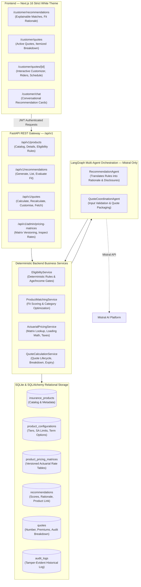
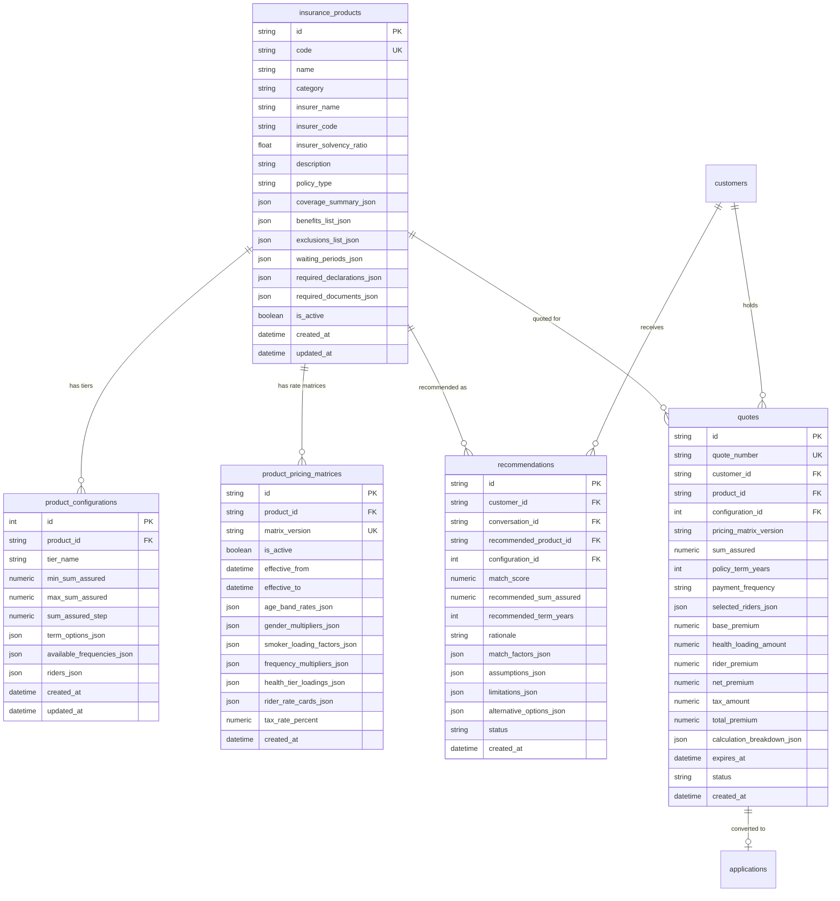

# PS-21 — Phase 6 Technical Specification & Implementation Plan
## Insurance Recommendation and Quotation Engine: Deterministic Actuarial Pricing, Multi-Tier Product Catalog & Explainable AI Advising

**Project:** PS-21 Conversational Insurance Acquisition & Onboarding Platform  
**Target Directories:** `microproject/backend` & `microproject/frontend`  
**Parent Guidelines:** `microproject/AGENTS.md` & `microproject/docs/Master_prompt.md`  
**Document Status:** Ready for Execution (Planning Document)  

---

## 1. Executive Summary & Objectives

The primary objective of **Phase 6** is to engineer the **Insurance Recommendation and Quotation Engine** for the PS-21 platform. Following the establishment of foundational AI orchestration (Phase 3), lead pipeline tracking (Phase 4), and the customer dashboard/conversational interface (Phase 5), **Phase 6 implements the core economic and underwriting intelligence of the platform**.

In strict accordance with `Master_prompt.md` (Phase 6: Lines 665–733), `AGENTS.md` (Rules 3, 5, 6, 11), and IRDAI insurance advisory standards, this engine bridges customer needs assessment with actuarially verified insurance products and binding/indicative pricing.

### Primary Objectives of Phase 6:
1. **Multi-Tier Configurable Product Catalog:**
   - Elevate `InsuranceProduct` and `ProductConfiguration` models to support comprehensive underwriting and regulatory fields: product category, insurer profile, eligibility criteria, waiting periods, coverage limits, comprehensive benefits, explicit policy exclusions, required medical/financial declarations, and mandatory onboarding documents.
   - Introduce database-backed, version-controlled **Pricing Matrices** (`ProductPricingMatrix`) to eliminate any possibility of hardcoded or hallucinated rates.
2. **Deterministic Recommendation Subsystem:**
   - Implement an automated, deterministic matching engine (`ProductMatchingService`) that cross-references a customer's validated qualifications (age, income, health tier, tobacco usage, dependents, debt liabilities) against catalog eligibility rules.
   - Calculate deterministic fit scores (0–100) and identify optimal sum assured, primary product tier, alternative policies, coverage gaps, and explicit policy limitations.
3. **Explainable AI Recommendation Agent (`RecommendationAgent`):**
   - Utilize Mistral LLM exclusively to generate transparent, empathetic, customer-friendly explanations of why a specific product was matched, what assumptions were applied, and which exclusions must be considered.
   - Never allow the LLM to invent benefits, modify eligibility decisions, or alter match ratings.
4. **Deterministic Actuarial Quotation Engine (`QuoteCalculationService`):**
   - Implement mathematical, audit-logged premium calculation services based on approved pricing matrices (age band, gender, tobacco status, sum assured, policy term, health loading factors, rider selection, and frequency installment loading).
   - Compute applicable Indian statutory taxes (18% GST).
   - Generate unique, tamper-evident indicative quotes (`QTE-YYYY-XXXXXX`) with a 30-day validity window and complete calculation audit traces.
   - **Zero LLM pricing rule:** LLM never calculates, estimates, or alters premiums.
5. **AI Quote Coordination Agent (`QuoteCoordinationAgent`):**
   - LangGraph-integrated agent that validates quote prerequisites, invokes the deterministic calculation tools, delivers structured quote cards to conversational streams, and enforces regulatory disclaimers.
6. **Customer & Admin User Experience (Strict White SaaS):**
   - **Customer Recommendation Hub (`/customer/recommendations`):** Dynamic recommendation breakdown, match score badges, coverage rationale cards, benefit comparisons, and exclusions disclosure.
   - **Interactive Quote Workspace (`/customer/quotes` & `/customer/quotes/[id]`):** Real-time sum assured slider, term selector, rider customization checkboxes, payment frequency toggles (monthly, quarterly, annually) with instant deterministic re-quoting, and transition to application proposal.
   - **Admin Product & Pricing Matrix Inspector (`/admin/products` & `/admin/pricing`):** Administrative inspection of active actuarial matrix versions, base rates, and loading parameters.

---

## 2. Core Mandates & Non-Negotiable Phase 6 Rules

All Phase 6 architecture, models, services, and UI components must rigorously abide by the governing rules established in `microproject/AGENTS.md`:

| Mandate | Specification & Regulatory Constraint | Strict Enforcement Mechanism |
| :--- | :--- | :--- |
| **No LLM Premium Calculation** | The LLM must NEVER calculate, approximate, or guess insurance premiums. | All pricing calculations are executed in Python inside `QuoteCalculationService` and `ActuarialPricingService` using database matrices. LLM only formats and explains calculated numbers. |
| **No Hardcoded Pricing or Rules** | Product pricing, age bands, smoker loadings, and rider rates must never be hardcoded into Python functions or React components. | Stored in `product_pricing_matrices` and `product_configurations` tables with version identifiers (`v1.0.0-actuarial-2026`). Missing matrix raises `PricingConfigurationException`. |
| **Deterministic Eligibility** | Product eligibility is a binary or graded deterministic decision based on approved criteria. | `EligibilityService` evaluates customer age, tobacco use, income, and pre-existing conditions against database rules. Ineligible products are cleanly rejected with explicit reasons. |
| **Comprehensive Audit Logging** | Every quote calculation and recommendation must be completely auditable. | `Quote.calculation_breakdown_json` stores exact mathematical inputs, formula factors, tax rates, and matrix version. Audit records saved to `audit_logs`. |
| **Indicative Quote Disclaimers** | Indicative quotes must never be represented as guaranteed policy issuance. | Every UI card, API response, and chat message carries the mandatory notice: *"Indicative quote only. Final premium and policy terms are subject to formal underwriting review and insurer approval."* |
| **Exclusive Mistral Provider** | Mistral is the sole permitted LLM provider. No OpenAI, Anthropic, or fake mock fallbacks. | All explanation prompts execute via `MistralClientWrapper`. Network or API failures produce structured exceptions; never fake success. |
| **Customer Data Isolation** | A customer must never see another customer's recommendations or quotes. | Backend endpoints enforce `Quote.customer_id == current_customer.id` via JWT authorization. Advisor access is strictly mediated by role checks. |
| **Strict Enterprise White Theme** | Pure white financial SaaS appearance (`bg-white`, `border-slate-200`, `text-slate-900`, `bg-blue-600`). | No dark mode, no black cards, no arbitrary gradients. Direct import of official shadcn/ui components. |

---

## 3. Technology Stack & Architectural Positioning



---

## 4. Database Schema Enhancements & Migration Plan

Phase 2 and Phase 5 created initial tables for `insurance_products`, `product_configurations`, `recommendations`, and `quotes`. Phase 6 enriches these entities with comprehensive actuarial, underwriting, and compliance structures, and introduces `product_pricing_matrices`.

### 4.1 Enhanced Entity Relationship Diagram



### 4.2 Detailed Column Specifications & Schema Enhancements

#### Table: `insurance_products` (Enhancements)
- `insurer_name` (VARCHAR(150), default "Star Union Life & General"): Insurer entity name.
- `insurer_code` (VARCHAR(50), default "SULG-IN"): Regulatory identifier.
- `insurer_solvency_ratio` (NUMERIC(5,2), default 2.15): IRDAI regulatory solvency health metric.
- `policy_type` (VARCHAR(50), default "individual"): `individual`, `family_floater`, `group`.
- `coverage_summary_json` (JSON): Bulleted summary of standard covers.
- `benefits_list_json` (JSON): List of structured benefits with maximum sub-limits.
- `exclusions_list_json` (JSON): Explicit exclusions (e.g., self-harm, cosmetic surgery, non-prescribed narcotics, hazardous sports).
- `waiting_periods_json` (JSON): Waiting period breakdown (initial 30 days, specific illnesses 24 months, pre-existing conditions 36 months).
- `required_declarations_json` (JSON): List of regulatory questions required at onboarding.
- `required_documents_json` (JSON): Required KYC and financial documents.

#### Table: `product_pricing_matrices` (New Model)
- `id` (VARCHAR(36), PK): UUID.
- `product_id` (VARCHAR(36), FK -> `insurance_products.id`): Associated product.
- `matrix_version` (VARCHAR(50), UNIQUE): Version string (e.g., `v1.0.0-term-2026`).
- `is_active` (BOOLEAN, default True): Active pricing indicator.
- `effective_from` (DATETIME): Effective start date.
- `effective_to` (DATETIME, nullable): Expiration date.
- `age_band_rates_json` (JSON): Rate per ₹1,000 Sum Assured per age band (e.g. `18-25`: 1.25, `26-35`: 1.80, `36-45`: 3.10, `46-55`: 5.80, `56-65`: 11.20).
- `gender_multipliers_json` (JSON): Actuarial risk factors (e.g. `male`: 1.00, `female`: 0.90, `other`: 1.00).
- `smoker_loading_factors_json` (JSON): e.g. `non_smoker`: 1.00, `smoker`: 1.35.
- `frequency_multipliers_json` (JSON): e.g. `annual`: 1.00, `half_yearly`: 0.51, `quarterly`: 0.26, `monthly`: 0.088.
- `health_tier_loadings_json` (JSON): e.g. `preferred_plus`: 0.95, `standard`: 1.00, `substandard_1`: 1.20, `substandard_2`: 1.40.
- `rider_rate_cards_json` (JSON): Base rates per ₹1,000 for optional riders (accidental death, critical illness, waiver of premium).
- `tax_rate_percent` (NUMERIC(5,2), default 18.00): Applicable GST.

#### Table: `recommendations` (Enhancements)
- `configuration_id` (INTEGER, FK -> `product_configurations.id`, nullable): Selected tier.
- `recommended_sum_assured` (NUMERIC(14,2)): Recommended sum assured calculated from needs.
- `recommended_term_years` (INTEGER): Recommended policy tenure.
- `match_factors_json` (JSON): Factor-by-factor breakdown of how the score was derived.
- `assumptions_json` (JSON): Explicit assumptions made by the model.
- `limitations_json` (JSON): Policy exclusions or waiting period limitations relevant to the customer.
- `alternative_options_json` (JSON): Secondary product alternatives for comparison.

#### Table: `quotes` (Enhancements)
- `configuration_id` (INTEGER, FK -> `product_configurations.id`, nullable): Configuration tier.
- `pricing_matrix_version` (VARCHAR(50)): Exact actuarial matrix version used.
- `selected_riders_json` (JSON): Array of chosen riders with individual coverage and cost.
- `health_loading_amount` (NUMERIC(10,2), default 0.00): Loading applied for declared health risks.
- `net_premium` (NUMERIC(10,2)): Base premium + health loading + rider premium before tax.
- `calculation_breakdown_json` (JSON): Fully transparent step-by-step math trace.

---

## 5. Directory Structure & Component Inventory

### 5.1 Backend Additions and Modifications (`microproject/backend`)

```text
backend/app/
├── models/
│   ├── product.py                         # Updated: Added insurer fields, exclusions, docs, declarations
│   ├── pricing_matrix.py                  # NEW: ProductPricingMatrix model with actuarial tables
│   ├── recommendation.py                  # Updated: Added match factors, assumptions, alternatives
│   └── __init__.py                        # Updated: Export new models
├── schemas/
│   ├── product.py                         # Updated: Comprehensive schemas with benefits, exclusions
│   ├── pricing_matrix.py                  # NEW: Pydantic schemas for pricing matrices
│   ├── recommendation.py                  # NEW: RecommendationCreate, Response, Evaluation schemas
│   └── quote.py                           # Updated: Detailed calculation breakdown, rider selection
├── repositories/
│   ├── product_repository.py              # Updated: Methods for category lookup, active matrices
│   ├── pricing_matrix_repository.py       # NEW: Repository for actuarial pricing matrices
│   ├── recommendation_repository.py       # NEW: Repository for recommendation persistence
│   └── quote_repository.py                # Updated: Detailed queries with customer isolation
├── services/
│   ├── eligibility_service.py             # NEW: Deterministic eligibility gatekeeper
│   ├── product_matching_service.py        # NEW: Deterministic fit scoring and category matching
│   ├── actuarial_pricing_service.py       # NEW: Pure mathematical matrix calculation engine
│   ├── quote_service.py                   # Updated: Full quote lifecycle, audit trail, versioning
│   └── recommendation_service.py          # NEW: Coordination of matching, Mistral AI explanation
├── ai/
│   ├── agents/
│   │   ├── definitions/
│   │   │   ├── recommendation_agent.py    # NEW: Mistral explainable recommendation agent
│   │   │   └── quote_coordination_agent.py# NEW: LangGraph quote assistant node
│   │   └── registry.py                    # Updated: Register new agents
│   └── tools/
│       ├── recommendation_tools.py        # NEW: Validated tool definitions for LangGraph
│       └── quote_tools.py                 # NEW: Deterministic calculation tools exposed to LangGraph
├── api/
│   └── v1/
│       ├── products.py                    # Updated: Catalog filtering, details, requirements
│       ├── recommendations.py             # NEW: Endpoints for generating and retrieving recommendations
│       ├── quotes.py                      # Updated: Endpoints for calculating, comparing, and customizing quotes
│       ├── admin_pricing.py               # NEW: Admin endpoints to inspect and version pricing matrices
│       └── api.py                         # Updated: Mount new routers
└── db/
    ├── seed_products.py                   # Updated: Seed rich insurance products with full exclusions/benefits
    └── seed_pricing_matrices.py           # NEW: Seed official actuarial pricing matrices (v1.0.0)
```

### 5.2 Frontend Additions and Modifications (`microproject/frontend`)

```text
frontend/src/
├── app/
│   └── customer/
│       ├── recommendations/
│       │   └── page.tsx                   # NEW: Comprehensive recommendation presentation page
│       └── quotes/
│           ├── page.tsx                   # Updated: Indicative quotes hub, comparison drawer
│           └── [id]/
│               └── page.tsx               # NEW: Deep quote breakdown, rider toggles, math schedule
├── components/
│   └── customer/
│       ├── recommendations/
│       │   ├── recommendation-card.tsx    # NEW: Match score gauge, primary recommendation card
│       │   ├── coverage-fit-breakdown.tsx # NEW: Accordion showing fit reasons & assumptions
│       │   ├── policy-exclusions-card.tsx # NEW: Prominent disclosure of exclusions & waiting periods
│       │   └── alternative-options.tsx    # NEW: Side-by-side comparison with other tiers
│       └── quotes/
│           ├── quote-summary-card.tsx     # NEW: Visual price badge, validity counter, CTA
│           ├── premium-breakdown-table.tsx# NEW: Transparent line-item math (Base, Loading, GST)
│           ├── rider-selection-list.tsx   # NEW: Dynamic rider toggles with live price update
│           ├── frequency-selector.tsx     # NEW: Monthly / Quarterly / Annual installment selector
│           └── quote-disclaimer-alert.tsx # NEW: Statutory IRDAI indicative quote disclosure
├── services/
│   ├── recommendation.service.ts          # NEW: API client for recommendations
│   ├── quote.service.ts                   # Updated: API client for quotes, re-quoting, customizers
│   └── product.service.ts                 # Updated: Extended client for rich product schemas
└── types/
    ├── recommendation.ts                  # NEW: TypeScript types for recommendations and fit factors
    ├── quote.ts                           # Updated: Types for pricing breakdown, riders, matrix version
    └── product.ts                         # Updated: Types for benefits, exclusions, waiting periods
```

---

## 6. Detailed Backend Specifications

### 6.1 Deterministic Pricing Matrix Architecture

The actuarial pricing matrices are structured to reflect real Indian life and health insurance rate cards. Under no circumstances is pricing calculated via free-form prompts or random multipliers.

#### Mathematical Calculation Formula:

$$\text{Base Annual Premium} = \left(\frac{\text{Sum Assured}}{1000}\right) \times \text{Base Rate}(\text{AgeBand}, \text{Term}) \times \text{Gender Multiplier} \times \text{Smoker Factor}$$

$$\text{Health Loaded Premium} = \text{Base Annual Premium} \times \text{Health Tier Factor}$$

$$\text{Rider Premium} = \sum_{r \in \text{Selected Riders}} \left(\frac{\text{Rider Sum Assured}}{1000}\right) \times \text{Rider Rate}_r$$

$$\text{Annual Net Premium} = \text{Health Loaded Premium} + \text{Rider Premium}$$

$$\text{Installment Premium} = \text{Annual Net Premium} \times \text{Frequency Factor}$$

$$\text{GST (Taxes)} = \text{Installment Premium} \times 18\%$$

$$\text{Total Premium Payable} = \text{Installment Premium} + \text{GST}$$

### 6.2 Deterministic Product Matching Algorithm

The `ProductMatchingService` scores products between 0 and 100 based on four objective dimensions:

1. **Category & Goal Alignment (Weight: 35%)**:
   - Matches primary customer goal (`family_protection` -> `term_life`, `health_hospitalization` -> `health`, `wealth_protection` -> `critical_illness`).
2. **Coverage Adequacy (Weight: 30%)**:
   - Evaluates whether the product configuration's sum assured tier adequately covers the customer's calculated Human Life Value (HLV) or required health coverage buffer.
3. **Financial Affordability & Capacity (Weight: 20%)**:
   - Compares the estimated annual premium against the customer's declared annual disposable income. Recommended guidelines stipulate that term insurance premiums should not exceed 3–5% of gross annual income.
4. **Health & Underwriting Admissibility (Weight: 15%)**:
   - Cross-references the customer's declared health tier (`preferred_plus`, `standard`, `substandard`) with product underwriting boundaries and pre-existing waiting period tolerance.

### 6.3 Pydantic Data Contracts

#### Recommendation Evaluation Contract:
```python
class RecommendationResponse(BaseModel):
    id: str
    customer_id: str
    product_id: str
    product_code: str
    product_name: str
    product_category: str
    tier_name: str
    match_score: float = Field(..., ge=0, le=100)
    recommended_sum_assured: float
    recommended_term_years: int
    rationale: str
    match_factors: Dict[str, Any]
    assumptions: List[str]
    limitations: List[str]
    alternative_options: List[Dict[str, Any]]
    status: str
    created_at: datetime
```

#### Actuarial Quote Request and Calculation Contract:
```python
class QuoteCalculationRequest(BaseModel):
    product_id: str
    configuration_id: Optional[int] = None
    sum_assured: float = Field(..., gt=0)
    policy_term_years: int = Field(..., gt=0, le=50)
    payment_frequency: Literal["monthly", "quarterly", "half_yearly", "annually"] = "annually"
    selected_rider_codes: List[str] = Field(default_factory=list)

class DetailedQuoteResponse(BaseModel):
    id: str
    quote_number: str
    customer_id: str
    product_id: str
    product_name: str
    product_code: str
    category: str
    tier_name: str
    pricing_matrix_version: str
    sum_assured: float
    policy_term_years: int
    payment_frequency: str
    selected_riders: List[Dict[str, Any]]
    base_premium: float
    health_loading_amount: float
    rider_premium: float
    net_premium: float
    tax_amount: float
    total_premium: float
    calculation_breakdown: Dict[str, Any]
    expires_at: datetime
    is_expired: bool
    status: str
    created_at: datetime
    disclaimer: str = (
        "Indicative quote only. Final premium and policy terms are subject to formal "
        "underwriting review and insurer acceptance."
    )
```

### 6.4 Explainable AI: Recommendation Agent Implementation

The `RecommendationAgent` interacts with Mistral using a strictly structured prompt pattern. It receives the deterministic matching results and outputs verified customer-facing text:

```python
RECOMMENDATION_EXPLANATION_PROMPT = """
You are the Senior Insurance Advisory Agent for PS-21.
Your task is to explain why a specific insurance product was recommended to a customer based on deterministic matching data.

CRITICAL CONSTRAINTS:
1. You must ONLY use the provided product benefits, rules, and match factors.
2. NEVER invent benefits, coverages, waiting periods, or policy terms.
3. NEVER calculate or modify premiums or quotes.
4. Clearly state key assumptions and mandatory policy exclusions.
5. Emphasize that all coverage is subject to formal underwriting review.

Customer Profile:
{customer_profile_json}

Deterministic Recommendation:
{recommendation_data_json}

Product Information:
{product_catalog_json}

Provide a structured, empathetic, and clear explanation covering:
- Primary reasons for recommendation
- How the coverage amount matches their needs
- Key policy exclusions and waiting periods they must know
- Important assumptions applied
"""
```

---

## 7. Frontend User Experience Specifications (Strict Enterprise White Theme)

All frontend components adhere strictly to the **Pure Enterprise White Theme**:
- Surfaces: `bg-white`, `bg-slate-50`
- Borders: `border-slate-200`, `border-slate-300`
- Typography: `text-slate-900` (headings), `text-slate-600` (body), `text-slate-500` (captions)
- Accents: `bg-blue-600`, `hover:bg-blue-700`, `text-blue-600`, `border-blue-200`
- Badges: `bg-blue-50 text-blue-700 border-blue-200`, `bg-emerald-50 text-emerald-700 border-emerald-200` (Success/Match)
- Components: Directly imported from `@/components/ui/*`.

### 7.1 Recommendation Overview Screen (`/customer/recommendations`)

- **Hero Header:** Displays the customer's assessed goal, target sum assured, and recommendation generation timestamp.
- **Top Match Card:**
  - High-impact clean white card with an emerald match score badge (`96% Match`).
  - Product title, insurer name, solvency ratio badge (`IRDAI Solvency 2.15x`).
  - Recommended sum assured (e.g., ₹1,00,00,000) and tenure (e.g., 30 years).
  - Clear itemized bullet points generated by Mistral explaining the match rationale.
- **Coverage Fit & Assumptions Accordion:**
  - Expandable shadcn `Accordion` itemizing financial protection rationale, family dependency horizon, and health tier compatibility.
- **Statutory Exclusions & Waiting Periods Drawer/Card:**
  - Distinct warning-bordered card detailing standard exclusions (pre-existing condition waiting period, non-covered treatments) to ensure compliance.
- **Action Toolbar:**
  - `Generate Indicative Quote` (primary blue button linking directly to quotation workflow).
  - `Compare with Alternatives` (secondary outline button opening side-by-side modal).

### 7.2 Interactive Quote Hub & Customizer (`/customer/quotes` & `/customer/quotes/[id]`)

- **Interactive Configuration Controls:**
  - **Sum Assured Slider & Number Input:** Bound to product configuration boundaries with immediate live recalculation.
  - **Policy Term Dropdown:** Configurable options (10, 15, 20, 25, 30, 35 years).
  - **Payment Frequency Toggle Group:** Segmented buttons for `Monthly`, `Quarterly`, `Half-Yearly`, and `Annually` with installment amounts clearly shown.
  - **Optional Rider Checkbox Group:** Toggle riders (Accidental Death, Critical Illness, Premium Waiver) with instant additive pricing updates.
- **Itemized Actuarial Math Breakdown:**
  - Detailed, transparent invoice-style table:
    - Base Annual Premium: ₹18,400.00
    - Smoker / Health Risk Loading: ₹0.00
    - Selected Riders (Accidental Death + Critical Illness): ₹3,200.00
    - Net Premium: ₹21,600.00
    - Frequency Multiplier Loading: ₹0.00 (Annual)
    - Goods & Services Tax (GST @ 18%): ₹3,888.00
    - **Total Indicative Premium:** ₹25,488.00 / year
- **Pricing Provenance & Audit Footer:**
  - Displays `Pricing Source: APPROVED_CONFIG_V1 (v1.0.0-term-2026)`, `Quote Number: QTE-2026-847291`, `Valid until: 30 days from creation`.
- **Primary CTA:**
  - `Apply for this Policy` button transitioning the quote into Phase 7 Application Onboarding.

---

## 8. Step-by-Step Implementation Roadmap

Phase 6 implementation is broken down into structured, sequential steps:

### Milestone 1: Database Models & Actuarial Pricing Matrices
1. Create `microproject/backend/app/models/pricing_matrix.py` defining `ProductPricingMatrix`.
2. Enhance `InsuranceProduct` in `product.py` with insurer details, benefits, exclusions, waiting periods, declarations, and required documents.
3. Enhance `Recommendation` and `Quote` models with configuration links, rider arrays, net premiums, and matrix versioning.
4. Create Alembic migration script applying these schema enhancements to SQLite.
5. Create `seed_pricing_matrices.py` and enrich `seed_products.py` with realistic Indian market products and actuarial tables.

### Milestone 2: Deterministic Business Engine (Services Layer)
1. Build `EligibilityService` (`eligibility_service.py`) for evaluating customer qualification against catalog rules.
2. Build `ProductMatchingService` (`product_matching_service.py`) executing multi-factor fit scoring.
3. Build `ActuarialPricingService` (`actuarial_pricing_service.py`) executing exact formula-based pricing math.
4. Refactor and upgrade `QuoteService` (`quote_service.py`) with full breakdown generation, rider computation, and audit persistence.
5. Build `RecommendationService` (`recommendation_service.py`) orchestrating matching and persistence.

### Milestone 3: Mistral AI Integration & LangGraph Agents
1. Implement `RecommendationAgent` (`app/ai/agents/definitions/recommendation_agent.py`) using Mistral structured outputs.
2. Implement `QuoteCoordinationAgent` (`app/ai/agents/definitions/quote_coordination_agent.py`) in LangGraph.
3. Define validated calculation tools in `app/ai/tools/quote_tools.py` and `app/ai/tools/recommendation_tools.py`.
4. Register agents and tools in `app/ai/agents/registry.py` and `app/ai/tools/registry.py`.

### Milestone 4: REST API Endpoints & RBAC Validation
1. Create `/api/v1/recommendations` router for generating and viewing recommendations.
2. Upgrade `/api/v1/quotes` router with calculation, recalculation, customizer, and comparison endpoints.
3. Update `/api/v1/products` router to expose rich benefit, exclusion, and configuration structures.
4. Implement `/api/v1/admin/pricing-matrices` router for authorized inspection of actuarial matrices.

### Milestone 5: Frontend Experience & UI Components
1. Create TypeScript types in `frontend/src/types/` for recommendations, quotes, and pricing matrices.
2. Build frontend services in `frontend/src/services/` for API communication.
3. Build customer recommendation view in `frontend/src/app/customer/recommendations/page.tsx` and accompanying components.
4. Build interactive quotation customizer in `frontend/src/app/customer/quotes/page.tsx` and `frontend/src/app/customer/quotes/[id]/page.tsx`.
5. Implement statutory compliance disclaimers and breakdown tables.

### Milestone 6: Automated Verification & Audit Trail Testing
1. Execute unit tests verifying deterministic math calculations across all age, gender, smoker, and term variations.
2. Execute eligibility tests verifying proper rejection of out-of-boundary applications.
3. Execute quote audit tests verifying exact JSON breakdown fidelity and matrix version tracking.
4. Execute customer isolation tests verifying cross-customer access prevention.

---

## 9. Automated Test Strategy & Scenarios

To ensure the highest reliability and regulatory compliance, Phase 6 incorporates automated test suites in `microproject/backend/tests/`:

| Test Suite | File | Coverage Focus |
| :--- | :--- | :--- |
| **Actuarial Math Unit Tests** | `test_actuarial_pricing.py` | Validates that base rates, smoker loading (1.35x), gender factors (0.90x), frequency installment multipliers, and 18% GST match exact mathematical tables. Zero floating point rounding drift. |
| **Eligibility Rule Tests** | `test_eligibility_service.py` | Tests age limits (min 18, max 65), income minimums, and health tier rules. Ensures ineligible profiles are rejected with clear reasons. |
| **Product Matching Tests** | `test_product_matching.py` | Tests scoring consistency. Verifies that customer profiles consistently receive the highest fit score for their designated category. |
| **Quote Isolation & Security** | `test_quote_permissions.py` | Verifies that Customer A receives HTTP 403 Forbidden when attempting to read or modify Customer B's quote. |
| **Negative Pricing Tests** | `test_pricing_errors.py` | Verifies that requesting a quote for an inactive matrix or unconfigured sum assured raises a clean, structured exception without falling back to random numbers. |
| **AI Recommendation Traceability** | `test_recommendation_agent.py` | Tests that Mistral client responses validate cleanly against `RecommendationResponse` schema with complete factor explanations. |

---

## 10. Acceptance & Completion Criteria

Phase 6 will be certified complete when all of the following requirements from `Master_prompt.md` and `AGENTS.md` are demonstrably satisfied:

1. **Deterministic Actuarial Calculations:** All quote premiums (base, riders, taxes, total) are computed strictly through database pricing matrices and Python formulas. Zero LLM guessing.
2. **Comprehensive Product Catalog:** Products in SQLite feature configurable insurer information, coverage limits, comprehensive benefits, explicit policy exclusions, waiting periods, declarations, and document lists.
3. **Traceable Recommendations:** Recommendations store numerical match scores, structured match factors, explicit assumptions, and alternatives in SQLite.
4. **Explainable AI Integration:** Mistral successfully generates customer-facing rationales and disclosures grounded strictly in database facts without hallucinations.
5. **Auditable Quotes:** Every quote generates a unique `QTE-YYYY-XXXXXX` identifier, 30-day expiration timestamp, matrix version string, and complete mathematical audit breakdown.
6. **Statutory Disclaimers:** All customer UI screens and API responses display unambiguous indicative quote disclaimers.
7. **Strict Enterprise White UI:** All screens (`/customer/recommendations`, `/customer/quotes`, `/customer/quotes/[id]`) adhere strictly to the pure white SaaS aesthetic with directly imported shadcn/ui components.
8. **Customer Isolation Enforced:** Backend RBAC strictly forbids cross-customer quote or recommendation access.
9. **Full Automated Test Pass:** All actuarial, eligibility, and authorization tests pass with zero failures.

---
*End of Phase 6 Technical Specification & Implementation Plan.*
