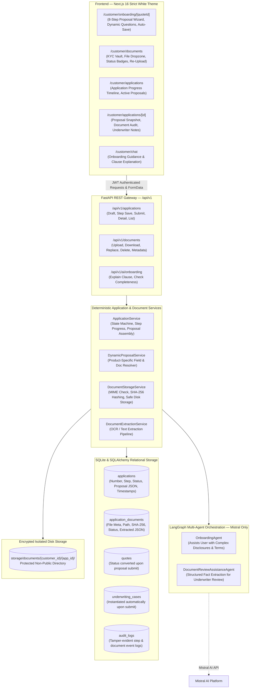
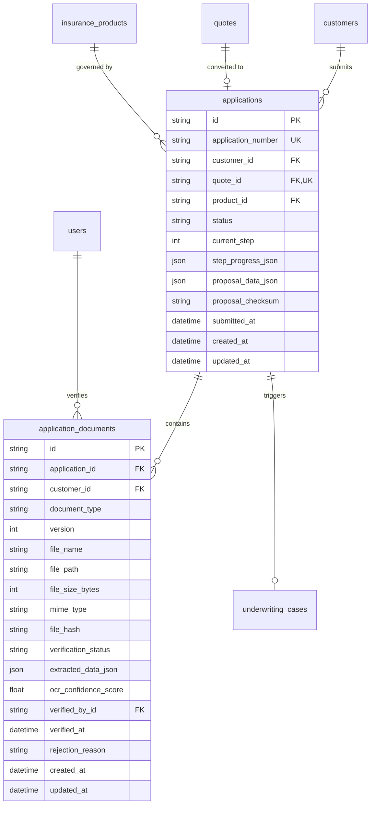
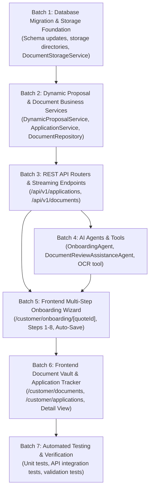

# PS-21 — Phase 7 Technical Specification & Implementation Plan
## Application Onboarding & Document Management: Dynamic Multi-Step Proposals, Secure KYC Vault & Explainable Onboarding AI

**Project:** PS-21 Conversational Insurance Acquisition & Onboarding Platform  
**Target Directories:** `microproject/backend` & `microproject/frontend`  
**Parent Guidelines:** `microproject/AGENTS.md` & `microproject/docs/Master_prompt.md` (Phase 7: Lines 734–788)  
**Document Status:** Ready for Execution (Planning Document)  

---

## 1. Executive Summary & Objectives

The primary objective of **Phase 7** is to engineer the end-to-end **Application Onboarding and Document Management System** for the PS-21 platform. Following the successful delivery of deterministic recommendations and actuarial quote generation (Phase 6), **Phase 7 translates indicative quotes into legally sound, verifiable insurance proposal submissions backed by a tamper-evident document vault**.

In strict compliance with `Master_prompt.md` (Phase 7: Lines 734–788), `AGENTS.md` (Rules 3, 5, 6, 8, 9, 10, 11), IRDAI (Insurance Regulatory and Development Authority of India) guidelines, Section 45 of the Insurance Act 1938, and the Digital Personal Data Protection (DPDP) Act 2023, this phase establishes:

### Primary Objectives of Phase 7:
1. **Dynamic Multi-Step Proposal Onboarding Engine:**
   - Implement an intelligent, 8-step structured proposal questionnaire: Personal Demographics, Contact & Addresses, Occupational & Financial Background, Family & Dependents, Existing Insurance Coverage, Medical & Lifestyle Disclosures, Nominee & Appointee Designations, and Statutory Declarations & Consent.
   - Tailor form requirements dynamically based on product catalog definitions (`required_declarations_json` and `required_documents_json`) and customer age/sum-assured thresholds (e.g., mandatory ITR for Sum Assured > ₹50 Lakhs; specialized cardiac/diabetes declarations for age > 45).
2. **Persistent Proposal Drafts & State Resumption:**
   - Incremental auto-save and draft restoration allowing customers to pause and resume multi-step proposal journeys across devices without losing progress (`status="draft"`, `current_step`, `step_progress_json`).
3. **Enterprise Secure Document Vault & Management Subsystem:**
   - Multipart file upload engine with strict MIME-type allowlisting (`application/pdf`, `image/jpeg`, `image/png`), strict 10MB file size limits, and sanitization against path-traversal attacks.
   - Cryptographic integrity hashing using SHA-256 upon file ingest.
   - Isolated physical storage (`storage/documents/<customer_id>/<application_id>/`) with zero public URL exposure; access is mediated through customer-scoped and RBAC-authorized streaming endpoints.
   - Full lifecycle management: upload, metadata indexing, document versioning, document replacement upon underwriter rejection, and tamper-evident audit logging.
4. **AI-Assisted Document Extraction & Review (`DocumentReviewAssistanceAgent`):**
   - Mistral-powered structured document analysis tool to extract and pre-populate key verification fields (PAN name matching, date-of-birth consistency, salary slip gross figures).
   - **Strict Non-Negotiable Rule:** Extracted data is strictly treated as advisory/untrusted until explicitly verified by an authorized human underwriter or customer confirmation. No document is ever marked `verified` automatically merely because extraction succeeded.
5. **Conversational Onboarding Guide (`OnboardingAgent`):**
   - LangGraph-integrated conversational assistant operating within the onboarding wizard to explain statutory requirements (e.g., Section 45 3-year incontestability rule), assist with nominee guidelines, and clarify medical declaration questions.
6. **Proposal Review, E-Signature & Underwriting Handoff:**
   - Formal proposal submission producing an immutable proposal snapshot, SHA-256 e-signature hash, automatic quote status conversion to `converted`, and immediate instantiation of an `UnderwritingCase` in the advisor/underwriter queue.
7. **Customer User Experience (Strict White SaaS Theme):**
   - **Multi-Step Onboarding Wizard (`/customer/onboarding/[quoteId]`):** Clean step navigation bar, real-time Zod validation, responsive card layouts, auto-save status indicators, and summary review screens.
   - **Centralized Document Vault (`/customer/documents`):** Complete customer document repository with upload dropzones, verification status badges (`Pending`, `Extracted`, `Verified`, `Rejected`), rejection notes, and re-upload triggers.
   - **Application Tracking Workspace (`/customer/applications` & `/customer/applications/[id]`):** Real-time visual progress tracker (Draft $\rightarrow$ Submitted $\rightarrow$ Underwriting Review $\rightarrow$ Decision), comprehensive proposal preview card, and document audit records.

---

## 2. Core Mandates & Non-Negotiable Phase 7 Rules

All Phase 7 architecture, database schemas, services, API routes, and React components must adhere to the following non-negotiable rules:

| Mandate | Specification & Regulatory Constraint | Strict Enforcement Mechanism |
| :--- | :--- | :--- |
| **No Auto-Verification of Documents** | Extracted OCR or AI document data must never automatically mark a document as `verified`. | `verification_status` remains `pending` or `extracted_unverified` until an authorized human Underwriter or Advisor explicitly reviews and signs off. |
| **Tamper-Evident Document Integrity** | All customer uploaded documents must be protected against tampering and corruption. | Every uploaded document file is hashed with SHA-256 immediately upon ingest; the hash is stored in `application_documents.file_hash` and verified on access. |
| **Isolated & Authorized Document Access** | Documents must never be served via public or unauthenticated static routes. | Files are served via `/api/v1/documents/{id}/download` with strict JWT ownership checks (`doc.customer_id == current_user.customer.id` or user holds `Advisor`/`Underwriter` role). |
| **Zero Hardcoding in Proposal Rules** | Document requirements, medical question triggers, and declaration clauses must not be hardcoded in UI components. | Loaded dynamically from `insurance_products.required_declarations_json` and `insurance_products.required_documents_json`. |
| **Statutory Disclosure Enforceability** | Applications cannot be submitted without explicit Section 45 disclosure and DPDP Act consent. | Backend Pydantic validator rejects proposal submission if `statutory_declarations.agreed_to_section_45` or `consent.data_processing_consent` is False. |
| **Exclusive Mistral Provider** | Mistral is the sole permitted LLM provider for the `OnboardingAgent` and document extraction assistance. | Invocations routed strictly through `MistralClientWrapper`. Network or API failures produce structured exceptions; never fake success or substitute third-party models. |
| **Strict Enterprise White Theme** | Pure white financial SaaS appearance (`bg-white`, `border-slate-200`, `text-slate-900`, `bg-blue-600`). | No dark mode, no black cards, no arbitrary gradients. Direct import of official shadcn/ui components (`Progress`, `Tabs`, `Dialog`, `Alert`, `Badge`, `Card`). |
| **Draft Persistence & Non-Loss of State** | Customers must not lose proposal form data upon navigation, tab close, or session timeout. | Auto-save hook debounces changes to `PUT /api/v1/applications/{id}/draft` storing `proposal_data_json` and `current_step`. |

---

## 3. Technology Stack & Architectural Positioning



---

## 4. Database Schema Enhancements & Migration Plan

The existing schema in `backend/app/models/application.py` provides initial definitions for `Application` and `ApplicationDocument`. Phase 7 enriches both tables to support the complete proposal lifecycle, step persistence, cryptographic checksums, OCR extraction payloads, and versioned document replacements.

### 4.1 Enhanced Entity Relationship Diagram



### 4.2 Detailed Column Specifications & Schema Enhancements

#### Table: `applications` (Enhancements)
- `id` (VARCHAR(36), PK): UUID.
- `application_number` (VARCHAR(50), UNIQUE, INDEX): Format `APP-YYYY-XXXXXX`.
- `customer_id` (VARCHAR(36), FK $\rightarrow$ `customers.id`, INDEX): Scoped applicant.
- `quote_id` (VARCHAR(36), FK $\rightarrow$ `quotes.id`, UNIQUE, INDEX): Converted quote.
- `product_id` (VARCHAR(36), FK $\rightarrow$ `insurance_products.id`, INDEX): Associated insurance plan.
- `status` (VARCHAR(50), default `"draft"`, INDEX): Lifecycle state:
  - `draft`: Customer actively filling steps.
  - `documents_pending`: Proposal details filled, awaiting mandatory documents.
  - `submitted`: Final proposal and mandatory KYC submitted; ready for underwriting.
  - `under_review`: Underwriting case actively assigned and being processed.
  - `additional_info_required`: Underwriter returned proposal requesting clarifications or additional documents.
  - `approved`: Underwriter approved; pending policy issuance.
  - `rejected`: Proposal declined.
- `current_step` (INTEGER, default `1`): Current step number (1 to 8).
- `step_progress_json` (JSON): Object tracking section completeness:
  ```json
  {
    "personal_info": true,
    "contact_address": true,
    "occupational_financial": true,
    "family_coverage": true,
    "medical_lifestyle": true,
    "nominee_details": true,
    "statutory_declarations": true,
    "document_upload": false
  }
  ```
- `proposal_data_json` (JSON): Full consolidated proposal payload (personal, nominee, medical declarations, etc.).
- `proposal_checksum` (VARCHAR(64), nullable): SHA-256 hash of consolidated `proposal_data_json` generated upon submission for tamper evidence.
- `submitted_at` (DATETIME, nullable): Exact submission timestamp.
- `created_at` / `updated_at` (DATETIME): Audit timestamps.

#### Table: `application_documents` (Enhancements)
- `id` (VARCHAR(36), PK): UUID.
- `application_id` (VARCHAR(36), FK $\rightarrow$ `applications.id`, INDEX): Associated proposal.
- `customer_id` (VARCHAR(36), FK $\rightarrow$ `customers.id`, INDEX): Owning customer.
- `document_type` (VARCHAR(50), INDEX): Standard categories:
  - `identity_proof`: PAN Card, Passport, Voter ID.
  - `address_proof`: Aadhaar Card, Electricity Bill, Rental Agreement.
  - `income_proof`: 3-month Salary Slips, Form 16, ITR-V Assessment.
  - `medical_report`: Medical Examination Report (MER), Blood/Urine profile, ECG.
  - `photograph`: Passport-sized photograph.
  - `age_proof`: Birth Certificate, School Leaving Certificate.
- `version` (INTEGER, default `1`): Increments upon re-upload / replacement.
- `file_name` (VARCHAR(255)): Original sanitized client file name.
- `file_path` (VARCHAR(500)): Relative file path in storage vault.
- `file_size_bytes` (INTEGER): File size in bytes (max 10,485,760 bytes = 10 MB).
- `mime_type` (VARCHAR(100)): Verified MIME type (`application/pdf`, `image/jpeg`, `image/png`).
- `file_hash` (VARCHAR(64)): SHA-256 cryptographic digest.
- `verification_status` (VARCHAR(30), default `"pending"`, INDEX):
  - `pending`: Uploaded, awaiting review.
  - `extracted`: AI / OCR extraction completed; pending human review.
  - `verified`: Formally signed off by authorized underwriter/advisor.
  - `rejected`: Disapproved with stated reason (e.g., blurry image, name mismatch).
- `extracted_data_json` (JSON, nullable): Structured output from `DocumentReviewAssistanceAgent` (e.g., extracted PAN number, name on card, date of birth, employer name).
- `ocr_confidence_score` (NUMERIC(5,4), nullable): Confidence score (0.0000 to 1.0000).
- `verified_by_id` (VARCHAR(36), FK $\rightarrow$ `users.id`, nullable): Reviewing employee.
- `verified_at` (DATETIME, nullable): Verification sign-off timestamp.
- `rejection_reason` (VARCHAR(500), nullable): Explicit feedback explaining rejection.
- `created_at` / `updated_at` (DATETIME): Timestamps.

---

## 5. Directory Structure & Component Inventory

```text
microproject/
├── backend/
│   ├── app/
│   │   ├── api/
│   │   │   └── v1/
│   │   │       ├── applications.py            # Enhanced: Draft saving, dynamic fields, multi-step submit
│   │   │       ├── documents.py               # NEW: Secure upload, stream download, replacement, delete
│   │   │       └── ai_onboarding.py           # NEW: AI assistance for terms, clause explanations, and checks
│   │   ├── models/
│   │   │   └── application.py                 # Enhanced: Step tracking, checksums, OCR extraction fields
│   │   ├── schemas/
│   │   │   ├── application.py                 # Enhanced: Proposal sections, step updates, dynamic requirements
│   │   │   └── document.py                    # NEW: Document metadata, upload response, review sign-off
│   │   ├── services/
│   │   │   ├── application_service.py         # NEW: State machine, proposal assembly, underwriting triggering
│   │   │   ├── dynamic_proposal_service.py    # NEW: Resolves dynamic questions/docs per product & customer tier
│   │   │   ├── document_storage_service.py    # NEW: MIME validation, SHA-256 hash, safe disk I/O, streaming
│   │   │   └── document_extraction_service.py # NEW: Orchestrates Mistral OCR text extraction & field parsing
│   │   ├── repositories/
│   │   │   ├── application_repository.py      # Enhanced: Step progression, checksum verification queries
│   │   │   └── document_repository.py         # NEW: Document versioning, customer vault queries
│   │   └── ai/
│   │       ├── agents/
│   │       │   ├── onboarding_agent.py        # NEW: Conversational proposal assistant (Mistral + LangGraph)
│   │       │   └── document_review_agent.py   # NEW: Structured document metadata extraction assistant
│   │       └── tools/
│   │           ├── proposal_validation_tool.py# NEW: Tool to check proposal completeness against catalog rules
│   │           └── document_ocr_tool.py       # NEW: Tool to parse document text into structured Pydantic data
│   └── storage/
│       └── documents/                         # Isolated, secure physical directory for customer files
│
└── frontend/
    └── src/
        ├── app/
        │   └── customer/
        │       ├── onboarding/
        │       │   ├── page.tsx               # Enhanced: Redirects to active proposal or quote selection
        │       │   └── [quoteId]/
        │       │       └── page.tsx           # NEW: 8-Step Interactive Onboarding Wizard
        │       ├── applications/
        │       │   ├── page.tsx               # Enhanced: Real-time Application Tracking Dashboard
        │       │   └── [id]/
        │       │       └── page.tsx           # NEW: Comprehensive Application Detail & Audit Viewer
        │       └── documents/
        │           └── page.tsx               # Enhanced: Centralized KYC & Policy Document Vault
        ├── components/
        │   └── customer/
        │       ├── onboarding/
        │       │   ├── step-indicator.tsx     # NEW: Visual 8-step progression bar with completion icons
        │       │   ├── step-personal.tsx      # NEW: Step 1: Personal Demographics & Identity (PAN/Aadhaar)
        │       │   ├── step-address.tsx       # NEW: Step 2: Residential & Permanent Addresses
        │       │   ├── step-employment.tsx    # NEW: Step 3: Occupation, Income, Tax & PEP Declarations
        │       │   ├── step-family.tsx        # NEW: Step 4: Family Dependents & Existing Insurance
        │       │   ├── step-medical.tsx       # NEW: Step 5: Dynamic Health & Lifestyle Disclosures
        │       │   ├── step-nominee.tsx       # NEW: Step 6: Nominee Shares & Minor Appointee Info
        │       │   ├── step-statutory.tsx     # NEW: Step 7: Section 45 Warnings & DPDP Act Consent
        │       │   ├── step-documents.tsx     # NEW: Step 8: Multi-Document Upload & Drag-and-Drop
        │       │   ├── step-review.tsx        # NEW: Step 9: Final Proposal Summary & E-Signature
        │       │   └── onboarding-ai-drawer.tsx# NEW: Inline chat drawer for AI question clarification
        │       ├── documents/
        │       │   ├── document-upload-card.tsx# NEW: Upload dropzone with MIME/size validation
        │       │   ├── document-table.tsx     # NEW: Vault table with status badges and download links
        │       │   └── document-reupload-dialog.tsx # NEW: Modal for replacing rejected documents
        │       └── applications/
        │           ├── application-card.tsx   # NEW: Card showing proposal status, plan, and actions
        │           ├── application-timeline.tsx# NEW: Milestones timeline (Submitted -> Review -> Decision)
        │           └── proposal-summary-view.tsx# NEW: Read-only summary of submitted proposal data
        ├── services/
        │   ├── application.service.ts         # NEW: Frontend client for draft saving, step updates, submit
        │   └── document.service.ts            # NEW: Frontend client for multipart upload, download, re-upload
        └── types/
            ├── application.ts                 # NEW: TypeScript interfaces for proposal steps, draft, response
            └── document.ts                    # NEW: TypeScript interfaces for document vault & verification
```

---

## 6. Detailed Backend Specifications

### 6.1 Dynamic Proposal Schema Architecture

Insurance products have diverse declaration and document requirements. For instance:
- **Term Life Insurance (Sum Assured > ₹50 Lakhs):** Requires 3-year ITR or Form 16, mandatory nominee designation with 100% total allocation, and smoker/tobacco frequency declarations.
- **Health Insurance:** Requires disclosure of pre-existing conditions (diabetes, hypertension, asthma, thyroid), hospitalization records in the past 48 months, and family medical history.
- **Motor Insurance:** Requires vehicle registration details, previous claim history, and no-claim bonus (NCB) declaration.

The `DynamicProposalService` reads `InsuranceProduct.required_declarations_json` and `InsuranceProduct.required_documents_json`, combining them with statutory IRDAI mandates to deliver a tailored schema to the frontend wizard.

#### Canonical Dynamic Declaration Definition:
```json
{
  "declarations": [
    {
      "id": "dec_tobacco",
      "category": "lifestyle",
      "question": "Have you used any form of tobacco, nicotine, or cigarettes in the past 36 months?",
      "field_type": "boolean",
      "required": true,
      "sub_fields_on_true": [
        { "id": "tobacco_type", "label": "Type of tobacco", "field_type": "select", "options": ["Cigarettes", "Bidi", "Cigar", "Chewing Tobacco"] },
        { "id": "tobacco_quantity_per_day", "label": "Average units per day", "field_type": "number", "min": 1 }
      ]
    },
    {
      "id": "dec_pre_existing_diabetes",
      "category": "medical",
      "question": "Have you ever been diagnosed or treated for Diabetes, Elevated Blood Sugar, or Glycosuria?",
      "field_type": "boolean",
      "required": true,
      "sub_fields_on_true": [
        { "id": "diabetes_diagnosis_year", "label": "Year of diagnosis", "field_type": "number" },
        { "id": "diabetes_treatment_type", "label": "Current treatment", "field_type": "select", "options": ["Diet Control", "Oral Medication", "Insulin"] }
      ]
    }
  ],
  "required_documents": [
    { "type": "identity_proof", "title": "Identity Proof (PAN Card mandatory)", "accepted_formats": ["application/pdf", "image/jpeg", "image/png"], "mandatory": true },
    { "type": "address_proof", "title": "Address Proof (Aadhaar / Passport / Utility Bill)", "accepted_formats": ["application/pdf", "image/jpeg", "image/png"], "mandatory": true },
    { "type": "income_proof", "title": "Income Proof (ITR-V / 3-month Salary Slips)", "accepted_formats": ["application/pdf"], "mandatory": true, "condition": "sum_assured >= 5000000" }
  ]
}
```

### 6.2 Proposal Step Structure & Validation Rules

#### Step 1: Personal Demographics & Identity
- `full_name`: String (2–100 chars), must match official identity proof.
- `date_of_birth`: ISO Date string, must satisfy product age criteria (e.g., 18–65 years).
- `gender`: `male` | `female` | `other`.
- `marital_status`: `single` | `married` | `divorced` | `widowed`.
- `pan_number`: Regex validation `^[A-Z]{5}[0-9]{4}[A-Z]{1}$`.
- `aadhaar_last_four`: Exactly 4 digits (full Aadhaar numbers are never stored in compliance with UIDAI regulations).
- `nationality`: ISO 2-letter country code (default `IN`).

#### Step 2: Contact & Address Information
- `mobile_number`: Exactly 10 digits starting with 6, 7, 8, or 9 (`^[6-9]\d{9}$`).
- `email`: Valid RFC 5322 email string.
- `residential_address`: Street line 1, line 2, landmark.
- `city`: String.
- `state`: Indian state / union territory from approved list.
- `pincode`: Exactly 6 digits (`^[1-9][0-9]{5}$`).
- `is_permanent_same`: Boolean (if False, permanent address fields are required).

#### Step 3: Occupational & Financial Declarations
- `occupation_type`: `salaried` | `self_employed_professional` | `business_owner` | `retired` | `homemaker` | `student`.
- `employer_or_business_name`: String.
- `designation`: String.
- `nature_of_duties`: `desk_office` | `light_manual` | `heavy_manual` | `hazardous_substances` | `aviation_offshore`.
- `gross_annual_income`: Numeric, must be greater than zero.
- `tax_resident_india_only`: Boolean (FATCA / CRS statutory declaration).
- `politically_exposed_person`: Boolean (PEP declaration).

#### Step 4: Family Dependents & Existing Insurance Coverage
- `dependents`: Array of `{ name, relation, age, financially_dependent: boolean }`.
- `has_existing_insurance`: Boolean.
- `existing_policies`: Array of `{ insurer_name, policy_number, sum_assured, year_issued }`.
- `has_previous_rejections`: Boolean (has any insurer ever declined, postponed, or loaded a proposal). If True, details required.

#### Step 5: Medical & Lifestyle Disclosures
- `height_cm`: Numeric (100–250 cm).
- `weight_kg`: Numeric (30–200 kg).
- `bmi`: Calculated automatically as:
  $$\text{BMI} = \frac{\text{weight in kg}}{(\text{height in meters})^2}$$
- `tobacco_use`: Boolean + details.
- `alcohol_consumption`: `none` | `occasional` | `regular`.
- `pre_existing_conditions`: Dynamic declarations loaded from product configuration.
- `hospitalization_past_5_years`: Boolean + details.
- `family_history_cardiac_or_cancer`: Boolean + details.

#### Step 6: Nominee & Appointee Designations
- Nominees: Array of 1 to 3 nominees:
  - `nominee_name`: String.
  - `relation`: `spouse` | `child` | `parent` | `sibling` | `other`.
  - `date_of_birth`: ISO Date.
  - `share_percentage`: Numeric (1–100).
- **Validation Rule:** The sum of all `share_percentage` fields must equal exactly 100%:
  $$\sum \text{share\_percentage} = 100$$
- If any nominee is a minor ($< 18$ years of age), an **Appointee** is mandatory:
  - `appointee_name`: String.
  - `appointee_relation`: String.
  - `appointee_contact`: 10-digit mobile number.

#### Step 7: Statutory Declarations & Consent
- `declaration_truthfulness`: Boolean (Must be `True` — declares all statements are true and complete).
- `section_45_insurance_act`: Boolean (Must be `True` — acknowledgment of Section 45 of Insurance Act, 1938 regarding 3-year incontestability).
- `dpdp_consent`: Boolean (Must be `True` — consent to process personal and health data under DPDP Act 2023).
- `consent_ckyc_verification`: Boolean (Must be `True` — consent to verify KYC via Central KYC Registry).
- `consent_timestamp`: ISO 8601 UTC timestamp.

#### Step 8: Document Upload
- File uploads for required documents (Identity Proof, Address Proof, Income Proof).
- Minimum requirement: At least 1 valid `identity_proof` and 1 valid `address_proof` before final submission.

---

### 6.3 Secure Document Storage & Streaming Architecture

1. **Upload Sanitation & Validation:**
   - File extensions are stripped and verified against the binary magic bytes using `python-magic` or MIME header verification:
     - `application/pdf` (magic `%PDF-`)
     - `image/jpeg` (magic `\xFF\xD8\xFF`)
     - `image/png` (magic `\x89PNG\r\n\x1a\n`)
   - Maximum file size: $10 \times 1024 \times 1024 = 10,485,760$ bytes (10 MB).
   - Filename is sanitized to prevent directory traversal (`os.path.basename` combined with UUID generation).
2. **Encrypted/Isolated Disk Storage:**
   - Physical location: `microproject/backend/storage/documents/{customer_id}/{application_id}/{document_type}_{uuid}.ext`.
   - File permissions restricted (`0600` on POSIX systems; standard local restricted user access on Windows).
3. **Cryptographic Checksum:**
   - A SHA-256 digest is calculated over the entire byte stream during upload:
     $$\text{file\_hash} = \text{SHA-256}(\text{file\_bytes})$$
   - Recorded in `application_documents.file_hash`.
4. **Authorized Streaming Endpoint:**
   - Files are never accessible via static web server directories.
   - Endpoint: `GET /api/v1/documents/{document_id}/download`
   - Access control:
     ```python
     if "Customer" in user_roles and doc.customer_id != current_user.customer.id:
         raise PermissionDeniedException("You do not have permission to access this document.")
     if "Advisor" in user_roles or "Underwriter" in user_roles:
         # Authorized case assignment verification
         pass
     ```
   - Returned via FastAPI `StreamingResponse` with appropriate `Content-Disposition` and `Content-Type`.

---

### 6.4 AI Agents & Tool Implementations

#### 1. `OnboardingAgent` (LangGraph Assistant)
- **Role:** Guides applicants through complex declarations, explains statutory rules (e.g. why PAN is required, what Section 45 means), and checks if the proposal draft is ready for submission.
- **System Prompt:**
  > You are the PS-21 Application Onboarding Assistant. You help insurance applicants complete their proposal forms accurately. You explain legal and medical disclosures in plain, reassuring language. You never provide medical advice or guarantee policy issuance. You inform customers that all declarations are subject to formal underwriting review.
- **Permitted Tools:**
  - `check_proposal_completeness_tool(application_id)`: Evaluates current step completion and returns missing mandatory items.
  - `explain_insurance_term_tool(term)`: Retrieves approved definitions for insurance clauses (e.g., Section 45, Appointee, Incontestability, Waiting Period).

#### 2. `DocumentReviewAssistanceAgent` (LangGraph Assistant)
- **Role:** Analyzes uploaded document text to assist human underwriters by extracting structured fields (e.g., matching applicant name with PAN card text, identifying annual salary on payslips).
- **System Prompt:**
  > You are an AI Document Assistant for insurance underwriters. You extract structured metadata from document OCR text. You must report extracted fields with confidence levels. You must NEVER mark a document as verified. Formal verification is exclusively reserved for authorized human personnel.
- **Strict Non-Negotiable Enforcement:** Extracted data is saved into `application_documents.extracted_data_json`. `verification_status` is updated to `"extracted"`, **never** `"verified"`.

---

### 6.5 Pydantic API Data Contracts

```python
# backend/app/schemas/application.py

class StepPersonalInfo(BaseModel):
    full_name: str = Field(..., min_length=2, max_length=100)
    date_of_birth: date
    gender: Literal["male", "female", "other"]
    marital_status: Literal["single", "married", "divorced", "widowed"]
    pan_number: str = Field(..., pattern=r"^[A-Z]{5}[0-9]{4}[A-Z]{1}$")
    aadhaar_last_four: str = Field(..., pattern=r"^[0-9]{4}$")
    nationality: str = Field(default="IN", max_length=2)

class StepContactAddress(BaseModel):
    mobile_number: str = Field(..., pattern=r"^[6-9]\d{9}$")
    email: EmailStr
    residential_address_line1: str = Field(..., min_length=5)
    residential_address_line2: Optional[str] = None
    city: str = Field(..., min_length=2)
    state: str = Field(..., min_length=2)
    pincode: str = Field(..., pattern=r"^[1-9][0-9]{5}$")
    is_permanent_same: bool = True
    permanent_address: Optional[Dict[str, Any]] = None

class StepEmploymentFinancial(BaseModel):
    occupation_type: Literal["salaried", "self_employed_professional", "business_owner", "retired", "homemaker", "student"]
    employer_or_business_name: str
    designation: str
    nature_of_duties: Literal["desk_office", "light_manual", "heavy_manual", "hazardous_substances", "aviation_offshore"]
    gross_annual_income: float = Field(..., gt=0)
    tax_resident_india_only: bool = True
    politically_exposed_person: bool = False

class StepNominee(BaseModel):
    nominee_name: str = Field(..., min_length=2)
    relation: Literal["spouse", "child", "parent", "sibling", "other"]
    date_of_birth: date
    share_percentage: float = Field(..., gt=0, le=100)
    appointee_name: Optional[str] = None
    appointee_relation: Optional[str] = None
    appointee_contact: Optional[str] = None

class StepStatutoryDeclarations(BaseModel):
    declaration_truthfulness: bool = True
    section_45_insurance_act: bool = True
    dpdp_consent: bool = True
    consent_ckyc_verification: bool = True
    consent_timestamp: datetime = Field(default_factory=datetime.utcnow)

class ProposalDraftUpdateRequest(BaseModel):
    current_step: int = Field(..., ge=1, le=8)
    step_key: str
    step_data: Dict[str, Any]

class ProposalSubmitRequest(BaseModel):
    e_signature_name: str
    acknowledged_declarations: bool = True

class ApplicationDetailResponse(BaseModel):
    id: str
    application_number: str
    customer_id: str
    quote_id: str
    product_id: str
    product_name: str
    status: str
    current_step: int
    step_progress: Dict[str, bool]
    proposal_data: Optional[Dict[str, Any]]
    proposal_checksum: Optional[str]
    submitted_at: Optional[datetime]
    created_at: datetime
    documents: List["DocumentReadResponse"]
```

---

## 7. Frontend User Experience Specifications (Strict Enterprise White Theme)

### 7.1 Visual & Layout Design Rules
- **Color Tokens:**
  - Page Background: `#FFFFFF` (`bg-white`).
  - Container / Card Surfaces: `#FFFFFF` with `#F8FAFC` (`bg-slate-50`) accents.
  - Borders: `#E2E8F0` (`border-slate-200`).
  - Typography: Primary `#0F172A` (`text-slate-900`), Secondary `#64748B` (`text-slate-500`).
  - Interactive Accent: `#2563EB` (`bg-blue-600 hover:bg-blue-700 text-white`).
  - Status Indicators:
    - Draft: Slate/Gray badge (`bg-slate-100 text-slate-700`).
    - Submitted / Under Review: Blue badge (`bg-blue-50 text-blue-700 border-blue-200`).
    - Verified / Approved: Emerald badge (`bg-emerald-50 text-emerald-700 border-emerald-200`).
    - Rejected / Action Required: Amber/Red badge (`bg-rose-50 text-rose-700 border-rose-200`).
- **Forbidden UI Elements:**
  - No dark backgrounds, dark cards, or black header bars.
  - No fake progress bars that animate without real server events.

### 7.2 Onboarding Wizard Flow (`/customer/onboarding/[quoteId]`)

```text
[Step 1: Identity] ──► [Step 2: Address] ──► [Step 3: Occupation] ──► [Step 4: Family/Coverage]
        ▲                      ▲                     ▲                      ▲
        │                      │                     │                      │
        ▼                      ▼                     ▼                      ▼
[Step 5: Health]   ──► [Step 6: Nominee] ──► [Step 7: Statutory]  ──► [Step 8: Docs & Review]
                                                                            │
                                                                            ▼
                                                                  [Submit to Underwriting]
```

1. **Step Indicator Component (`step-indicator.tsx`):**
   - Horizontal responsive stepper showing numbered circles (1 to 8), labels, and checkmarks for completed steps.
   - Allows direct jumping only to previously validated steps.
2. **Auto-Save & Draft State:**
   - Every input change triggers a debounced (800ms) background call to `PUT /api/v1/applications/{id}/draft`.
   - Visual status pill in header: *"Draft saved automatically at 11:42 AM"*.
3. **Document Dropzone Component (`document-upload-card.tsx`):**
   - Supports drag-and-drop and standard file selector.
   - Shows file name, file size in KB/MB, and instantaneous upload progress bar.
   - Client-side pre-validation: instantly flags file type errors (e.g., trying to upload `.docx` or `.exe`) or files exceeding 10MB.
4. **Interactive AI Guidance Drawer (`onboarding-ai-drawer.tsx`):**
   - Floating assistance button: *"Need Help With This Step?"*
   - Opens a right-side shadcn Sheet containing a conversation with the `OnboardingAgent`, contextualized to the current active step.

### 7.3 Centralized Document Vault (`/customer/documents`)
- Displays all documents ever uploaded by the customer across quotes and proposals.
- Filter by Document Type (`Identity`, `Address`, `Income`, `Medical`).
- Clear verification badges with timestamp and reviewer notes.
- If a document is `rejected`, a prominent amber alert highlights the underwriter's rejection note and displays an instant *"Replace Document"* button opening the upload modal.

### 7.4 Application Tracking (`/customer/applications` & `[id]`)
- Real-time progression milestones:
  1. Proposal Submitted $\rightarrow$
  2. Document Verification $\rightarrow$
  3. Underwriting Assessment $\rightarrow$
  4. Final Decision
- Detailed proposal review drawer displaying a clean, read-only PDF-like summary of all submitted declarations.

---

## 8. Step-by-Step Implementation Roadmap



### Phase 7 Execution Batches:

- **Batch 1: Storage Infrastructure & Schema Enhancements**
  - Create Alembic migration script for `applications` and `application_documents` columns (`current_step`, `step_progress_json`, `proposal_checksum`, `ocr_confidence_score`, `extracted_data_json`, `version`).
  - Initialize secure storage folder structure: `microproject/backend/storage/documents/`.
  - Implement `DocumentStorageService` for safe disk writes, SHA-256 calculation, and streaming file responses.

- **Batch 2: Deterministic Proposal & Document Services**
  - Implement `DynamicProposalService` to resolve required declarations and document checklists per product and customer tier.
  - Implement `ApplicationService` managing draft persistence, step validation, proposal checksum assembly, quote conversion, and `UnderwritingCase` instantiation.
  - Implement `DocumentRepository` and update `ApplicationRepository`.

- **Batch 3: REST API Endpoints & Multipart Upload Handling**
  - Implement `POST /api/v1/applications/draft` (create or resume proposal draft from quote).
  - Implement `PUT /api/v1/applications/{id}/draft` (auto-save step data).
  - Implement `POST /api/v1/applications/{id}/submit` (validate completeness, compute checksum, transition status).
  - Implement `POST /api/v1/documents/upload` (multipart form-data, MIME verification, SHA-256 ingest).
  - Implement `GET /api/v1/documents/{id}/download` (streaming response with RBAC and customer isolation).
  - Implement `POST /api/v1/documents/{id}/replace` (re-upload for rejected files with version increment).

- **Batch 4: AI Onboarding & Document Review Agents**
  - Build `OnboardingAgent` in LangGraph with prompt specialized in Indian insurance statutory disclosures and proposal support.
  - Build `DocumentReviewAssistanceAgent` with Mistral structured output to extract metadata from document text without auto-verifying.
  - Register `check_proposal_completeness_tool` and `document_ocr_tool`.

- **Batch 5: Frontend Multi-Step Wizard (`/customer/onboarding/[quoteId]`)**
  - Build responsive 8-step wizard using React Hook Form and Zod schemas.
  - Build step components (`step-personal.tsx`, `step-address.tsx`, `step-employment.tsx`, `step-family.tsx`, `step-medical.tsx`, `step-nominee.tsx`, `step-statutory.tsx`, `step-documents.tsx`, `step-review.tsx`).
  - Implement auto-save hook debouncing state to backend draft endpoint.
  - Implement inline AI guidance drawer (`onboarding-ai-drawer.tsx`).

- **Batch 6: Frontend Document Vault & Application Workspace**
  - Build `/customer/documents` page with upload dropzones, status badges, and re-upload dialogs.
  - Build `/customer/applications` page with active proposal cards and milestone timeline.
  - Build `/customer/applications/[id]` detail view showing submitted proposal summary and uploaded document links.

- **Batch 7: Automated Testing & Verification**
  - Test PAN regex, PIN code regex, and nominee 100% share sum validation.
  - Test file upload MIME spoofing rejection and size limit enforcement.
  - Test customer data isolation (Customer A cannot download Customer B's documents).
  - Test draft persistence and resume journey.
  - Verify strict white SaaS styling across all new pages.

---

## 9. Automated Test Strategy & Scenarios

### 9.1 Unit Test Coverage (`backend/tests/test_applications.py`)
1. **Nominee Share Validation:**
   - Test that nominees totaling 90% or 110% raise `ValidationException`.
   - Test that nominees totaling exactly 100% pass validation.
2. **Minor Nominee Appointee Requirement:**
   - Test that a nominee under 18 without appointee details fails validation.
3. **PAN & Identity Format Checks:**
   - Valid PAN `ABCDE1234F` passes; invalid `12345ABCDE` fails.
   - Pincode `400001` passes; `012345` fails.
4. **Proposal Checksum Integrity:**
   - Verify that altering `proposal_data_json` invalidates the computed `proposal_checksum`.

### 9.2 Document Security & Isolation Tests (`backend/tests/test_documents.py`)
1. **MIME Allowlist Enforcement:**
   - Attempt upload of `.exe` renamed to `.pdf`; verify server detects file signature and returns `400 Bad Request`.
2. **File Size Enforcement:**
   - Upload of 11MB file rejected with `413 Payload Too Large`.
3. **Customer Data Isolation:**
   - Customer B attempts `GET /api/v1/documents/{doc_of_customer_A}/download`; verify `403 Forbidden` response.
4. **Document Replacement Versioning:**
   - Replacing a document increments `version` from 1 to 2 and marks status back to `pending`.

### 9.3 End-to-End Workflow Integration Test
1. Create quote in Phase 6 engine $\rightarrow$
2. Initialize application draft $\rightarrow$
3. Save Step 1 through Step 7 sequentially $\rightarrow$
4. Upload KYC identity proof $\rightarrow$
5. Submit proposal $\rightarrow$
6. Verify quote status transitions to `converted` $\rightarrow$
7. Verify `UnderwritingCase` is automatically created with case number `UW-YYYY-XXXXXX`.

---

## 10. Acceptance & Completion Criteria

Phase 7 will be declared fully complete only when all of the following verifiable conditions are met:

- [ ] **Multi-Step Proposal Flow:** Customers can navigate through all 8 proposal steps with validation and progress tracking.
- [ ] **Draft Persistence:** Customers can exit the wizard, log out, log back in, and resume exactly where they left off.
- [ ] **Dynamic Question Resolution:** Product-specific declarations and document requirements are dynamically fetched from the database, not hardcoded.
- [ ] **Secure Multipart Upload:** File uploads accept only valid PDFs, JPEGs, and PNGs under 10MB, compute SHA-256 hashes, and store files safely.
- [ ] **Authorized Document Streaming:** Documents are strictly accessible to the owning customer and authorized underwriters/advisors.
- [ ] **Zero Auto-Verification:** Uploaded or extracted documents are never marked `verified` without explicit human review.
- [ ] **Statutory & Consent Compliance:** Proposals cannot be submitted without agreeing to Section 45 disclosures and DPDP Act consent.
- [ ] **Underwriting Handoff:** Final submission generates an immutable proposal checksum, updates quote status, and instantiates an `UnderwritingCase`.
- [ ] **Strict White Theme UI:** All pages (`/customer/onboarding/[quoteId]`, `/customer/documents`, `/customer/applications`) follow the pure white financial SaaS styling with direct shadcn/ui components.
- [ ] **Automated Test Suite:** All unit, integration, and security tests pass with zero regressions.

