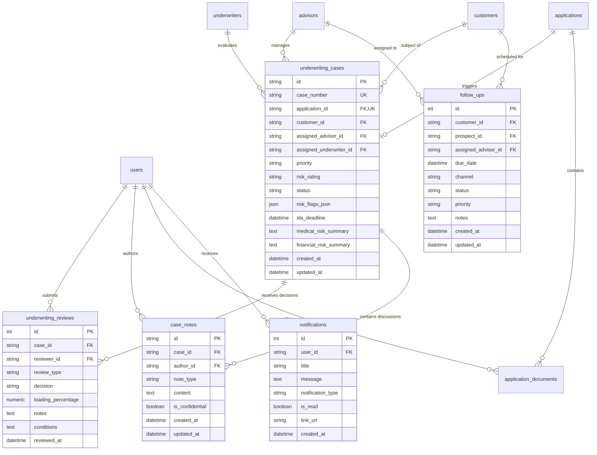
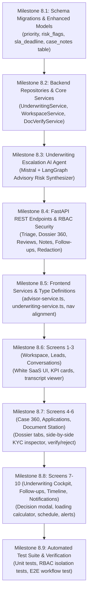

# PS-21 — Phase 8 Technical Specification & Implementation Plan
## Advisor and Underwriter Dashboard: High-Performance Employee Workspace, Underwriting Queue Orchestration, Document Verification & Human-in-the-Loop Decisions

**Project:** PS-21 Conversational Insurance Acquisition & Onboarding Platform  
**Target Directories:** `microproject/backend` & `microproject/frontend`  
**Parent Guidelines:** `microproject/AGENTS.md` & `microproject/docs/Master_prompt.md` (Phase 8: Lines 790–854)  
**Document Status:** Ready for Execution (Planning Document)  

---

## 1. Executive Summary & Objectives

The primary objective of **Phase 8** is to engineer the end-to-end **Advisor and Underwriter Dashboard & Case Management System** for the PS-21 platform. Following the successful delivery of dynamic proposals, secure KYC document uploads, and automated case triggering in Phase 7, **Phase 8 constructs the mission-critical employee workspace where insurance advisors and underwriters collaborate, investigate customer risk profiles, verify compliance documents, and record statutory underwriting decisions**.

In strict compliance with `Master_prompt.md` (Phase 8: Lines 790–854), `AGENTS.md` (Rules 1, 2, 3, 4, 5, 6, 7, 8, 9, 10, 11, 12, 13, 14, 15, 16, 17, 18, 19), IRDAI (Protection of Policyholders' Interests) Regulations, Section 45 of the Insurance Act 1938, and the Digital Personal Data Protection (DPDP) Act 2023, this phase establishes:

### Primary Objectives of Phase 8:
1. **Dual-Persona Employee Workspace Architecture:**
   - **Insurance Advisor Workstation:** Lead management (prospect ingestion, assignment claiming, conversion follow-ups), multi-turn conversation review (inspecting customer transcripts with the Mistral AI bot), KYC pre-screening, customer engagement scheduling, and proposal pipeline tracking.
   - **Underwriter Cockpit:** Risk-prioritized triage queue, 360° customer case examination (cross-checking declared demographics, income disclosures, and medical declarations against OCR-extracted facts), risk flag analysis, side-by-side document verification, structured requests for additional information, actuarial loading calculations, and formal review decisioning.
2. **The 10 Required Employee Screens:**
   - Fully implement all 10 required operational interfaces:
     1. **My Workspace (`/advisor`):** Unified executive cockpit featuring real-time KPI metrics, urgent task feeds, SLA breach alerts, and assigned caseload counters.
     2. **Assigned Leads (`/advisor/leads`):** Dynamic lead pipeline featuring AI scoring breakdowns, engagement status, direct conversion triggers, and advisor reassignment.
     3. **Customer Conversations (`/advisor/conversations` & `/advisor/conversations/[id]`):** Complete chronological chat transcript inspector displaying customer exchanges with the AI assistant, extracted intent tags, and advisor note-taking.
     4. **Customer Case Details (360° Dossier) (`/advisor/cases/[id]`):** Tabbed deep-dive workspace displaying customer demographics, proposal snapshot, health & financial declarations, AI recommendation rationale, indicative quote, document vault, activity timeline, and review history.
     5. **Application Management (`/advisor/applications`):** Comprehensive proposal lifecycle table with multi-parameter filtering (Draft, Submitted, Documents Pending, Under Review, Info Requested, Approved, Declined), pagination, and search.
     6. **Document Verification Station (`/advisor/documents`):** Side-by-side document inspection console with SHA-256 integrity verification, OCR-extracted vs declared claim reconciliation, and one-click Approve or Reject actions with mandatory reason codes.
     7. **Underwriting Cases & Review Cockpit (`/advisor/underwriting` & `/advisor/underwriting/[caseNumber]`):** Risk-tiered triage matrix (Preferred, Standard, Substandard, Decline), SLA countdowns, loading calculation sheet, and formal decision submission.
     8. **Follow-up Management (`/advisor/follow-ups`):** Integrated calendar and schedule organizer for phone calls, emails, verification follow-ups, overdue alerts, and completion tracking.
     9. **Activity Timeline (`/advisor/timeline`):** Enterprise audit feed aggregating chronological customer actions, system triggers, agent executions, and employee notes.
     10. **Employee Notification Center (`/advisor/notifications`):** Real-time operational notification inbox for SLA alerts, new case assignments, customer replies, and document re-uploads.
3. **Strict Human-in-the-Loop Underwriting Mandate:**
   - **AI Never Approves or Declines Applications:** While the `UnderwritingEscalationAgent` provides advisory risk summaries and flags inconsistencies between declarations and uploaded documents, **only authenticated human underwriters holding valid authority levels can execute formal review decisions** (`approved_standard`, `approved_with_loading`, `declined`, `more_info_needed`).
   - Every human review is permanently stamped with the reviewer's user ID, timestamp, license credentials, risk rating, loading percentage, and statutory conditions.
4. **Granular RBAC & Sensitive Medical Data Isolation (SPDI):**
   - Advisors without explicit `medical_data:view` permission receive strictly redacted medical risk summaries (`[RESTRICTED - AUTHORIZED UNDERWRITER ONLY]`) and cannot access clinical diagnosis records or medical lab attachments.
   - Underwriters and Owners possess full unredacted access. Every access to sensitive medical data is recorded in `audit_logs`.
5. **Real-Time Transactional Synchronization:**
   - Underwriting review decisions execute as atomic database transactions: updating `underwriting_cases.status`, synchronizing `applications.status`, updating `quotes.status`, and generating targeted customer notifications with explanatory notes.
6. **Strict Enterprise White SaaS Theme:**
   - Adhere uncompromisingly to the white-only design system: pure white backgrounds (`bg-white`), light-slate secondary surfaces (`bg-slate-50/50`), subtle borders (`border-slate-200`), dark navy typography (`text-slate-900`), restrained blue accents (`bg-blue-600`), and official shadcn/ui components (`Card`, `Table`, `Badge`, `Dialog`, `Sheet`, `Tabs`, `Select`, `Alert`). No dark mode. No dark cards.

---

## 2. Core Mandates & Non-Negotiable Phase 8 Rules

All Phase 8 architecture, database models, services, API routers, and React components must adhere strictly to the following non-negotiable rules:

| Mandate | Specification & Regulatory Constraint | Strict Enforcement Mechanism |
| :--- | :--- | :--- |
| **Zero Autonomous AI Underwriting** | AI agents must never independently approve, decline, or issue policies. Formal underwriting remains an authorized human process under IRDAI guidelines. | Review decisions can only be submitted via `POST /api/v1/underwriting/cases/{case_number}/reviews` requiring authenticated `Underwriter`, `Admin`, or `Owner` roles. |
| **Granular Medical SPDI Redaction** | Sensitive Personal Data or Information (SPDI)—such as medical records, lab tests, and clinical diagnoses—must not be visible to unauthorized staff. | In `underwriting.py` and case serializers, if the user lacks `medical_data:view` permission, `medical_risk_summary`, medical notes, and medical document attachments are redacted. |
| **Immutable Audit Logging** | Every employee access to customer cases, document downloads, and decision submissions must be auditable. | Endpoints write an immutable record into `audit_logs` specifying `user_id`, `action` (`VIEW_CASE_FILE`, `DOWNLOAD_KYC_DOCUMENT`, `SUBMIT_UNDERWRITING_DECISION`), `resource_type`, and `resource_id`. |
| **Atomic Status Synchronization** | Application and case statuses must never drift out of sync. | In `UnderwritingService.submit_formal_review`, the review creation, case status update, application status transition, and customer notification dispatch happen inside a single atomic database transaction. |
| **Human Document Sign-Off** | Documents cannot be marked `verified` by OCR or AI alone. | Only an advisor or underwriter can transition document `verification_status` to `verified` via `POST /api/v1/documents/{id}/verify`. A human user ID and timestamp are recorded. |
| **Mandatory Rejection Reasons** | Document rejections and information requests cannot be vague. | `DocumentRejectionRequest` and `MoreInfoNeededRequest` require structured reason codes and explanatory instructions to guide the customer. |
| **Zero Hardcoding & Zero Fallback** | Caseloads, lead metrics, and review queues must reflect real database records. | No fake hardcoded cases or mock statistics. When no cases match filters, render clean shadcn/ui empty states (`Card`, `Inbox` icon, clear message). |
| **Strict Enterprise White Theme** | Uniform, professional fintech appearance across all 10 screens. | Pure white theme (`bg-white`, `border-slate-200`, `text-slate-900`, `bg-blue-600`). Direct imports of official shadcn/ui components. No arbitrary dark elements. |

---

## 3. Technology Stack & Architectural Positioning

```mermaid
flowchart TB
    subgraph AdvisorUI [Frontend — Next.js 16 Advisor & Underwriter Workbench]
        MyWorkspace["/advisor\n(Executive Cockpit, KPI Cards, Urgent Tasks, SLA Alerts)"]
        AssignedLeads["/advisor/leads\n(Lead Triage, Score Factors, Direct Handoff)"]
        Conversations["/advisor/conversations & /[id]\n(AI Chat Transcript Inspector, Intent Tags)"]
        CaseDetails["/advisor/cases/[id]\n(360° Dossier, Proposals, Declarations, Vault, Timeline)"]
        AppManagement["/advisor/applications\n(Full Proposal Pipeline, Multi-Filter, Search)"]
        DocVerification["/advisor/documents\n(Side-by-Side KYC Inspection, OCR Match, Sign-Off)"]
        UWQueue["/advisor/underwriting & /[caseNumber]\n(Risk Triage Matrix, Loading Calculator, Decision Cockpit)"]
        FollowUps["/advisor/follow-ups\n(Follow-Up Calendar, Phone/Email Tracker, Overdue)"]
        ActivityTimeline["/advisor/timeline\n(Enterprise Audit Trail, Chronological Event Feed)"]
        NotificationCenter["/advisor/notifications\n(Employee Alert Inbox, SLA Breach, Case Updates)"]
    end

    subgraph APIGateway [FastAPI REST Gateway — /api/v1]
        UWRouter["/api/v1/underwriting\n(Triage Queue, Case Detail, Review Submission, Risk Analysis)"]
        AdvWorkspaceRouter["/api/v1/advisor/workspace\n(KPIs, Caseload Summary, Priority Feeds)"]
        CaseNotesRouter["/api/v1/cases/{id}/notes\n(Internal Advisor/Underwriter Collaboration Threads)"]
        DocVerifyRouter["/api/v1/documents/{id}/(verify|reject)\n(Human Document Sign-Off Engine)"]
        FollowUpRouter["/api/v1/follow-ups\n(CRUD, Status Transition, Due-Date Scheduling)"]
        NotifyRouter["/api/v1/notifications\n(List, Mark Read, Unread Counts)"]
    end

    subgraph BusinessEngine [Deterministic Services & Case Workflow Layer]
        UWSvc["UnderwritingService\n(Triage Logic, Risk Ratings, Loading Engine, Decision State Machine)"]
        AdvWorkspaceSvc["AdvisorWorkspaceService\n(Caseload Metrics, Priority Queues, SLA Breach Engine)"]
        DocVerifySvc["DocumentVerificationService\n(OCR vs Declared Reconciler, Verification Audit)"]
        FollowUpSvc["FollowUpService\n(Follow-Up State Machine, Calendar Aggregator)"]
        CaseNotesSvc["CaseNotesService\n(Threaded Case Notes, Confidentiality Access Control)"]
        TimelineSvc["TimelineService\n(Cross-Domain Event Aggregator: Leads, Apps, Docs, Reviews)"]
    end

    subgraph LangGraphAI [LangGraph Multi-Agent Orchestration — Mistral Only]
        UWEscalationAgent["UnderwritingEscalationAgent\n(Advisory Risk Synthesizer, Discrepancy Detector)"]
    end

    subgraph DatabaseLayer [SQLite & SQLAlchemy Relational Storage]
        UWCasesTable[("underwriting_cases\n(Case #, Risk Rating, Priority, SLA Deadline, Summaries)")]
        UWReviewsTable[("underwriting_reviews\n(Decisions, Loading %, Conditions, Reviewer FK, Notes)")]
        CaseNotesTable[("case_notes\n(Case FK, Author FK, Note Type, Content, Confidentiality)")]
        AppsTable[("applications\n(Status, Proposal JSON, Checksum, Current Step)")]
        DocsTable[("application_documents\n(SHA-256 Hash, Status, Verified By FK, OCR JSON)")]
        FollowUpsTable[("follow_ups\n(Customer FK, Advisor FK, Due Date, Channel, Status)")]
        NotifyTable[("notifications\n(User FK, Title, Message, Type, Is Read, Link)")]
        AuditTable[("audit_logs\n(User FK, Action, Resource, IP, Changes JSON, Timestamp)")]
    end

    AdvisorUI -->|JWT Authenticated Requests (Role: Advisor / Underwriter / Owner)| APIGateway
    APIGateway --> BusinessEngine
    BusinessEngine --> DatabaseLayer
    BusinessEngine --> LangGraphAI
    LangGraphAI -.->|Mistral AI Client| ExternalMistral[Mistral AI Platform]
```

---

## 4. Database Schema Enhancements & Migration Plan

The existing schema in `backend/app/models/underwriting.py` and `backend/app/models/system.py` contains foundational entities for cases, reviews, follow-ups, and notifications. Phase 8 introduces necessary schema enhancements to support operational prioritization, SLA tracking, risk flags, and internal collaboration notes.

### 4.1 Enhanced Entity Relationship Diagram



### 4.2 Specific Model Modifications & Additions

#### 1. Enhancements to `UnderwritingCase` (`backend/app/models/underwriting.py`):
- `priority`: `Mapped[str] = mapped_column(String(20), default="medium", nullable=False)` — Values: `low`, `medium`, `high`, `urgent`.
- `risk_flags_json`: `Mapped[Optional[List[Dict[str, Any]]]] = mapped_column(JSON, nullable=True)` — Array of structured risk indicators generated by `UnderwritingEscalationAgent` or dynamic rules (e.g., `[{"category": "medical", "severity": "high", "flag": "History of Type 2 Diabetes", "source": "proposal_step_6"}]`).
- `sla_deadline`: `Mapped[Optional[datetime]] = mapped_column(DateTime(timezone=True), nullable=True)` — Calculated deadline based on product SLA policy (e.g., standard: 48 hours; high priority: 24 hours).
- `case_notes`: `Mapped[List["CaseNote"]] = relationship("CaseNote", back_populates="case", cascade="all, delete-orphan", order_by="CaseNote.created_at.desc()")`

#### 2. New Entity: `CaseNote` (`backend/app/models/underwriting.py`):
```python
class CaseNote(Base, TimestampMixin):
    __tablename__ = "case_notes"

    id: Mapped[str] = mapped_column(String(36), primary_key=True, default=generate_uuid)
    case_id: Mapped[str] = mapped_column(String(36), ForeignKey("underwriting_cases.id", ondelete="CASCADE"), nullable=False, index=True)
    author_id: Mapped[str] = mapped_column(String(36), ForeignKey("users.id", ondelete="RESTRICT"), nullable=False, index=True)
    note_type: Mapped[str] = mapped_column(String(30), default="internal_note", nullable=False)  # internal_note, inquiry, underwriter_query, customer_communication
    content: Mapped[str] = mapped_column(Text, nullable=False)
    is_confidential: Mapped[bool] = mapped_column(Boolean, default=False, nullable=False)  # If True, visible only to Underwriters and Admins

    case: Mapped["UnderwritingCase"] = relationship("UnderwritingCase", back_populates="case_notes")
    author: Mapped["User"] = relationship("User")
```

#### 3. Enhancements to `FollowUp` (`backend/app/models/system.py`):
- `priority`: `Mapped[str] = mapped_column(String(20), default="medium", nullable=False)` — Values: `low`, `medium`, `high`.

### 4.3 Alembic Migration Specification
A new migration `alembic/versions/xxxx_phase8_advisor_underwriting_workbench.py` will:
1. Add columns `priority`, `risk_flags_json`, and `sla_deadline` to table `underwriting_cases`.
2. Create table `case_notes` with appropriate foreign keys to `underwriting_cases` and `users`.
3. Add column `priority` to table `follow_ups`.
4. Create index on `case_notes(case_id, created_at)` and `underwriting_cases(priority, status)`.

---

## 5. Directory Structure & Component Inventory

The following files will be added or enhanced across the backend and frontend:

```text
microproject/
├── backend/
│   ├── alembic/versions/
│   │   └── xxxx_phase8_advisor_underwriting_workbench.py  # Schema migration
│   ├── app/
│   │   ├── api/v1/
│   │   │   ├── underwriting.py            # Enhanced triage, deep detail, reviews, & escalation
│   │   │   ├── advisor_workspace.py       # New: Workspace KPIs, caseload, SLA feeds
│   │   │   ├── case_notes.py              # New: Threaded case notes & inquiries
│   │   │   ├── follow_ups.py              # New: Employee follow-up scheduler & manager
│   │   │   ├── notifications.py           # New: Employee notifications inbox & mark-read
│   │   │   └── documents.py               # Enhanced: verify/reject document endpoints
│   │   ├── models/
│   │   │   └── underwriting.py            # Enhanced UnderwritingCase & new CaseNote
│   │   ├── repositories/
│   │   │   ├── underwriting_repository.py # Enhanced: triage filtering, priority queries
│   │   │   ├── case_note_repository.py    # New: Case notes repository
│   │   │   └── follow_up_repository.py    # New: Follow-up repository
│   │   ├── schemas/
│   │   │   ├── underwriting.py            # Enhanced: Triage, Detail, Review, & Note DTOs
│   │   │   ├── advisor.py                 # New: Workspace KPIs & summary schemas
│   │   │   └── follow_up.py               # New: Follow-up CRUD & filter schemas
│   │   ├── services/
│   │   │   ├── underwriting_service.py    # New: Triage, loading, SLA, & decision orchestrator
│   │   │   ├── advisor_workspace_service.py # New: Aggregates KPIs, urgent actions, caseloads
│   │   │   ├── case_notes_service.py      # New: Internal collaboration thread manager
│   │   │   ├── follow_up_service.py       # New: Schedule & execute customer follow-ups
│   │   │   └── timeline_service.py        # Enhanced: Cross-domain case activity timeline
│   │   └── agents/
│   │       └── underwriting_escalation_agent.py # LangGraph agent for advisory risk synthesis
│   └── tests/
│       ├── test_underwriting_service.py   # Unit tests for triage, loading, decisions
│       ├── test_document_verification.py  # Unit tests for human verify & reject
│       ├── test_advisor_rbac_isolation.py # Security tests for medical SPDI redaction
│       └── test_underwriting_e2e.py       # E2E workflow integration test
│
└── frontend/
    └── src/
        ├── app/
        │   └── advisor/
        │       ├── page.tsx                    # Screen 1: My Workspace
        │       ├── leads/
        │       │   └── page.tsx                # Screen 2: Assigned Leads
        │       ├── conversations/
        │       │   ├── page.tsx                # Screen 3: Customer Conversations List
        │       │   └── [id]/page.tsx           # Screen 3 (Cont): Conversation Transcript Viewer
        │       ├── cases/
        │       │   └── [id]/page.tsx           # Screen 4: Customer Case Details (360° Dossier)
        │       ├── applications/
        │       │   └── page.tsx                # Screen 5: Application Management
        │       ├── documents/
        │       │   └── page.tsx                # Screen 6: Document Verification Station
        │       ├── underwriting/
        │       │   ├── page.tsx                # Screen 7: Underwriting Triage Matrix
        │       │   └── [caseNumber]/page.tsx   # Screen 7 (Cont): Decision Review Cockpit
        │       ├── follow-ups/
        │       │   └── page.tsx                # Screen 8: Follow-up Management
        │       ├── timeline/
        │       │   └── page.tsx                # Screen 9: Enterprise Activity Timeline
        │       └── notifications/
        │           └── page.tsx                # Screen 10: Notification Center
        ├── components/
        │   ├── advisor/
        │   │   ├── workspace-kpi-grid.tsx      # High-level metric cards
        │   │   ├── urgent-tasks-card.tsx       # SLA countdown & priority task queue
        │   │   ├── case-dossier-header.tsx     # Customer 360 header with status & risk badges
        │   │   ├── proposal-snapshot-tab.tsx   # Step-by-step proposal data renderer
        │   │   ├── medical-financial-tab.tsx   # Health disclosures & income verification
        │   │   ├── side-by-side-doc-viewer.tsx # Document inspection & OCR reconciliation modal
        │   │   ├── underwriting-decision-dialog.tsx # Formal review submission & loading calculator
        │   │   ├── case-notes-thread.tsx       # Internal chat & collaboration feed
        │   │   ├── follow-up-scheduler-dialog.tsx # Call/Email follow-up creation dialog
        │   │   └── timeline-event-card.tsx     # Render individual timeline audit events
        │   └── navigation/
        │       └── role-nav-config.ts          # Updated ADVISOR_NAV linking all 10 screens
        ├── services/
        │   ├── advisor-service.ts              # API client for workspace, leads, notes, follow-ups
        │   └── underwriting-service.ts         # API client for triage, cases, reviews, decisions
        └── types/
            ├── advisor.ts                      # TypeScript interfaces for workspace & follow-ups
            └── underwriting.ts                 # TypeScript interfaces for cases, reviews, notes
```

---

## 6. Detailed Backend Specifications

### 6.1 Pydantic Schemas

#### Underwriting Case & Review Schemas (`backend/app/schemas/underwriting.py`):
```python
from datetime import datetime
from typing import Any, Dict, List, Optional
from pydantic import BaseModel, Field

class UnderwritingCaseSummaryRead(BaseModel):
    id: str
    case_number: str
    application_id: str
    customer_id: str
    customer_name: str
    product_name: str
    sum_assured: float
    total_premium: float
    priority: str  # low, medium, high, urgent
    risk_rating: str  # preferred, standard, substandard, decline
    status: str  # assigned, in_review, more_info_needed, approved, declined
    sla_deadline: Optional[datetime] = None
    sla_hours_remaining: Optional[float] = None
    risk_flags_count: int = 0
    assigned_advisor_name: Optional[str] = None
    assigned_underwriter_name: Optional[str] = None
    created_at: datetime

    class Config:
        from_attributes = True

class RiskFlagItem(BaseModel):
    category: str  # medical, financial, lifestyle, identity
    severity: str  # low, medium, high, critical
    flag: str
    source: str

class UnderwritingCaseDetailRead(BaseModel):
    id: str
    case_number: str
    application_id: str
    customer_id: str
    customer_name: str
    customer_email: str
    customer_phone: Optional[str] = None
    customer_dob: Optional[str] = None
    customer_city: Optional[str] = None
    product_id: str
    product_name: str
    product_category: str
    sum_assured: float
    policy_term_years: int
    total_premium: float
    priority: str
    risk_rating: str
    status: str
    sla_deadline: Optional[datetime] = None
    risk_flags: List[RiskFlagItem] = Field(default_factory=list)
    medical_risk_summary: Optional[str] = None  # Redacted if user lacks medical_data:view
    financial_risk_summary: Optional[str] = None
    proposal_data: Optional[Dict[str, Any]] = None
    proposal_checksum: Optional[str] = None
    documents: List[Dict[str, Any]] = Field(default_factory=list)
    reviews: List[Dict[str, Any]] = Field(default_factory=list)
    notes: List[Dict[str, Any]] = Field(default_factory=list)
    created_at: datetime
    updated_at: datetime

    class Config:
        from_attributes = True

class UnderwritingReviewCreate(BaseModel):
    review_type: str = Field(..., description="initial_assessment, medical_evaluation, financial_scrutiny, supervisor_escalation")
    decision: str = Field(..., description="approved_standard, approved_with_loading, declined, more_info_needed")
    loading_percentage: float = Field(default=0.0, ge=0.0, le=200.0, description="Actuarial loading percentage applied to premium")
    notes: str = Field(..., min_length=10, description="Mandatory detailed underwriter clinical/financial rationale")
    conditions: Optional[str] = Field(None, description="Policy endorsements, exclusions, or mandatory health checkups")

class CaseNoteCreate(BaseModel):
    note_type: str = Field(default="internal_note", description="internal_note, inquiry, underwriter_query, customer_communication")
    content: str = Field(..., min_length=3, description="Body of the note")
    is_confidential: bool = Field(default=False, description="If True, restricted to Underwriters/Admins")

class CaseNoteRead(BaseModel):
    id: str
    case_id: str
    author_id: str
    author_name: str
    author_role: str
    note_type: str
    content: str
    is_confidential: bool
    created_at: datetime

    class Config:
        from_attributes = True

class DocumentVerificationActionRequest(BaseModel):
    verification_notes: Optional[str] = None

class DocumentRejectionActionRequest(BaseModel):
    rejection_reason_code: str = Field(..., description="ILLEGIBLE_SCAN, EXPIRED_DOCUMENT, NAME_MISMATCH, INCOMPLETE_PAGES, FRAUD_SUSPICION")
    detailed_instructions: str = Field(..., min_length=10, description="Guidance sent to customer for re-upload")
```

#### Advisor Workspace Schemas (`backend/app/schemas/advisor.py`):
```python
from datetime import datetime
from typing import List, Optional
from pydantic import BaseModel

class WorkspaceKPICounters(BaseModel):
    active_cases_count: int
    pending_document_verifications: int
    overdue_follow_ups_count: int
    cases_awaiting_info_count: int
    sla_at_risk_count: int
    total_assigned_leads: int

class UrgentTaskItem(BaseModel):
    id: str
    task_type: str  # SLA_BREACH_WARNING, PENDING_DOC_VERIFICATION, OVERDUE_FOLLOW_UP, ESCALATED_CASE
    title: str
    description: str
    priority: str  # urgent, high, medium
    due_date: Optional[datetime] = None
    link_url: str
    related_entity_id: str
```

### 6.2 Core Services

#### 1. `UnderwritingService` (`backend/app/services/underwriting_service.py`):
- **`list_triage_cases(filters, current_user)`**: Returns a paginated list of cases. If user is an `Advisor`, filters by `assigned_advisor_id == current_user.advisor.id`. If user is an `Underwriter`, returns cases assigned to them or in the unassigned pool. Calculates hours remaining until `sla_deadline`. Redacts medical fields for users without `medical_data:view`.
- **`get_case_detail_360(case_number, current_user)`**: Assembles the complete customer dossier including proposal snapshot, KYC document list, OCR extractions, previous reviews, and internal notes. Enforces RBAC medical data redaction. Writes a `VIEW_CASE_FILE` entry to `audit_logs`.
- **`submit_formal_review(case_number, data, current_user)`**:
  - Enforces role validation: User must possess `Underwriter`, `Admin`, or `Owner` role.
  - Inserts `UnderwritingReview` record with reviewer ID, decision, loading %, and notes.
  - Updates `underwriting_cases.status`:
    - `approved_standard` or `approved_with_loading` $\rightarrow$ `status = "approved"`, `applications.status = "approved"`, `quotes.status = "approved"`.
    - `declined` $\rightarrow$ `status = "declined"`, `applications.status = "rejected"`.
    - `more_info_needed` $\rightarrow$ `status = "more_info_needed"`, `applications.status = "additional_info_required"`.
  - Creates a targeted `Notification` for the customer explaining the review outcome.
  - Writes an immutable `UNDERWRITING_DECISION` entry into `audit_logs`.
- **`trigger_ai_risk_escalation(case_number, current_user)`**: Invokes the `UnderwritingEscalationAgent` via LangGraph to parse declared health and income fields against underwriting tables and store synthesized `risk_flags_json`.

#### 2. `DocumentVerificationService` (`backend/app/services/document_verification_service.py`):
- **`verify_document(document_id, notes, current_user)`**:
  - Verifies user has `Advisor` or `Underwriter` role.
  - Sets `application_documents.verification_status = "verified"`, `verified_by_id = current_user.id`, `verified_at = utc_now()`.
  - Checks if all required documents for the associated application are now verified; if so, updates application status from `documents_pending` to `under_review`.
  - Records `VERIFY_DOCUMENT` in `audit_logs`.
- **`reject_document(document_id, rejection_code, instructions, current_user)`**:
  - Sets `verification_status = "rejected"`, `rejection_reason = f"[{rejection_code}] {instructions}"`.
  - Updates parent application status to `documents_pending`.
  - Sends immediate `Notification` to customer with the rejection reason and a link to `/customer/documents`.
  - Records `REJECT_DOCUMENT` in `audit_logs`.

#### 3. `AdvisorWorkspaceService` (`backend/app/services/advisor_workspace_service.py`):
- Aggregates real-time metrics without hardcoding: counts from `underwriting_cases`, `application_documents`, `follow_ups`, and `prospects`.
- Identifies SLA breach warnings (cases within 4 hours of `sla_deadline`).

### 6.3 LangGraph AI Agent: `UnderwritingEscalationAgent` (`backend/app/agents/underwriting_escalation_agent.py`)

In accordance with AGENTS.md Rule 3 (Mistral exclusively) and Rule 4 (LangGraph stateful workflow), this agent provides advisory risk analysis:
- **State Definition (`UnderwritingEscalationState`):** Typed dict containing `customer_id`, `proposal_data`, `document_ocr_data`, `product_rules`, `risk_flags`, and `advisory_summary`.
- **Tools Registered:**
  - `check_medical_underwriting_grid`: Deterministic lookup against medical underwriting rule tables.
  - `check_financial_underwriting_grid`: Deterministic lookup comparing declared income with sum assured multiples.
- **Workflow:**
  1. Node 1: `ExtractDeclaredRisks`: Parses proposal Step 5 (Existing Coverage), Step 6 (Medical & Lifestyle), and Step 3 (Income).
  2. Node 2: `ReconcileDocumentEvidence`: Compares OCR-extracted income slip figures with declared income.
  3. Node 3: `SynthesizeRiskFlags` (Mistral LLM): Emits structured `RiskFlagItem` list and advisory underwriter notes.
- **Strict Constraint:** The agent's output is purely advisory; it produces JSON flags inserted into `underwriting_cases.risk_flags_json` and never mutates case or application statuses.

### 6.4 API Endpoints Inventory

| Method | Endpoint | Authorized Roles | Description |
| :--- | :--- | :--- | :--- |
| `GET` | `/api/v1/advisor/workspace/kpis` | Advisor, Underwriter, Admin, Owner | Operational KPI counts (active cases, pending docs, overdue tasks). |
| `GET` | `/api/v1/advisor/workspace/urgent-tasks` | Advisor, Underwriter, Admin, Owner | Priority queue of SLA alerts and pending reviews. |
| `GET` | `/api/v1/underwriting/triage` | Advisor, Underwriter, Admin, Owner | Filterable triage queue (status, priority, risk rating). |
| `GET` | `/api/v1/underwriting/cases/{case_number}` | Advisor, Underwriter, Admin, Owner | 360° Case Dossier (proposal, docs, reviews, notes). Redacts medical SPDI if unprivileged. |
| `POST` | `/api/v1/underwriting/cases/{case_number}/reviews` | Underwriter, Admin, Owner | Submit formal human underwriting review decision. |
| `POST` | `/api/v1/underwriting/cases/{case_number}/ai-escalation` | Underwriter, Admin, Owner | Trigger Mistral `UnderwritingEscalationAgent` risk synthesis. |
| `GET` | `/api/v1/underwriting/cases/{case_id}/notes` | Advisor, Underwriter, Admin, Owner | Retrieve internal case notes (filters confidential if unprivileged). |
| `POST` | `/api/v1/underwriting/cases/{case_id}/notes` | Advisor, Underwriter, Admin, Owner | Post an internal collaboration note or inquiry. |
| `POST` | `/api/v1/documents/{id}/verify` | Advisor, Underwriter, Admin, Owner | Human sign-off marking document verified. |
| `POST` | `/api/v1/documents/{id}/reject` | Advisor, Underwriter, Admin, Owner | Reject document with structured reason code and customer instructions. |
| `GET` | `/api/v1/follow-ups` | Advisor, Underwriter, Admin, Owner | List assigned follow-ups with date and status filters. |
| `POST` | `/api/v1/follow-ups` | Advisor, Admin, Owner | Schedule a new customer engagement task (Call, Email, Meeting). |
| `PUT` | `/api/v1/follow-ups/{id}/status` | Advisor, Admin, Owner | Mark follow-up as completed or cancelled with notes. |
| `GET` | `/api/v1/notifications` | All Authenticated Users | Fetch unread and recent employee notifications. |
| `PUT` | `/api/v1/notifications/{id}/read` | All Authenticated Users | Mark notification as read. |

---

## 7. Frontend User Experience Specifications (Strict Enterprise White Theme)

All screens must be built using Next.js 16 App Router, TypeScript, Tailwind CSS, and shadcn/ui components. The visual style is strictly white-only enterprise SaaS:
- Background: `bg-white` and `bg-slate-50/50`.
- Cards: `bg-white border border-slate-200 shadow-xs`.
- Primary Accent: `bg-blue-600 hover:bg-blue-700 text-white`.
- Typography: `text-slate-900` (headings), `text-slate-600` (body), `text-slate-400` (captions).
- No dark mode. No dark cards. No black surfaces.

### 7.1 Detailed Screen Breakdown (The 10 Screens)

#### Screen 1: My Workspace (`/advisor/page.tsx`)
- **Header:** Personalized greeting, current date, active role badge ("Licensed Advisor" or "Senior Underwriter"), quick-action buttons ("New Follow-up", "View Triage").
- **KPI Counter Grid:** 4 responsive metric cards:
  - Active Cases (`Briefcase` icon, blue badge)
  - Pending Document Verifications (`FileCheck` icon, amber badge)
  - SLA at Risk (< 4h) (`ClockAlert` icon, red badge)
  - Overdue Follow-ups (`CalendarAlert` icon, orange badge)
- **Urgent Action Queue:** Real-time priority table showing cases with pending SLA deadlines or customer information submissions.
- **Recent Casework Feed:** Compact list of recent case transitions and customer uploads.

#### Screen 2: Assigned Leads (`/advisor/leads/page.tsx`)
- **Status Tabs:** `All Leads`, `New / Uncontacted`, `In Discussion`, `Qualified`, `Proposal Started`.
- **Search & Filters:** Search by customer name, phone, email, or lead source; filter by score tier (High, Medium, Low).
- **Lead Data Table:** Displays prospect name, source badge, AI engagement score, date captured, assigned advisor, and actions ("Call", "View Transcript", "Convert to Proposal").

#### Screen 3: Customer Conversations (`/advisor/conversations/page.tsx` & `[id]/page.tsx`)
- **Split Layout:**
  - **Left Pane (1/3 width):** Searchable list of customer conversation threads with snippet preview, unread indicator, and timestamp.
  - **Right Pane (2/3 width):** Multi-turn chat transcript viewer rendering customer questions and Mistral AI responses in clean message bubbles. Includes intent tags (e.g., `#HLV_Calculation`, `#Health_Exclusions`), extracted customer qualification facts, and an internal advisor notes drawer.

#### Screen 4: Customer Case Details (360° Dossier) (`/advisor/cases/[id]/page.tsx`)
- **Sticky Case Header:** Customer name, Case Number, Application Number, Risk Tier badge, SLA countdown timer, and assigned underwriter avatar.
- **7-Tab Dossier:**
  1. *Proposal Snapshot:* Full 8-step proposal questionnaire data rendered in structured, readable summary cards.
  2. *Declarations & Lifestyle:* Highlights declared medical history (surgeries, hypertension, diabetes), smoking/alcohol habits, and family medical background.
  3. *Indicative Quote & Product:* Sum assured, policy term, premium breakdown, included riders, and insurer details.
  4. *Document Vault:* List of all uploaded KYC and medical files with SHA-256 verification badge, OCR extraction preview, and verification action triggers.
  5. *Underwriting Reviews:* Historical review log showing underwriter notes, applied loadings, and conditions.
  6. *Internal Notes:* Real-time collaboration discussion thread between advisors and underwriters.
  7. *Activity Timeline:* Chronological audit log of all events related to this customer case.

#### Screen 5: Application Management (`/advisor/applications/page.tsx`)
- **Full Pipeline Table:** Complete application directory featuring columns for Application Number, Customer Name, Product, Step Progress, Status badge (`Draft`, `Submitted`, `Documents Pending`, `Under Review`, `Approved`, `Declined`), and Date Submitted.
- **Controls:** Multi-select status filtering, search bar, and CSV export.

#### Screen 6: Document Verification Station (`/advisor/documents/page.tsx`)
- **Queue View:** Filter by verification status (`Pending Review`, `Verified`, `Rejected`).
- **Side-by-Side Verification Modal (`side-by-side-doc-viewer.tsx`):**
  - Left Side: Clean high-fidelity PDF/image document preview.
  - Right Side: Comparison table showing OCR-extracted data (e.g., Name on PAN, PAN Number, DOB) side-by-side with customer-declared proposal values. Highlights discrepancies in amber.
  - Footer Actions: "Verify Document" (green button) and "Reject Document" (red button opening structured reason selection).

#### Screen 7: Underwriting Cases & Review Cockpit (`/advisor/underwriting/page.tsx` & `[caseNumber]/page.tsx`)
- **Risk Triage Matrix:** Cases grouped into risk categories: Preferred, Standard, Substandard, Decline.
- **Cockpit Actions:**
  - "Run AI Risk Synthesis" (invokes `UnderwritingEscalationAgent`).
  - "Submit Underwriting Review" (opens `underwriting-decision-dialog.tsx`):
    - Select Decision: `Approved (Standard)`, `Approved (With Loading)`, `More Information Needed`, `Declined`.
    - Loading Percentage slider / input (0% to 100%).
    - Mandatory Underwriter Rationale text area.
    - Statutory Endorsements / Conditions text area.

#### Screen 8: Follow-up Management (`/advisor/follow-ups/page.tsx`)
- **Views:** Toggle between "Upcoming Agenda" and "All Follow-ups".
- **Follow-up Card:** Shows customer name, contact channel (`Phone`, `Email`, `Meeting`), scheduled time, priority badge, and notes.
- **Action Buttons:** "Mark Complete" (prompts for outcome notes) and "Reschedule".
- **New Follow-up Modal:** Form to pick customer, channel, date/time, and objective.

#### Screen 9: Activity Timeline (`/advisor/timeline/page.tsx`)
- Chronological, vertical audit feed spanning all case events: lead creation, chat sessions, quote generation, proposal submission, document uploads, human verifications, and underwriting decisions.
- Filter by Category: `All`, `Applications`, `Underwriting`, `Documents`, `Compliance`.

#### Screen 10: Notification Center (`/advisor/notifications/page.tsx`)
- Categorized notification list: `All`, `Unread`, `SLA Alerts`, `Case Updates`.
- Notification Card: Title, detailed message, time ago, "Mark as Read", and direct navigation link.

---

## 8. Step-by-Step Implementation Roadmap



### Milestone 8.1: Database Schema Migrations & Enhanced Models
- Update `backend/app/models/underwriting.py` with `priority`, `risk_flags_json`, `sla_deadline` in `UnderwritingCase`.
- Add `CaseNote` model to `backend/app/models/underwriting.py`.
- Add `priority` column to `FollowUp` in `backend/app/models/system.py`.
- Generate and execute Alembic migration script `alembic/versions/xxxx_phase8_advisor_underwriting_workbench.py`.

### Milestone 8.2: Backend Repositories & Core Services
- Implement `CaseNoteRepository` and enhance `UnderwritingRepository` with triage filters and SLA calculation methods.
- Build `UnderwritingService` (triage matrix, case 360 aggregator, review submission, status synchronizer).
- Build `DocumentVerificationService` (human verify/reject logic, audit logging).
- Build `AdvisorWorkspaceService` (caseload counters, urgent task aggregation).
- Build `FollowUpService` (schedule, reschedule, complete follow-up tasks).

### Milestone 8.3: LangGraph Underwriting Escalation AI Agent
- Create `backend/app/agents/underwriting_escalation_agent.py`.
- Define `UnderwritingEscalationState` and register deterministic underwriting lookup tools.
- Configure Mistral client call for advisory risk synthesis.
- Ensure agent outputs strictly populate `risk_flags_json` without modifying case statuses.

### Milestone 8.4: FastAPI REST Endpoints & RBAC Security
- Implement routers in `backend/app/api/v1/`:
  - `underwriting.py` (triage, case 360, review submission, AI escalation).
  - `advisor_workspace.py` (KPIs, urgent tasks).
  - `case_notes.py` (threaded notes).
  - `follow_ups.py` (follow-up CRUD).
  - `notifications.py` (employee notifications).
- Enhance `documents.py` with `/verify` and `/reject` endpoints.
- Enforce medical SPDI redaction for users without `medical_data:view`.
- Register new routers in `backend/app/api/v1/api.py`.

### Milestone 8.5: Frontend Services & Type Definitions
- Create `frontend/src/types/advisor.ts` and `frontend/src/types/underwriting.ts`.
- Create `frontend/src/services/advisor-service.ts` and `frontend/src/services/underwriting-service.ts`.
- Update `ADVISOR_NAV` in `frontend/src/components/navigation/role-nav-config.ts` with all 10 screen routes and icons.

### Milestone 8.6: Frontend Screens 1 to 3
- Implement `/advisor/page.tsx` (My Workspace with KPI cards and urgent tasks).
- Implement `/advisor/leads/page.tsx` (Assigned Leads table with score badges).
- Implement `/advisor/conversations/page.tsx` & `[id]/page.tsx` (AI conversation inspector).

### Milestone 8.7: Frontend Screens 4 to 6
- Implement `/advisor/cases/[id]/page.tsx` (Customer Case 360 Dossier with 7 tabs).
- Implement `/advisor/applications/page.tsx` (Full proposal pipeline directory).
- Implement `/advisor/documents/page.tsx` (Document Verification Station with side-by-side inspector).

### Milestone 8.8: Frontend Screens 7 to 10
- Implement `/advisor/underwriting/page.tsx` & `[caseNumber]/page.tsx` (Risk Triage Matrix & Decision Cockpit).
- Implement `/advisor/follow-ups/page.tsx` (Follow-up scheduler & agenda view).
- Implement `/advisor/timeline/page.tsx` (Enterprise activity timeline).
- Implement `/advisor/notifications/page.tsx` (Notification center).

### Milestone 8.9: Automated Test Suite & Acceptance Verification
- Write and execute pytest suite covering:
  - Triage filtering and SLA deadline calculations.
  - Review decision state machine and atomic status transitions.
  - Human document verification and rejection flows.
  - Advisor vs Underwriter medical SPDI redaction.
  - Full E2E case workflow test.

---

## 9. Automated Test Strategy & Scenarios

### 9.1 Unit Test Scenarios (`backend/tests/test_underwriting_service.py`)
1. **Triage Queue & SLA Computation:**
   - Create 3 cases with varying creation dates and priority levels.
   - Verify `sla_deadline` is computed correctly and `sla_hours_remaining` reflects remaining hours.
2. **Review Decision Execution:**
   - Underwriter submits `approved_standard` review.
   - Verify `underwriting_reviews` record created.
   - Verify `underwriting_cases.status` updates to `approved`.
   - Verify associated `applications.status` updates to `approved`.
3. **Information Request Handoff:**
   - Underwriter submits `more_info_needed` decision with notes.
   - Verify case status updates to `more_info_needed`.
   - Verify application status updates to `additional_info_required`.
   - Verify customer notification created with link to `/customer/onboarding`.

### 9.2 Security & Authorization Scenarios (`backend/tests/test_advisor_rbac_isolation.py`)
1. **Advisor Medical SPDI Redaction:**
   - Log in as user with role `Advisor` (without `medical_data:view`).
   - Call `GET /api/v1/underwriting/cases/{case_number}`.
   - Assert `medical_risk_summary` equals `"[RESTRICTED - AUTHORIZED UNDERWRITER ONLY]"`.
   - Assert medical reports are excluded or marked restricted.
2. **Underwriter Full Access:**
   - Log in as user with role `Underwriter`.
   - Call `GET /api/v1/underwriting/cases/{case_number}`.
   - Assert `medical_risk_summary` contains full clinical evaluation.
3. **Unauthorized Decision Submission:**
   - Advisor attempts `POST /api/v1/underwriting/cases/{case_number}/reviews`.
   - Assert response status is `403 Forbidden`.
4. **Audit Trail Verification:**
   - Verify every case retrieval and review decision creates an entry in `audit_logs`.

### 9.3 End-to-End Workflow Integration Test (`backend/tests/test_underwriting_e2e.py`)
1. Ingest proposal submission from Phase 7 $\rightarrow$
2. Verify `UnderwritingCase` appears in Underwriter triage queue $\rightarrow$
3. Underwriter examines Case 360 dossier $\rightarrow$
4. Underwriter reviews and verifies KYC documents in Document Station $\rightarrow$
5. Underwriter calculates 10% actuarial loading due to declared lifestyle risk $\rightarrow$
6. Underwriter submits formal `approved_with_loading` decision with conditions $\rightarrow$
7. Assert atomic synchronization: case `approved`, application `approved`, quote updated, customer notification dispatched $\rightarrow$
8. Verify all actions recorded in `audit_logs`.

---

## 10. Acceptance & Completion Criteria

Phase 8 will be declared fully complete only when all of the following verifiable conditions are met:

- [ ] **All 10 Screens Implemented:** All 10 required advisor/underwriter pages exist, render cleanly, and follow the pure white financial SaaS visual theme.
- [ ] **Dual-Persona RBAC Enforced:** Advisors and Underwriters access appropriate queues with strict backend permission checks.
- [ ] **Medical SPDI Redacted:** Sensitive clinical data is strictly redacted for advisors lacking `medical_data:view`.
- [ ] **Human-in-the-Loop Exclusivity:** AI agents provide advisory risk synthesis only; formal review decisions require authenticated human underwriter sign-off.
- [ ] **Atomic Status Synchronization:** Review decisions atomically synchronize `underwriting_cases`, `applications`, `quotes`, and customer notifications.
- [ ] **Side-by-Side Document Verification:** Document verification console displays OCR-extracted vs declared values and supports human sign-off or rejection with reason codes.
- [ ] **Follow-Up Management:** Advisors can schedule, view, and complete customer follow-up tasks.
- [ ] **Audit Trail Completeness:** All case accesses, document downloads, and review decisions create immutable records in `audit_logs`.
- [ ] **Zero Hardcoding & Zero Fallback:** All dashboards and tables bind to real database models; clean empty states display when no records exist; Mistral client failures produce structured errors.
- [ ] **Automated Test Suite:** All unit, integration, and security tests pass with 100% execution success.
