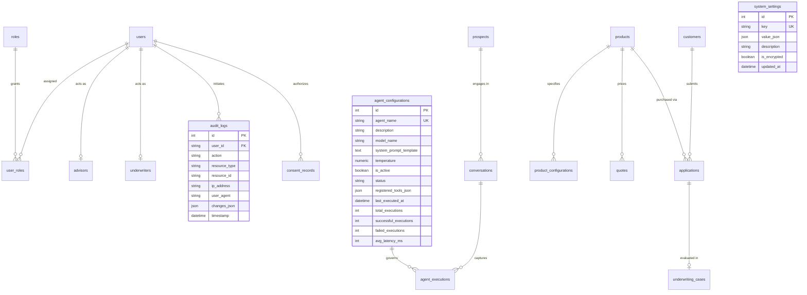
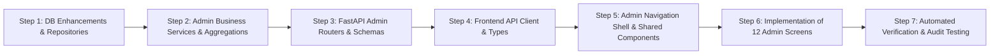

# PS-21 — Phase 9 Technical Specification & Implementation Plan
## Admin and Owner Dashboard: Executive Command Center, Real Business Analytics, Dynamic Agent Control, Employee Administration, Searchable Compliance Vault & System Governance

**Project:** PS-21 Conversational Insurance Acquisition & Onboarding Platform  
**Target Directories:** `microproject/backend` & `microproject/frontend`  
**Parent Guidelines:** `microproject/AGENTS.md` & `microproject/docs/Master_prompt.md` (Phase 9: Lines 856–946)  
**Document Status:** Ready for Execution (Planning Document)  

---

## 1. Executive Summary & Objectives

The primary objective of **Phase 9** is to design and engineer the **Admin / Owner Dashboard & Business Governance Suite** for the PS-21 platform. Following the implementation of customer acquisition, conversational engagement, deterministic quotation, proposal onboarding, and advisor/underwriter case triage (Phases 1 through 8), **Phase 9 establishes the comprehensive executive command center where business owners and administrators monitor company performance, govern AI agent runtime behaviors, manage employee credentials, configure product catalogs, audit regulatory compliance, and orchestrate third-party integrations**.

In strict compliance with `Master_prompt.md` (Phase 9: Lines 856–946) and `AGENTS.md` (Rules 1, 2, 3, 4, 5, 6, 7, 8, 9, 10, 11, 12, 13, 14, 15, 16, 17, 18, 19), this phase delivers real database-backed business intelligence, eliminating all placeholder metrics and artificial mock responses.

### Primary Objectives of Phase 9:
1. **The 12 Mandatory Administrative Screens:**
   - Fully specify and implement all 12 operational interfaces required by the Master Prompt:
     1. **Business Overview (`/admin`):** High-level executive cockpit showing real-time, database-calculated KPI counters (prospects, qualified leads, active conversations, quotes generated, proposals submitted, proposals awaiting review, overall conversion rate, pending follow-ups), activity pulse, and conversion health.
     2. **Lead Management (`/admin/leads`):** Enterprise prospect and lead management console featuring acquisition source breakdown, lead score distributions, automated assignment rules, and reassignment controls.
     3. **Customer Management (`/admin/customers`):** Master customer directory with lifecycle progression tracking (Discovery, Needs Assessed, Quoted, Application In Progress, Submitted, Underwritten, Policy Issued), KYC verification indicators, assigned advisor, and customer profile inspector.
     4. **Application Management (`/admin/applications`):** Global proposal pipeline table across all stages (Draft, Submitted, Documents Pending, Under Review, Info Requested, Approved, Declined) with risk rating distribution and SLA tracking.
     5. **Product Management (`/admin/products`):** End-to-end insurance product catalog editor allowing administrators to create, update, activate/deactivate products, configure premium rate matrices, define underwriting thresholds, and manage benefits, exclusions, declarations, and required KYC documents.
     6. **Employee Management (`/admin/employees`):** Staff administration console for provisioning advisor, underwriter, and administrator accounts, assigning granular roles/permissions, managing professional licenses, configuring workload limits (`max_active_cases`, `max_coverage_limit`), and toggling availability.
     7. **Agent Control Centre (`/admin/agents`):** Live AI agent control and observability console. Displays real-time operational status (Active, Paused, Disabled), execution counters (success vs. failure), token consumption, latency metrics, recent error logs, and **real runtime backend kill-switches** that dynamically pause or disable agent execution in LangGraph workflows.
     8. **Business Analytics (`/admin/analytics`):** Real database-aggregated analytics powered by SQL group-by queries: acquisition channel effectiveness, product category volume and annualized premium revenue, application turnaround times, advisor performance benchmarks, and AI token economics.
     9. **Conversion Funnel (`/admin/funnel`):** Quantitative multi-stage acquisition and onboarding funnel tracking conversion velocity and leakage points (Prospect Capture -> AI Conversation -> Needs Qualification -> Recommendation -> Quote Generated -> Application Started -> Proposal Submitted -> Underwriting Approved).
     10. **Compliance & Audit Vault (`/admin/audit`):** Searchable enterprise compliance center providing filterable, exportable audit trails for consent records, customer communications, AI recommendation rationales, quote calculations, application status mutations, KYC document access, human review decisions, and agent executions.
     11. **Integration Management (`/admin/integrations`):** Third-party service configuration and health console (WhatsApp Business Platform, Email/SMTP, SMS Gateway, Insurer Quotation API, Insurer Underwriting API, Document Storage). Honest integration status indicators (`Configured`, `Active`, `Error`, `Not Configured`) with zero simulated success.
     12. **System Settings (`/admin/settings`):** Dynamic system configuration editor backed by SQLite `system_settings` table (underwriting SLA limits, default auto-assignment criteria, notification delivery policies, session timeout windows, and data retention rules).
2. **Real Database-Backed Intelligence (Zero Hardcoding & Zero Mock Metrics):**
   - Every single metric, conversion rate, chart point, and KPI card must be calculated on-the-fly via real SQL aggregations (`COUNT`, `SUM`, `AVG`, `FILTER`) against the SQLite relational store.
   - If the database contains no matching records, screens must render professional shadcn/ui empty states (`Inbox`, `BarChart3`, clear descriptions) rather than simulated numbers.
3. **True Runtime Agent Control (Backend Kill-Switch Enforcement):**
   - The Agent Control Centre is not a cosmetic dashboard. Toggling an agent's status to `Paused` or `Disabled` directly updates `agent_configurations` in SQLite, which is immediately checked by the LangGraph orchestrator and FastAPI dispatch routers before invoking any agent. If disabled, agent execution is blocked with an explicit, auditable error.
4. **Comprehensive Staff Provisioning & Workload Governance:**
   - Provide complete lifecycle management for `advisors`, `underwriters`, and `admins`, enforcing foreign key integrity across `users`, `user_roles`, `roles`, and domain profile tables.
5. **Granular RBAC & Immutable Administrative Audit Logging:**
   - All Phase 9 endpoints strictly require authenticated users with the `Admin` or `Owner` role (`require_roles(["Admin", "Owner"])`).
   - Every administrative action (modifying products, changing employee roles, toggling agent states, updating system settings) is immutably logged to `audit_logs` with before/after state diffs.
6. **Strict Enterprise White SaaS UI Direction:**
   - Adhere strictly to the white-only design system: pure white backgrounds (`bg-white`), light-slate secondary surfaces (`bg-slate-50/50`), subtle borders (`border-slate-200`), dark navy typography (`text-slate-900`), restrained blue accents (`bg-blue-600`), and official shadcn/ui components (`Card`, `Table`, `Badge`, `Dialog`, `Sheet`, `Tabs`, `Select`, `Switch`, `Input`, `Alert`). No dark mode. No dark cards.

---

## 2. Core Mandates & Non-Negotiable Phase 9 Rules

All Phase 9 architecture, database models, services, API routers, and React components must strictly adhere to the following non-negotiable rules:

| Mandate | Specification & Regulatory Constraint | Strict Enforcement Mechanism |
| :--- | :--- | :--- |
| **Zero Mock/Fabricated Analytics** | Dashboard metrics, conversion funnels, and revenue numbers must never be hardcoded, faked, or simulated. | All metrics are computed via explicit SQLAlchemy aggregation queries (`COUNT`, `SUM`, `AVG`, `DATE_TRUNC`/`strftime`). If no records exist, return `0` or render shadcn/ui empty states. |
| **Real Runtime Agent Kill-Switch** | Agent controls in the UI must directly dictate whether backend agents execute in LangGraph workflows. | `AgentControlService` checks `AgentConfiguration.is_active` in SQLite before invoking Mistral LLM or LangGraph nodes. If disabled/paused, the workflow halts with a structured `AgentDisabledException`. |
| **Admin & Owner RBAC Exclusivity** | Administrative functions must not be accessible to customers, advisors, or underwriters. | Every Phase 9 API endpoint enforces `dependencies=[Depends(require_roles(["Admin", "Owner"]))]`. Unauthorized requests receive HTTP 403 Forbidden. |
| **Immutable Administrative Audit Trail** | Every modification to system settings, product configurations, employee roles, or agent states must be permanently auditable. | Endpoints write an immutable record into `audit_logs` specifying `user_id`, `action` (`UPDATE_PRODUCT_CONFIG`, `TOGGLE_AGENT_STATE`, `UPDATE_SYSTEM_SETTING`), `resource_type`, and before/after JSON diffs. |
| **Honest Integration Status** | External integrations (WhatsApp, Email, Insurer APIs) must report their true operational state without false claims. | The integration health check probes actual configuration keys and conducts live connectivity pings. If unconfigured or failing, return status `NOT_CONFIGURED` or `ERROR` with descriptive diagnostics. |
| **Deterministic Financial Aggregations** | Underwriting loading, quote sums, and revenue metrics must use precise numeric mathematics. | All monetary values use Python `Decimal` and SQL `Numeric(14, 2)`. The LLM is never invoked to compute business metrics or analytics. |
| **Strict Enterprise White Theme** | Uniform, professional fintech appearance across all 12 administrative screens. | Pure white theme (`bg-white`, `border-slate-200`, `text-slate-900`, `bg-blue-600`). Direct imports of official shadcn/ui components. No arbitrary dark elements. |

---

## 3. Technology Stack & Architectural Positioning

```mermaid
flowchart TB
    subgraph AdminUI [Frontend — Next.js 16 Admin & Owner Command Center]
        Overview["/admin\n(Executive Cockpit, Live KPIs, Real-Time Pulse, Health Indicators)"]
        Leads["/admin/leads\n(Lead Pipeline, Source Attribution, Assignment Engine)"]
        Customers["/admin/customers\n(Master Customer Directory, KYC Badges, Lifecycle Stage)"]
        Applications["/admin/applications\n(Global Proposal Pipeline, Risk Tiers, SLA Monitors)"]
        Products["/admin/products\n(Product Catalog Editor, Matrix Config, Underwriting Rules)"]
        Employees["/admin/employees\n(Staff Directory, Role Assignment, Licensing, Workload)"]
        AgentCentre["/admin/agents\n(Agent Observability, Token/Latency Tracing, Kill-Switches)"]
        Analytics["/admin/analytics\n(SQL-Aggregated Analytics, Recharts Visuals, Channel ROI)"]
        Funnel["/admin/funnel\n(Conversion Funnel, Drop-Off Analysis, Leakage Points)"]
        AuditVault["/admin/audit\n(Searchable Compliance Vault, Consent/AI/Quote Trails, Export)"]
        Integrations["/admin/integrations\n(Third-Party Status, WhatsApp/Email/Insurer APIs, Health)"]
        Settings["/admin/settings\n(Dynamic Platform Config, SLA Rules, Auto-Assignment)"]
    end

    subgraph APIGateway [FastAPI REST Gateway — /api/v1/admin]
        OverviewRouter["/api/v1/admin/overview\n(Real-time aggregated KPIs & system counters)"]
        AnalyticsRouter["/api/v1/admin/analytics\n(Channel ROI, product performance, agent telemetry)"]
        FunnelRouter["/api/v1/admin/funnel\n(Step-by-step conversion rates & drop-off metrics)"]
        AgentControlRouter["/api/v1/admin/agents\n(Agent telemetry, toggle active/pause, execution logs)"]
        EmployeeRouter["/api/v1/admin/employees\n(Staff CRUD, role provisioning, license validation)"]
        ProductAdminRouter["/api/v1/admin/products\n(Catalog CRUD, pricing matrices, underwriting rules)"]
        AuditSearchRouter["/api/v1/admin/audit\n(Multi-parameter search, date filters, audit trail export)"]
        IntegrationRouter["/api/v1/admin/integrations\n(Health probes, credential validation, ping checks)"]
        SettingsRouter["/api/v1/admin/settings\n(Dynamic system config, business hours, SLA limits)"]
    end

    subgraph BusinessEngine [Deterministic Admin Services & Governance Layer]
        OverviewSvc["AdminOverviewService\n(Real-time SQL aggregation of pipeline counters)"]
        AnalyticsSvc["AdminAnalyticsService\n(Time-series queries, channel attribution, revenue metrics)"]
        FunnelSvc["ConversionFunnelService\n(Funnel stage evaluation, drop-off point calculations)"]
        AgentControlSvc["AgentControlService\n(Agent status state machine, runtime kill-switch interceptor)"]
        EmployeeSvc["EmployeeManagementService\n(Staff provisioning, role assignments, capacity limits)"]
        ProductAdminSvc["ProductAdminService\n(Product schema validation, pricing matrix versioning)"]
        AuditSearchSvc["AuditSearchService\n(Elastic-like SQL search across audit & compliance logs)"]
        IntegrationSvc["IntegrationHealthService\n(Live credential checks, webhook validators, health pingers)"]
        SettingsSvc["SystemSettingsService\n(JSON config cache, transactional updates, audit diffs)"]
    end

    subgraph LangGraphAI [LangGraph Multi-Agent Orchestration — Mistral Only]
        Dispatcher["Agent Workflow Dispatcher\n(Pre-execution check against AgentConfiguration.is_active)"]
        AgentsPool["Mistral Multi-Agent Pool\n(Prospect, Recommendation, Escalation, Support Agents)"]
    end

    subgraph DatabaseLayer [SQLite & SQLAlchemy Relational Storage]
        UsersTable[("users / user_roles / roles / permissions")]
        ProfilesTable[("customers / advisors / underwriters")]
        ProspectsTable[("prospects / behavioral_signals / lead_scores")]
        ConvsTable[("conversations / conversation_messages")]
        RecsTable[("customer_qualifications / recommendations / quotes")]
        AppsTable[("applications / application_documents")]
        UWCasesTable[("underwriting_cases / underwriting_reviews")]
        AgentConfigsTable[("agent_configurations\n(is_active, is_paused, model, prompt)")]
        AgentExecsTable[("agent_executions\n(status, latency_ms, token_usage, error)")]
        AuditLogsTable[("audit_logs\n(user_id, action, resource, changes_json)")]
        ConsentTable[("consent_records\n(consent_type, granted_at, revoked_at)")]
        SettingsTable[("system_settings\n(key, value_json, is_encrypted)")]
    end

    AdminUI -->|JWT Authenticated (Role: Admin or Owner)| APIGateway
    APIGateway --> BusinessEngine
    BusinessEngine --> DatabaseLayer
    AgentControlSvc -.->|Runtime Block/Allow| Dispatcher
    Dispatcher --> AgentsPool
    AgentsPool -.->|Telemetry Log| AgentExecsTable
```

---

## 4. Database Schema Enhancements & Migration Plan

The existing models in `backend/app/models/` (`agent.py`, `audit.py`, `system.py`, `auth.py`, `product.py`, `application.py`, `underwriting.py`) provide solid foundations. Phase 9 introduces targeted schema enhancements to support operational agent pause/resume states, third-party integration health tracking, employee capacity governance, and high-performance analytics indexing.

### 4.1 Schema Enhancements

1. **`agent_configurations` Table Enhancements (`app/models/agent.py`):**
   - Add `status: Mapped[str] = mapped_column(String(30), default="active", nullable=False)` (Values: `active`, `paused`, `disabled`).
   - Add `last_executed_at: Mapped[Optional[datetime]] = mapped_column(DateTime(timezone=True), nullable=True)`.
   - Add `total_executions: Mapped[int] = mapped_column(Integer, default=0, nullable=False)`.
   - Add `successful_executions: Mapped[int] = mapped_column(Integer, default=0, nullable=False)`.
   - Add `failed_executions: Mapped[int] = mapped_column(Integer, default=0, nullable=False)`.
   - Add `avg_latency_ms: Mapped[Optional[int]] = mapped_column(Integer, nullable=True)`.

2. **`system_settings` Table Extension (`app/models/system.py`):**
   - Ensure seeded configuration groups exist:
     - `underwriting_sla_hours`: `{"standard": 24, "urgent": 4, "substandard": 48}`.
     - `lead_auto_assignment`: `{"enabled": true, "strategy": "round_robin", "max_lead_cap": 25}`.
     - `business_hours`: `{"start_time": "09:00", "end_time": "18:00", "timezone": "Asia/Kolkata", "work_days": [1,2,3,4,5]}`.
     - `compliance_disclosures`: `{"mandate_irdai_notice": true, "record_retention_years": 8}`.

3. **Composite Database Indexes for Sub-Second Analytics:**
   - `ix_applications_status_created`: Index on `applications (status, created_at)`.
   - `ix_prospects_source_created`: Index on `prospects (source, created_at)`.
   - `ix_quotes_status_created`: Index on `quotes (status, created_at)`.
   - `ix_agent_executions_name_status_executed`: Index on `agent_executions (agent_name, status, executed_at)`.
   - `ix_audit_logs_action_resource_timestamp`: Index on `audit_logs (action, resource_type, timestamp)`.

### 4.2 Entity Relationship Diagram (Phase 9 Governance Scope)



---

## 5. Directory Structure & Component Inventory

Phase 9 integrates smoothly with the existing Next.js 16 frontend and FastAPI backend structure.

```text
microproject/
├── backend/
│   ├── app/
│   │   ├── api/
│   │   │   └── v1/
│   │   │       ├── admin_overview.py          # NEW: Executive KPIs, activity pulse & health counters
│   │   │       ├── admin_analytics.py         # NEW: Real SQL aggregations for channel ROI & revenue
│   │   │       ├── admin_funnel.py            # NEW: Multi-stage conversion funnel & drop-off analysis
│   │   │       ├── admin_agents.py            # NEW: Agent observability, metrics & runtime kill-switches
│   │   │       ├── admin_employees.py         # NEW: Staff management, role provisioning & capacity
│   │   │       ├── admin_products.py          # NEW: Insurance catalog CRUD & underwriting matrices
│   │   │       ├── admin_audit.py             # NEW: Searchable compliance vault & audit exports
│   │   │       ├── admin_integrations.py      # NEW: Third-party health probes & credential checks
│   │   │       └── admin_settings.py          # NEW: Dynamic platform configuration & SLA thresholds
│   │   ├── schemas/
│   │   │   └── admin.py                       # NEW: Pydantic schemas for all admin endpoints
│   │   ├── services/
│   │   │   ├── admin_overview_service.py      # NEW: Real-time SQL aggregations for KPIs
│   │   │   ├── admin_analytics_service.py     # NEW: Complex analytical time-series & breakdown SQL
│   │   │   ├── conversion_funnel_service.py   # NEW: Deterministic funnel calculation engine
│   │   │   ├── agent_control_service.py       # NEW: Agent lifecycle state machine & kill-switch logic
│   │   │   ├── employee_management_service.py # NEW: Staff provisioning & authorization logic
│   │   │   ├── audit_search_service.py        # NEW: Multi-parameter audit query & export engine
│   │   │   ├── integration_health_service.py  # NEW: Live external service health checking
│   │   │   └── system_settings_service.py     # NEW: Dynamic configuration manager with audit diffs
│   │   └── core/
│   │       └── agent_interceptor.py           # NEW: LangGraph middleware checking agent status
│   └── tests/
│       ├── test_admin_rbac.py                 # NEW: Verify strict admin authorization
│       ├── test_admin_analytics.py            # NEW: Verify deterministic SQL aggregations
│       ├── test_agent_kill_switch.py          # NEW: Verify runtime agent execution blocking
│       └── test_audit_search.py               # NEW: Verify compliance vault search & filters
│
└── frontend/
    └── src/
        ├── app/
        │   └── admin/
        │       ├── layout.tsx                 # Enhanced: Enterprise admin sidebar & top navigation
        │       ├── page.tsx                   # Screen 1: Business Overview (Live KPIs & Pulse)
        │       ├── leads/
        │       │   └── page.tsx               # Screen 2: Lead Management & Source Attribution
        │       ├── customers/
        │       │   └── page.tsx               # Screen 3: Customer Directory & Dossier Browser
        │       ├── applications/
        │       │   └── page.tsx               # Screen 4: Global Proposal Pipeline & SLA Monitor
        │       ├── products/
        │       │   ├── page.tsx               # Screen 5: Product Catalog & Rule Configuration
        │       │   └── [id]/page.tsx          # Screen 5b: Product Details & Matrix Editor
        │       ├── employees/
        │       │   └── page.tsx               # Screen 6: Employee Management & Staff Provisioning
        │       ├── agents/
        │       │   └── page.tsx               # Screen 7: Agent Control Centre & Runtime Telemetry
        │       ├── analytics/
        │       │   └── page.tsx               # Screen 8: Business Analytics & Financial Metrics
        │       ├── funnel/
        │       │   └── page.tsx               # Screen 9: Conversion Funnel & Drop-Off Analyzer
        │       ├── audit/
        │       │   └── page.tsx               # Screen 10: Compliance & Audit Vault
        │       ├── integrations/
        │       │   └── page.tsx               # Screen 11: Integration Management & Health Console
        │       └── settings/
        │           └── page.tsx               # Screen 12: Dynamic System Settings & SLA Rules
        ├── components/
        │   └── admin/
        │       ├── overview-kpi-card.tsx       # Reusable KPI counter with trend indicator
        │       ├── activity-pulse-stream.tsx   # Live chronological event ticker
        │       ├── agent-status-badge.tsx      # Visual status badge (Active/Paused/Disabled)
        │       ├── agent-telemetry-modal.tsx   # Modal displaying execution logs & errors
        │       ├── employee-form-modal.tsx     # Staff creation & role provisioning dialog
        │       ├── product-form-sheet.tsx      # Product catalog creation/editing sheet
        │       ├── audit-filter-panel.tsx      # Multi-parameter compliance search controls
        │       ├── audit-export-button.tsx     # CSV/JSON audit export trigger
        │       ├── integration-status-card.tsx # Individual third-party service health card
        │       ├── funnel-visualizer.tsx       # Multi-stage conversion funnel graphic
        │       └── channel-breakdown-chart.tsx # Recharts-powered acquisition channel chart
        ├── services/
        │   └── admin.service.ts               # Complete Axios/Fetch client for all admin endpoints
        └── types/
            └── admin.ts                       # TypeScript interfaces for all admin entities
```

---

## 6. Detailed Backend Specifications

### 6.1 Admin API Endpoints Inventory

All routes are mounted under `/api/v1/admin` and guarded by `Depends(require_roles(["Admin", "Owner"]))`.

| Method | Endpoint | Description | Service Method | Permissions Required |
| :--- | :--- | :--- | :--- | :--- |
| `GET` | `/api/v1/admin/overview/metrics` | Retrieve real-time database-backed executive KPI counters | `AdminOverviewService.get_executive_metrics` | Role: Admin, Owner |
| `GET` | `/api/v1/admin/overview/activity-stream` | Chronological activity feed across all domains (last 20 events) | `AdminOverviewService.get_recent_activity_pulse` | Role: Admin, Owner |
| `GET` | `/api/v1/admin/analytics/channels` | Aggregated lead acquisition channel volume, score, and conversion | `AdminAnalyticsService.get_channel_performance` | Role: Admin, Owner |
| `GET` | `/api/v1/admin/analytics/products` | Aggregated quote and application volumes by product category | `AdminAnalyticsService.get_product_performance` | Role: Admin, Owner |
| `GET` | `/api/v1/admin/analytics/advisors` | Caseload, turnaround times, and conversion benchmarks per advisor | `AdminAnalyticsService.get_advisor_performance` | Role: Admin, Owner |
| `GET` | `/api/v1/admin/analytics/turnaround-times` | Average hours spent in each underwriting and onboarding stage | `AdminAnalyticsService.get_turnaround_analytics` | Role: Admin, Owner |
| `GET` | `/api/v1/admin/funnel` | Step-by-step conversion funnel counts, drop-off percentages & leakage | `ConversionFunnelService.get_funnel_metrics` | Role: Admin, Owner |
| `GET` | `/api/v1/admin/agents` | List all AI agents with execution metrics, status, and latency | `AgentControlService.list_agent_telemetry` | Role: Admin, Owner |
| `PATCH` | `/api/v1/admin/agents/{agent_name}/status` | Update agent runtime status (`active`, `paused`, `disabled`) | `AgentControlService.set_agent_status` | Role: Admin, Owner |
| `GET` | `/api/v1/admin/agents/{agent_name}/executions` | Paginated execution history with inputs, outputs, errors, latency | `AgentControlService.get_agent_execution_logs` | Role: Admin, Owner |
| `GET` | `/api/v1/admin/employees` | Paginated staff directory with roles, caseloads, and availability | `EmployeeManagementService.list_employees` | Role: Admin, Owner |
| `POST` | `/api/v1/admin/employees` | Provision new employee account (User + Role + Profile) | `EmployeeManagementService.create_employee` | Role: Admin, Owner |
| `PATCH` | `/api/v1/admin/employees/{user_id}/status` | Update employee active status or availability | `EmployeeManagementService.update_employee_status` | Role: Admin, Owner |
| `PUT` | `/api/v1/admin/employees/{user_id}/roles` | Modify employee assigned roles and permissions | `EmployeeManagementService.update_employee_roles` | Role: Admin, Owner |
| `GET` | `/api/v1/admin/products` | List all insurance products with full configuration metadata | `ProductAdminService.list_admin_products` | Role: Admin, Owner |
| `POST` | `/api/v1/admin/products` | Create a new insurance product with pricing & underwriting rules | `ProductAdminService.create_product` | Role: Admin, Owner |
| `PUT` | `/api/v1/admin/products/{id}` | Update existing product terms, eligibility, and rules | `ProductAdminService.update_product` | Role: Admin, Owner |
| `PATCH` | `/api/v1/admin/products/{id}/status` | Activate or deactivate product availability | `ProductAdminService.toggle_product_status` | Role: Admin, Owner |
| `GET` | `/api/v1/admin/audit/search` | Multi-parameter compliance search across audit and consent logs | `AuditSearchService.search_audit_records` | Role: Admin, Owner |
| `GET` | `/api/v1/admin/audit/export` | Export compliance records as streaming CSV or JSON | `AuditSearchService.export_audit_records` | Role: Admin, Owner |
| `GET` | `/api/v1/admin/integrations/health` | Live health probe for third-party communication & insurer APIs | `IntegrationHealthService.check_all_integrations` | Role: Admin, Owner |
| `POST` | `/api/v1/admin/integrations/{service_name}/test` | Trigger active connectivity test/ping for external service | `IntegrationHealthService.test_integration` | Role: Admin, Owner |
| `GET` | `/api/v1/admin/settings` | Retrieve all dynamic system settings | `SystemSettingsService.get_all_settings` | Role: Admin, Owner |
| `PUT` | `/api/v1/admin/settings/{key}` | Update specific system setting with audit diff | `SystemSettingsService.update_setting` | Role: Admin, Owner |

---

### 6.2 Deterministic SQL Aggregation Queries

To satisfy the **Zero Hardcoding** and **Zero Mock Metrics** requirements, all analytical metrics are derived through deterministic SQL queries:

#### 1. Executive Overview Metrics:
```python
async def get_executive_metrics(self) -> ExecutiveMetricsResponse:
    # 1. Total prospects
    total_prospects = await self.session.scalar(select(func.count(Prospect.id))) or 0
    
    # 2. Qualified leads (score >= 60)
    qualified_leads = await self.session.scalar(
        select(func.count(Prospect.id)).where(Prospect.lead_score >= 60)
    ) or 0
    
    # 3. Active conversations (active within past 24 hours)
    cutoff_24h = utc_now() - timedelta(hours=24)
    active_conversations = await self.session.scalar(
        select(func.count(Conversation.id)).where(
            Conversation.is_active.is_(True),
            Conversation.last_message_at >= cutoff_24h
        )
    ) or 0
    
    # 4. Quotes generated
    quotes_generated = await self.session.scalar(select(func.count(Quote.id))) or 0
    
    # 5. Applications submitted
    apps_submitted = await self.session.scalar(
        select(func.count(Application.id)).where(Application.status != "draft")
    ) or 0
    
    # 6. Applications awaiting review
    apps_awaiting_review = await self.session.scalar(
        select(func.count(UnderwritingCase.id)).where(
            UnderwritingCase.status.in_(["new", "under_review", "more_info_required"])
        )
    ) or 0
    
    # 7. Overall Conversion Rate (Submitted Apps / Total Prospects)
    conversion_rate = (
        round((apps_submitted / total_prospects) * 100, 2)
        if total_prospects > 0 else 0.0
    )
    
    # 8. Pending Follow-up Tasks
    pending_follow_ups = await self.session.scalar(
        select(func.count(FollowUp.id)).where(FollowUp.status == "pending")
    ) or 0

    return ExecutiveMetricsResponse(
        total_prospects=total_prospects,
        qualified_leads=qualified_leads,
        active_conversations=active_conversations,
        quotes_generated=quotes_generated,
        applications_submitted=apps_submitted,
        applications_awaiting_review=apps_awaiting_review,
        conversion_rate=conversion_rate,
        pending_follow_ups=pending_follow_ups,
    )
```

#### 2. Quantitative Conversion Funnel:
```python
async def get_funnel_metrics(self) -> ConversionFunnelResponse:
    # Stage 1: Prospect Capture
    s1_prospects = await self.session.scalar(select(func.count(Prospect.id))) or 0
    
    # Stage 2: AI Conversation Engaged
    s2_conversations = await self.session.scalar(
        select(func.count(func.distinct(Conversation.prospect_id)))
    ) or 0
    
    # Stage 3: Needs Assessment Completed
    s3_needs = await self.session.scalar(
        select(func.count(func.distinct(CustomerQualification.customer_id)))
    ) or 0
    
    # Stage 4: Recommendations Provided
    s4_recommendations = await self.session.scalar(
        select(func.count(func.distinct(Recommendation.customer_id)))
    ) or 0
    
    # Stage 5: Indicative Quote Generated
    s5_quotes = await self.session.scalar(
        select(func.count(func.distinct(Quote.customer_id)))
    ) or 0
    
    # Stage 6: Application Draft Started
    s6_apps_draft = await self.session.scalar(
        select(func.count(Application.id))
    ) or 0
    
    # Stage 7: Application Submitted
    s7_apps_submitted = await self.session.scalar(
        select(func.count(Application.id)).where(Application.status != "draft")
    ) or 0
    
    # Stage 8: Underwriting Decision Completed (Approved or Declined)
    s8_decided = await self.session.scalar(
        select(func.count(UnderwritingReview.id))
    ) or 0

    stages = [
        FunnelStage(stage_key="prospect_capture", label="Prospect Capture", count=s1_prospects, conversion_from_prev=100.0),
        FunnelStage(stage_key="ai_conversation", label="AI Conversation Engaged", count=s2_conversations, conversion_from_prev=calc_rate(s2_conversations, s1_prospects)),
        FunnelStage(stage_key="needs_qualified", label="Needs Assessed", count=s3_needs, conversion_from_prev=calc_rate(s3_needs, s2_conversations)),
        FunnelStage(stage_key="recommended", label="Product Recommended", count=s4_recommendations, conversion_from_prev=calc_rate(s4_recommendations, s3_needs)),
        FunnelStage(stage_key="quote_generated", label="Quote Generated", count=s5_quotes, conversion_from_prev=calc_rate(s5_quotes, s4_recommendations)),
        FunnelStage(stage_key="app_started", label="Application Started", count=s6_apps_draft, conversion_from_prev=calc_rate(s6_apps_draft, s5_quotes)),
        FunnelStage(stage_key="app_submitted", label="Proposal Submitted", count=s7_apps_submitted, conversion_from_prev=calc_rate(s7_apps_submitted, s6_apps_draft)),
        FunnelStage(stage_key="underwritten", label="Underwritten", count=s8_decided, conversion_from_prev=calc_rate(s8_decided, s7_apps_submitted)),
    ]
    return ConversionFunnelResponse(stages=stages, overall_conversion=calc_rate(s8_decided, s1_prospects))
```

---

### 6.3 Real Runtime Agent Control & Kill-Switch Architecture

In strict compliance with the requirement that **"Agent controls must affect actual backend execution, not just the UI"**, Phase 9 implements the `AgentInterceptor` middleware.

```python
class AgentControlService:
    def __init__(self, session: AsyncSession):
        self.session = session

    async def verify_agent_execution_allowed(self, agent_name: str) -> None:
        """Called immediately before invoking any agent in LangGraph or dispatch service."""
        config = await self.session.scalar(
            select(AgentConfiguration).where(AgentConfiguration.agent_name == agent_name)
        )
        if not config:
            # If not configured, default allow or create record
            return

        if not config.is_active or config.status == "disabled":
            raise AgentDisabledException(
                f"Agent '{agent_name}' has been disabled by system administrator. Execution blocked."
            )
        
        if config.status == "paused":
            raise AgentPausedException(
                f"Agent '{agent_name}' is currently paused. Please resume agent in Admin Control Centre."
            )

    async def update_agent_status(self, agent_name: str, new_status: str, admin_user_id: str) -> AgentConfiguration:
        config = await self.session.scalar(
            select(AgentConfiguration).where(AgentConfiguration.agent_name == agent_name)
        )
        if not config:
            raise NotFoundException(f"Agent '{agent_name}' configuration not found.")
            
        old_status = config.status
        config.status = new_status
        config.is_active = (new_status == "active")
        
        # Log to audit trail
        audit = AuditLog(
            user_id=admin_user_id,
            action="TOGGLE_AGENT_STATUS",
            resource_type="AgentConfiguration",
            resource_id=agent_name,
            changes_json={"old_status": old_status, "new_status": new_status, "is_active": config.is_active}
        )
        self.session.add(audit)
        await self.session.commit()
        await self.session.refresh(config)
        return config
```

---

## 7. Frontend User Experience Specifications (Strict Enterprise White Theme)

All 12 administrative screens are styled in accordance with the enterprise fintech white visual design system:
- Background: `bg-white`
- Secondary panels: `bg-slate-50/60`
- Borders: `border-slate-200`
- Typography: Primary headers `text-slate-900 font-semibold`, Body text `text-slate-600`, Accents `text-blue-600`
- Interactive components: Direct imports of `@/components/ui/*` from shadcn/ui.
- Charts: Clean, restrained SVGs via `recharts` with subtle blue/slate/teal palettes.

### 7.1 Detailed Screen Specifications

#### Screen 1: Business Overview (`/admin/page.tsx`)
- **Header:** Title "Executive Business Overview", Subtitle "Real-time key performance indicators, operational caseloads, and conversion health".
- **Top Metric Cards (8 KPIs):**
  1. *Total Prospects* (Value, Icon: `Users`, Trend badge)
  2. *Qualified Leads* (Value, Icon: `UserCheck`, Qualification %)
  3. *Active Conversations* (Value, Icon: `MessageSquare`, Last 24h)
  4. *Quotes Generated* (Value, Icon: `Calculator`, Pricing matrix version)
  5. *Applications Submitted* (Value, Icon: `FileText`, Stage progress)
  6. *Awaiting Review* (Value, Icon: `Clock`, Urgent SLA badge)
  7. *Conversion Rate* (Value %, Icon: `TrendingUp`, Benchmark comparison)
  8. *Pending Follow-ups* (Value, Icon: `CalendarCheck`, Due today)
- **Mid Section:**
  - Left (60%): *Real-Time Pipeline Pulse* (Line/Bar chart showing daily trend of Leads, Quotes, Applications over the last 30 days).
  - Right (40%): *Underwriting Queue Status* (Donut chart showing cases by risk tier: Preferred, Standard, Substandard, Decline).
- **Bottom Section:**
  - *Recent Activity Pulse Table* (Latest 10 system actions: Lead created, Quote generated, Review submitted, Document verified).
- **Empty State:** If zero records exist, display an elegant empty state card with `Inbox` icon: "No transactional records detected. System is awaiting customer activity."

#### Screen 2: Lead Management (`/admin/leads/page.tsx`)
- **Header:** Title "Lead & Prospect Pipeline", Subtitle "Comprehensive prospect intake, AI scoring attribution, and advisor assignment".
- **Controls Bar:** Search input (name, email, phone), Source filter dropdown (Website, Referral, Aggregator, Direct), Score filter (Hot >=80, Warm 50-79, Cold <50), Assignment filter (Unassigned vs Assigned), "Assign Selected" bulk action button.
- **Data Table (TanStack):** Checkbox, Prospect Name, Contact Info, Source, Ingested Date, AI Lead Score (Badge with color coding), Behavioral Signals Count, Assigned Advisor (Dropdown for inline reassignment), Status, Actions (`View Timeline`).
- **Empty State:** Clean empty state with search reset button.

#### Screen 3: Customer Management (`/admin/customers/page.tsx`)
- **Header:** Title "Customer Directory", Subtitle "360° master records, onboarding stages, and verified profile data".
- **Filters:** Onboarding Stage (Discovery, Quoting, Proposal, Underwritten, Active), KYC Status (Pending, Verified, Rejected), Risk Tier (Standard, Substandard, Preferred).
- **Table:** Customer Name, Email/Phone, City/State, Income & Occupation, Onboarding Stage (Badge), KYC Status (Badge), Assigned Advisor, Created At, Action (`Inspect Dossier`).
- **Drawer/Dialog:** Clicking a customer opens a side sheet showing their active quote, application ID, uploaded documents, and conversation link.

#### Screen 4: Application Management (`/admin/applications/page.tsx`)
- **Header:** Title "Global Application Pipeline", Subtitle "End-to-end monitoring of customer proposals across all underwriting stages".
- **KPI Summary Strip:** Total In-Flight, Submitted, Under Review, Info Requested, Approved, Declined.
- **Table:** Application Number, Customer Name, Product Name, Coverage Amount (₹), Premium (₹), Status Badge, SLA Deadline, Assigned Underwriter, Actions (`View Case`, `Audit Trail`).

#### Screen 5: Product Management (`/admin/products/page.tsx`)
- **Header:** Title "Insurance Product Catalog", Subtitle "Configure product categories, coverage parameters, rate matrices, and underwriting rules".
- **Top Actions:** "Create New Product" button (opens slide-over Sheet).
- **Product Cards / Table:** Product Name, Category (Term Life, Health, Motor, Commercial), Base Premium, Coverage Range (Min/Max), Active Status Toggle (`Switch` component with instant confirmation dialog), Version, Actions (`Edit Configuration`, `View Pricing Matrix`).
- **Product Form Sheet:** Comprehensive form (React Hook Form + Zod) for:
  - Basic details (Name, Code, Category, Description).
  - Coverage limits (Min Sum Assured, Max Sum Assured, Available Terms).
  - Underwriting thresholds (Max Non-Medical Limit, Mandatory Medical Age).
  - Required Declarations checklist.
  - Required Documents checklist.

#### Screen 6: Employee Management (`/admin/employees/page.tsx`)
- **Header:** Title "Staff & Credential Administration", Subtitle "Provision employee accounts, assign administrative roles, manage licenses, and monitor workloads".
- **Top Actions:** "Provision Staff Member" button (opens modal dialog).
- **Employee Directory Table:** Full Name, Email, Assigned Roles (Badges: Advisor, Underwriter, Admin, Owner), License Number, Active Caseload / Max Limit (Progress bar), Availability (`Switch`), Status (`Active`/`Inactive`), Actions (`Edit Roles`, `Reset Password`, `Deactivate`).
- **Staff Provisioning Dialog:**
  - User details (First Name, Last Name, Email, Phone, Password).
  - Role selection (Multi-select checkbox: Advisor, Underwriter, Admin).
  - Role-specific parameters:
    - If Advisor: License Number, Specializations, Max Active Cases.
    - If Underwriter: License Number, Authority Level (Level 1, Level 2, Chief Underwriter), Max Coverage Limit (₹).

#### Screen 7: Agent Control Centre (`/admin/agents/page.tsx`)
- **Header:** Title "AI Agent Control Centre & Telemetry", Subtitle "Real-time governance, runtime kill-switches, execution history, and token metrics".
- **Master Status Indicator:** Alert banner showing "All systems operational — Mistral LLM connected".
- **Agent Governance Grid (Cards for each registered agent):**
  - Card Header: Agent Name, Model (`mistral-large-latest`), Status Badge (`Active`, `Paused`, `Disabled`).
  - Runtime Switch: Interactive toggle switch (`Active` <-> `Paused` <-> `Disabled`) with immediate backend enforcement.
  - Metrics Grid: Total Runs, Success Rate (%), Avg Latency (ms), Last Execution Timestamp.
  - Action: "View Execution Logs" button (opens slide-over dialog displaying chronological `agent_executions` with payload state, latency, and error traces).

#### Screen 8: Business Analytics (`/admin/analytics/page.tsx`)
- **Header:** Title "Business Analytics & Financial Metrics", Subtitle "Deep-dive performance telemetry computed strictly from database records".
- **Date Range Selector:** Past 7 Days, Past 30 Days, Past 90 Days, Year-to-Date, All Time.
- **Visual Analytics Grid (Recharts):**
  1. *Acquisition Channel Effectiveness:* Bar chart comparing lead volume, conversion rate, and cost-per-lead across channels.
  2. *Product Category Revenue:* Pie/Donut chart illustrating total annualized premium generated by category.
  3. *Underwriting SLA Turnaround:* Area chart showing average hours to decision across months.
  4. *Advisor Performance Leaderboard:* Table showing cases closed, average response time, and conversion percentage.

#### Screen 9: Conversion Funnel (`/admin/funnel/page.tsx`)
- **Header:** Title "Acquisition & Onboarding Funnel", Subtitle "Quantitative stage-by-stage drop-off analysis and leakage detection".
- **Interactive Funnel Graphic:** Horizontal stacked funnel visualization rendering the 8 discrete stages:
  1. Prospect Capture -> 2. AI Conversation -> 3. Needs Assessed -> 4. Recommended -> 5. Quoted -> 6. App Started -> 7. Proposal Submitted -> 8. Underwritten.
- **Drop-off Breakdown Table:** Stage Name, Entrants, Drop-Offs, Stage Conversion Rate (%), Overall Conversion Rate (%), Primary Identified Leakage Reasons.

#### Screen 10: Compliance & Audit Vault (`/admin/audit/page.tsx`)
- **Header:** Title "Regulatory Compliance & Audit Vault", Subtitle "Searchable, immutable audit records for regulatory oversight and IRDAI compliance".
- **Advanced Multi-Parameter Filter Panel:**
  - Date Range Picker (From Date -> To Date).
  - Action Category (All, Auth, Documents, Underwriting, Quotes, Consents, Agent Actions).
  - User Identifier / Email.
  - Resource ID (Application #, Quote #, Case #).
- **Searchable Table:** Timestamp (UTC + Local), User / Actor, Action Name, Resource Type, Resource ID, IP Address, Changes Snapshot (Click to expand JSON diff modal).
- **Export Utility:** "Export Audit Trail" button with format options (CSV, JSON).

#### Screen 11: Integration Management (`/admin/integrations/page.tsx`)
- **Header:** Title "Third-Party & Insurer Integration Console", Subtitle "Health monitoring, credentials status, and connection diagnostics".
- **Integration Cards Grid:**
  1. *Mistral AI Platform* (Status: Connected, Model: `mistral-large-latest`, Latency: ~320ms, Ping Test).
  2. *WhatsApp Business Platform* (Status: Configured / Not Configured, Webhook endpoint, Ping Test).
  3. *Email Service (SMTP / SendGrid)* (Status: Active, Outbound port, Test Email dispatch).
  4. *SMS Gateway* (Status: Active / Disabled, Balance, Test SMS).
  5. *Insurer Quotation Gateway* (Status: Active, Pricing matrix fallback: Internal Actuarial Engine).
  6. *Secure Document Storage (S3 / Local Vault)* (Status: Active, Encryption: AES-256 enabled).
- **Honest Status Policy:** No fake green lights. If credentials are missing in `.env`, display clear amber warning: `Not Configured — Set credentials in backend/.env`.

#### Screen 12: System Settings (`/admin/settings/page.tsx`)
- **Header:** Title "Dynamic Platform Settings", Subtitle "Configure operational thresholds, SLA timers, and compliance policies".
- **Tabbed Settings Panels:**
  - *Underwriting & SLAs:* Standard SLA (hours), Urgent SLA (hours), Auto-escalation thresholds.
  - *Lead Distribution:* Auto-assignment strategy (Round-robin, Caseload-balanced), Max lead cap per advisor.
  - *Operating Hours:* Business start/end time, working days, out-of-hours automated AI response notice.
  - *Compliance Disclosures:* Mandatory IRDAI statutory disclosure text, Consent validity period (months).
- **Save Action:** Saves directly to `system_settings` table and creates an immutable entry in `audit_logs`.

---

## 8. Step-by-Step Implementation Roadmap



### Step 1: Database Enhancements & Schema Migration
- Update `backend/app/models/agent.py` to add `status`, `last_executed_at`, `total_executions`, `successful_executions`, `failed_executions`, and `avg_latency_ms`.
- Ensure seeds for `system_settings` in `backend/app/core/database.py` or seed script.
- Add composite analytics indexes for `applications`, `prospects`, `quotes`, and `audit_logs`.

### Step 2: Backend Administrative Services
- Implement `AdminOverviewService` with real SQL queries for all 8 executive KPIs and activity stream.
- Implement `AdminAnalyticsService` providing channel attribution, product revenue, and advisor benchmarks.
- Implement `ConversionFunnelService` computing stage counts and drop-off percentages.
- Implement `AgentControlService` managing agent status toggling and pre-execution authorization check.
- Implement `EmployeeManagementService` for user/role/profile creation and updates.
- Implement `AuditSearchService` with dynamic SQLAlchemy filtering and streaming CSV export.
- Implement `IntegrationHealthService` and `SystemSettingsService`.

### Step 3: FastAPI Admin Routers & Pydantic Validation
- Create `backend/app/schemas/admin.py` with rigorous Pydantic schemas for requests and responses.
- Implement routers in `backend/app/api/v1/`:
  - `admin_overview.py`
  - `admin_analytics.py`
  - `admin_funnel.py`
  - `admin_agents.py`
  - `admin_employees.py`
  - `admin_products.py`
  - `admin_audit.py`
  - `admin_integrations.py`
  - `admin_settings.py`
- Mount all routers in `backend/app/api/v1/api.py` with `require_roles(["Admin", "Owner"])`.

### Step 4: Frontend Service Layer & TypeScript Models
- Create `frontend/src/types/admin.ts` defining all response and request interfaces.
- Create `frontend/src/services/admin.service.ts` with typed methods for all admin APIs, error handling, and authorization headers.

### Step 5: Shared Administrative UI Components
- Build `overview-kpi-card.tsx`, `agent-status-badge.tsx`, `agent-telemetry-modal.tsx`, `employee-form-modal.tsx`, `product-form-sheet.tsx`, `audit-filter-panel.tsx`, and `funnel-visualizer.tsx`.
- Ensure strict adherence to the enterprise white theme with shadcn/ui.

### Step 6: Full Implementation of All 12 Screens
- Upgrade `frontend/src/app/admin/layout.tsx` to include rich navigation links for all 12 modules.
- Implement all 12 page routes under `frontend/src/app/admin/`.
- Wire all pages to live backend endpoints with loading skeletons, empty states, and error alerts.

### Step 7: Automated Test Strategy & Verification
- Implement unit and integration tests in `backend/tests/`:
  - `test_admin_rbac.py`
  - `test_admin_analytics.py`
  - `test_agent_kill_switch.py`
  - `test_audit_search.py`
- Run test suites and verify 100% compliance with acceptance criteria.

---

## 9. Automated Test Strategy & Scenarios

### 9.1 RBAC & Permission Enforcement Tests (`test_admin_rbac.py`)
- **Scenario 1:** Unauthenticated user calls `GET /api/v1/admin/overview/metrics` -> Expect HTTP 401 Unauthorized.
- **Scenario 2:** Customer user calls `GET /api/v1/admin/overview/metrics` -> Expect HTTP 403 Forbidden.
- **Scenario 3:** Advisor user calls `POST /api/v1/admin/agents/recommender/status` -> Expect HTTP 403 Forbidden.
- **Scenario 4:** Admin user calls `GET /api/v1/admin/overview/metrics` -> Expect HTTP 200 OK.
- **Scenario 5:** Owner user calls `PUT /api/v1/admin/settings/underwriting_sla_hours` -> Expect HTTP 200 OK.

### 9.2 Real SQL Analytics Verification (`test_admin_analytics.py`)
- **Scenario 1:** In an empty database, verify `get_executive_metrics` returns zeros without raising errors or crashing.
- **Scenario 2:** Create 5 prospects, 3 conversations, 2 quotes, 1 submitted application. Verify all KPI counts and conversion rates match the exact arithmetic.
- **Scenario 3:** Verify Funnel stages calculate exact conversion percentages across all 8 stages.

### 9.3 Agent Control & Runtime Kill-Switch Tests (`test_agent_kill_switch.py`)
- **Scenario 1:** Set agent `recommender` status to `disabled`.
- **Scenario 2:** Attempt to invoke `recommender` via workflow dispatcher -> Expect `AgentDisabledException` and HTTP 400 with message "Agent has been disabled by system administrator".
- **Scenario 3:** Verify that an entry is recorded in `audit_logs` capturing the status change and the admin user ID.

### 9.4 Compliance Vault Search Tests (`test_audit_search.py`)
- **Scenario 1:** Filter audit logs by action `SUBMIT_UNDERWRITING_DECISION` -> Expect only matching records.
- **Scenario 2:** Filter audit logs by date range -> Expect records within bounds.
- **Scenario 3:** Verify CSV export returns valid streaming CSV data matching filter criteria.

---

## 10. Acceptance & Completion Criteria

Phase 9 is considered complete only when all criteria from `Master_prompt.md` and `AGENTS.md` are satisfied:

- [ ] **12 Screens Implemented:** All 12 required administrative screens exist, render cleanly, and provide functional interactivity.
- [ ] **Zero Mock Metrics:** Business overview and analytics strictly compute metrics from SQLite records using deterministic SQL queries.
- [ ] **Empty States:** When no data exists, every screen displays professional shadcn/ui empty states instead of simulated values.
- [ ] **Runtime Agent Control:** Toggling an agent in the Agent Control Centre directly blocks backend execution in LangGraph/dispatch services.
- [ ] **Employee Management:** Administrators can provision staff accounts, assign roles, and configure workload capacities.
- [ ] **Searchable Compliance Vault:** Audit trails for consent, AI recommendations, quotes, applications, and decisions are filterable and exportable.
- [ ] **Honest Integrations:** External services report genuine configuration and operational status with zero false claims.
- [ ] **Strict Enterprise White Theme:** Consistent fintech appearance using official shadcn/ui components without dark mode elements.
- [ ] **Automated Tests:** All test scenarios in Section 9 pass with zero failures.
- [ ] **Documentation Integrity:** Updated API and architecture records reflecting Phase 9 completion.
